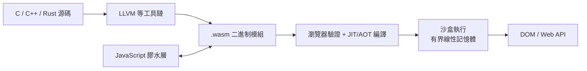
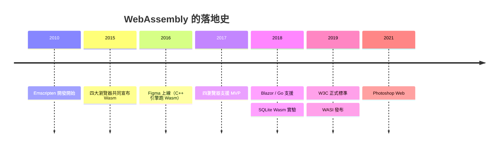

# 節標題：WebAssembly 的誕生：C/C++ 進瀏覽器

## 2015：一紙共同聲明

2015 年 6 月，Mozilla、Google、Microsoft 與 Apple 共同宣布 WebAssembly（Wasm）專案，目標是在 Web 平台加入一種**可移植的二進制指令格式**，作為 C/C++ 等語言的編譯目標，與 JavaScript 並行而非取代。宣言的措辭克制，分量卻極重：這是瀏覽器四大陣營第一次為「超出 JS 的執行格式」聯合背書。

進度快得驚人：2017 年 2 月，四家瀏覽器的實現同時達成 **MVP（最小可行版本）**共識——Wasm 正式跨瀏覽器可用；2019 年 12 月，W3C 將其定為正式標準。Web 標準史上的「快」，通常以十年計，Wasm 只用了四年。

## 核心設計：一門嚴謹的虛擬機指令集

Wasm 不是「更好的 JS」，而是一門全新的、極度精簡的指令集架構：

- **二進制格式（.wasm）**：緊湊、以單遍（single-pass）解碼為設計前提，載入即驗證，無需 parse JS 那種文字格式的痛苦（asm.js 必須先 parse 巨大的 JS 文字再辨認模式，這正是它被 Wasm 取代的原因）；
- **堆疊式虛擬機**：指令操作一個運算堆疊，結構化控制流（無任意 goto），驗證器可在載入時靜態證明型別與記憶體安全；
- **線性記憶體**：Wasm 模組只能讀寫自己一塊連續的、有邊界檢查的記憶體——**沒有任意記憶體存取**，這是沙盒安全的基石；
- **與 JS 互操作**：JS 可以呼叫 Wasm 匯出的函數、讀寫其記憶體，Wasm 也能回呼 JS——兩者不是替代關係，而是分工：Wasm 做重計算，JS 掌 DOM 與生態。

相較 asm.js，這是質變：asm.js 是「JS 語言內的約定」，Wasm 是「平台內建的新執行格式」——小型化、載入快、驗證即安全，且不再受 JS 語義的形狀束縛。

## 工具鏈：Emscripten 的先驅與 Rust 的擁抱

Wasm 能起飛，靠的是工具鏈早已就位。**Alon Zakai** 從 2010 年就開始寫 **Emscripten**——起初是把 C/C++ 編譯成 JS（asm.js）的瘋狂實驗，後來順勢改為輸出 Wasm，並附上整套模擬 POSIX 環境的運行時（檔案系統、malloc、OpenGL 到 WebGL 的轉譯）。數十年的 C/C++ 代碼存量，就此獲得通往瀏覽器的直達車票。

語言陣營的加入讓 Wasm 超越「C/C++ 專用」：

- **Rust** 把 `wasm32-unknown-unknown` 列為一等編譯目標，並提供 **wasm-bindgen** 讓 Rust 型別與 JS 無縫互動——記憶體安全 + Wasm 沙盒，成為新一代 Web 基建的天作之合（本書《Rust 的故事》將詳述）；
- **Go**（1.11 起）、Kotlin、Java（透過 GraalVM）、.NET（Blazor，2018 起）先後支援；
- 甚至連解釋型語言也可以把直譯器編進 Wasm，在瀏覽器裡跑 Python、Ruby、SQLite。

## 落地：重型應用攻入瀏覽器

Wasm 的價值由真實產品驗證：

- **Figma**：這款協同設計工具的核心是數十萬行的 C++ 渲染引擎。2016 年上線時把引擎編譯成 Wasm 跑在瀏覽器，效能流暢得讓人忘了這是 Web——它證明了「專業級桌面軟體體驗可以在瀏覽器重現」，並在 2022 年以 200 億美元被 Adobe 收購，成為 Wasm 史上最昂貴的背書；
- **AutoCAD Web**：老牌 CAD 的 C++ 代碼直達瀏覽器；
- **Google Earth**：曾依賴外掛（NaCl 世代）的 3D 地球，終於以 Wasm 重生於 Web；
- **Photoshop Web**（2021）：Adobe 把旗艦級桌面軟體帶進瀏覽器，其歷史意義在於宣示桌面與 Web 的城牆被鑿穿；
- **Unity / Unreal 遊戲**：從 asm.js 時代的掙扎到 Wasm 時代的可玩；
- **SQLite 編譯成 Wasm**（2018 年實驗、2022 年官方支援）：資料庫在瀏覽器內執行，離線應用獲得真正的 SQL 引擎。

## WASI：走出瀏覽器的野心

Wasm 的設計者很快意識到一個更大的命題：這種「可移植、快啟動、預設沙盒」的格式，憑什麼只能活在瀏覽器裡？2019 年，Mozilla 的 Luke Wagner 等人發布 **WASI（WebAssembly System Interface）**：一套標準化的系統介面，讓 Wasm 程式在瀏覽器之外（伺服器、CLI、嵌入式）存取檔案、時鐘、網路——但透過**能力制（capability-based）**授權：程式拿不到它沒被明確授予的權限。

這是對 1995 年 Java「Write once, run anywhere」的第二次衝擊——這次沒有虛擬機器的重量級安裝，只有毫秒級啟動的沙盒模組。容器時代的重量（幾百 MB 鏡像、秒級冷啟動）與 Wasm 的輕量（KB 級、毫秒級）形成了鮮明對比，一場關於雲端運算未來的敘事就此展開。

從 asm.js 的權宜之計，到瀏覽器裡的 C++ 遊戲與 Photoshop，再到走出瀏覽器的 WASI——Wasm 在短短十年間走完了別的平台幾十年的路。它的第三幕：邊緣運算與「瀏覽器即作業系統」，是下一節的主題。
