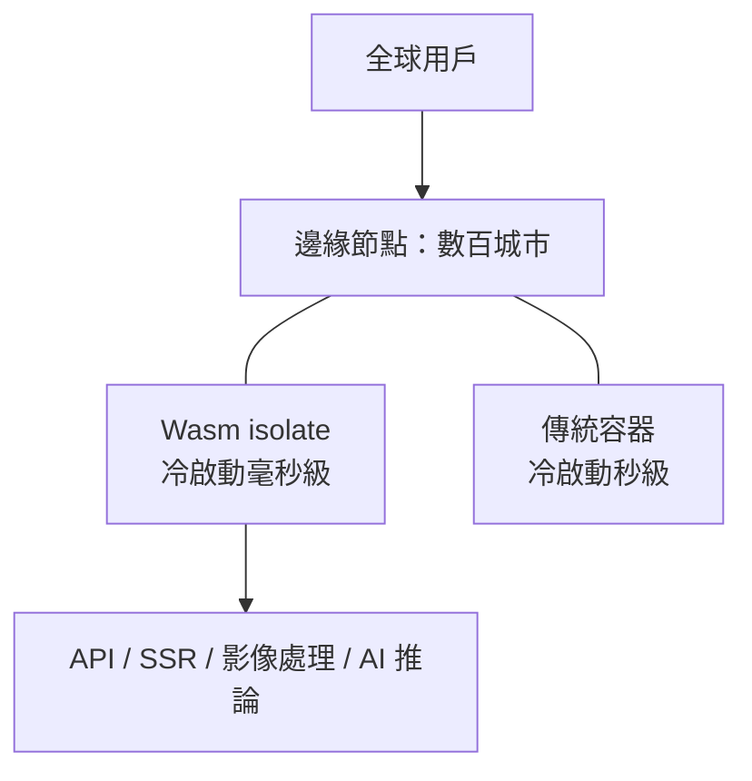
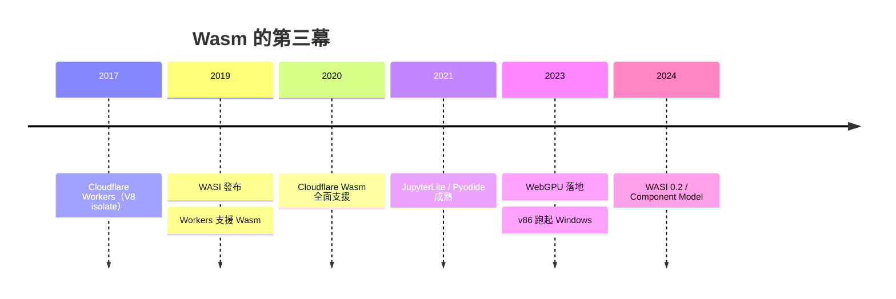

# 節標題：邊緣運算與瀏覽器內的虛擬機

## 第三幕：Wasm 離開瀏覽器

WebAssembly 的故事有三幕：第一幕是 asm.js 時代的權宜先聲；第二幕是 C/C++ 攻入瀏覽器（Figma、Photoshop）；第三幕，則是 Wasm **離開**孕育它的瀏覽器，成為雲端與邊緣運算的執行層。推動這一幕的，是一個簡單而殘酷的經濟學問題：**冷啟動的成本**。

傳統容器（Docker）的冷啟動以秒計，鏡像以百 MB 計；Wasm 模體積以 KB 計、啟動以毫秒計、記憶體占用低數個量級。當應用的部署位置從「幾個資料中心」遷往「全球數百個邊緣節點」，每個節點都要為可能到來的請求備好執行環境——這時，秒級與毫秒級的差距，就是兩種完全不同的商業模式。

## Cloudflare Workers 與邊緣的誕生

2017 年，Cloudflare 推出 **Workers**：不走容器路線，而是借用 V8 引擎的 **isolate** 機制——同一個進程內安全隔離多個執行環境，冷啟動約五毫秒。2019 年加入 Wasm 支援，開發者可把 Rust/C/C++ 編譯的模組部署到 Cloudflare 全球 200 多個城市的邊緣節點。隨後的競逐者排成一列：Fastly 的 **Compute@Edge**（其 **Lucet** 編譯器把 Wasm 預先編譯成原生碼，啟動低至數十微秒）、Deno Deploy、Fermyon Spin、wasmCloud。它們共同書寫了一個新範式：**程式不再「部署到伺服器」，而是「出現在離用戶最近的地方」。**

## WASI 的發展與分裂

這場遷徙的關鍵地基是 WASI，但它的路並不平坦。**Preview 1**（2020 年左右穩定）務實先行，被 Emscripten、Rust、Go 廣泛支援，卻有設計債：基於 C 的 `preopen` 檔案描述子模型、不支援非同步、難以表達元件級複用。社群隨後推動更宏大的 **Component Model**（Preview 2 / WASI 0.2，2024 年初落地）：以 WIT 介面定義語言描述元件、支援語言之間的高階型別互操作——Rust 元件可以直接呼叫 Python 元件。代價是複雜度陡增與標準化週期拉長，2023 到 2025 年間，社群關於「務實的 P1 路線」與「優雅的 P2 路線」的辯論不斷——這是任何新平台從「黑客的玩具」走向「產業的基建」必經的陣痛，如同當年 JavaScript 的 ES4 之殤。

## 瀏覽器內的完整虛擬機

與此同時，另一條戰線在朝反方向推進：把**整台電腦**塞回瀏覽器。

- **v86**（Fabian Hemmer）：把 x86 指令集用 Wasm 模擬，可以在瀏覽器分頁裡開機 Linux；
- **WebVM**：基於 CheerpX 的完整 Linux 環境跑在瀏覽器，網路透過 TLS 隧道接通；
- **Pyodide**（Mozilla 起源、Pyodide 社群接棒）：把 CPython 與 NumPy、pandas 編譯成 Wasm——**JupyterLite** 由此讓資料科學筆記本完全離線運行於瀏覽器，零安裝、零伺服器；
- **Photoshop Web、LibreOffice Web**：重量級生產力軟體常駐分頁。

這背後是 Web 平台能力的全面成熟：檔案系統（File System Access API）、GPU（WebGPU，2023 年起各瀏覽器落地）、多執行緒（Web Workers + SharedArrayBuffer）、持久化資料庫（IndexedDB/OPFS）。「瀏覽器做為通用作業系統」——這個 2010 年代的口號，在 2020 年代成為工程事實。

## 限制與批評：革尚未成

清醒的工程師會列出 Wasm 的未竟之處：

1. **GC 整合**：早期 Wasm 只有線性記憶體，Java/Kotlin 編譯到 Wasm 得自帶 GC；垃圾回收提案（WasmGC，2023 年落地）雖已解決大半，但與宿主語言的物件模型互操作仍有鴻溝；
2. **DOM 互操作成本**：Wasm 不能直接碰 DOM，每次呼叫都要穿過 JS 邊界轉換資料——對 UI 密集應用，這層「邊界稅」可能吃掉計算優勢；
3. **能力模型的學習曲線**：WASI 的能力制安全模型優雅，但對習慣「程式預設什麼都能做」的開發者，是新的思維負擔；
4. **生態碎片化**：工具鏈、元件模型的演進速度，讓早期採用者承受重複遷移的成本。

批評是真實的，但沒有動搖結論：這些是**年輕平台的工程問題**，而非**方向錯誤**。

## 戰略總結：從 HTML 平台到執行層

回望 1989 年 Berners-Lee 在 CERN 寫下的構想，Web 的本體是超文字文檔；1995 年 JavaScript 讓它獲得行為；2013 年前後的框架革命讓它獲得工程學科的身分；而 Wasm 讓它獲得了最後一塊拼圖——**語言中立、沙盒安全的執行層**。從此，Web 不再是「HTML 平台上的一種應用形態」，而是「任何語言、任何應用都可以編譯進來的通用執行環境」：C++ 的設計引擎、Rust 的邊緣函數、Python 的資料科學、整個 Linux——全部收進一枚分頁。

歷史的弔詭在於：這個「任何語言」的終點，恰恰驗證了當年 JavaScript 設計者 Brendan Eich 十天趕工的那門語言最深刻的遺產——**沙盒、即載即用、跨平台**。語言會老，平台不朽。Web 的故事，仍在編譯中。
