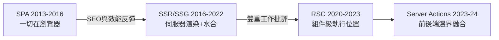

# React Server Components 與 Next.js

2020 年 12 月，React 團隊的 Dan Abramov、Sebastian Markbåge、Lauren Tan 等人發布了一份技術演講與 RFC：React Server Components（RSC）。影片開頭的演示令整個前端社群倒吸一口氣——一個組件標記為「server」，可以直接 `await` 資料庫查詢、讀檔案、用任何後端相依套件，而它渲染的結果只是序列化後的樹，**不送任何 JavaScript 給瀏覽器**。需要互動的組件則加上 `'use client'` 宣告，回到傳統世界。這不是 SSR 的修補，而是對「組件在哪裡執行」這個問題的重新立法。

經過近三年打磨，2023 年 Next.js 13 的 App Router 讓 RSC 正式落地，並在 Next.js 13.4 後趨於穩定，成為預設架構。要理解它的意義，得先釐清與傳統 SSR 的差別：SSR 是「整棵樹先在伺服器渲染成 HTML，再於瀏覽器整棵水合」——執行位置只有時間差，沒有劃分；RSC 則是**組件級的執行位置劃分**：資料密集的清單、文章、側欄留在伺服器，按鈕、表單、下拉選單標記為客戶端。頁面可以只送 20 KB 的互動代碼，而不是整個應用。水合的「雙重工作」批評，在此有了結構性的答案。

2023 到 2024 年，Server Actions 更進一步：`<form action={...}>` 裡可以直接呼叫一個伺服器函式，表單提交、資料變更、重新驗證快取一氣呵成，不必手寫 API 端點與 fetch。熟悉經典 Web 的老工程師會愣住——這不就是 2004 年的 PHP 和 Rails 嗎？差別只在組件化與型別。前後端的邊界，在分離了十二年之後，被重新模糊化：前端工程師第一次能在一個檔案裡查資料庫、寫表單邏輯、渲染 UI。

爭議與榮光同步到來。批評者的火力集中在心智模型：伺服器組件不能用 state、不能綁事件；快取層（fetch 預設快取、Router Cache）的行為一度令開發者困惑；「為什麼我的按鈕不能加 onClick」成為當年面試與論壇的高頻題。支持者則反駁：複雜度不是被發明出來的，而是從手寫的 API 層、客戶端狀態庫與資料同步邏輯**搬進了框架**。社群評價長期兩極，Reddit 與 X 上「App Router 好用還是難用」的論戰至今未歇——這也是任何改變生態底層的技術必然承受的代價。

App Router 的統治也催生了對手群。2020 年，Ryan Florence 與 Michael Jackson 把 React Router 的經驗煉成 Remix，打出的旗號是「回到 Web 標準」：Loader/Action 對應 HTTP 語義、表單漸進增強、離線可用，且在 2021 年先於 App Router 提供了完整的嵌套路由與資料流體驗。2022 年 Remix 被電商巨頭 Shopify 收購，後於 2024 年宣布與 React Router v7 合流——獨立框架的理想，以另一種方式延續。Astro 則選擇了「預設零 JS」的群島（islands）架構：頁面是靜態 HTML，互動組件像島嶼般各自水合，內容網站市場被它迅速收割。SvelteKit 與 Nuxt 3 分別在 Svelte 與 Vue 陣營裡做出同構的答案——**「伺服器優先」已從 React 的選項變成全行業的預設**。

更深的一層融合發生在語言層面：TypeScript 成為事實標準後，tRPC 讓前端直接以型別安全的方式呼叫後端程序，Prisma 與 Drizzle 讓查詢資料庫像操作型別化的物件。這些工具與 RSC 疊加，拼出「全端型別安全棧」的完整圖景。

而對個人，這場融合改寫了職業的定義。2015 年的「前端工程師」可以理直氣壯地說「我只管瀏覽器」；2024 年的 React 開發者，面試題裡必有資料庫正規化與 N+1 查詢。RSC 不是把後端變簡單了，而是把後端變**近**了——近到前端工程師再也無法假裝它不存在。有人視之為職業焦慮，有人視之為十年來最好的機會：從前需要三個角色才能做成的產品，如今一個「產品工程師」就能端到端交付。框架重新劃定的不只是代碼的邊界，還有人的邊界。
