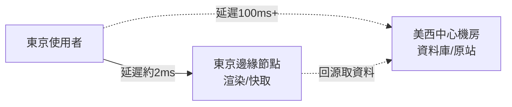

# 邊緣渲染與全球 CDN

1998 年，MIT 教授 Tom Leighton 與學生 Daniel Lewin 把演算法課題變成了公司：Akamai。「Akamai」是夏威夷語「聰明、快速」之意，公司的洞察樸素而深刻——Web 变慢的主因不是伺服器不夠快，而是光在光纖裡跑得太慢。把內容複製到全球數百個節點，讓每個使用者就近取用，這就是內容分發網路（CDN）的起點。Lewin 後來在 911 事件中罹難於美航 11 號班機，而 Akamai 成長為承載全球網路流量相當比例的基礎設施帝國。此後二十年，CDN 的使命是搬運**靜態內容**：圖片、影片、CSS、JS。

質變發生在 2017 年 9 月：Cloudflare 推出 Workers。它的技術妙筆是 V8 isolates——不為每個請求啟動容器或程序，而是在同一個 V8 引擎內切出毫秒級啟動、記憶體開銷極小的隔離執行環境，於是**程式碼可以被部署到 Cloudflare 全球每個節點**。繼之而起的是 Vercel Edge Functions、Deno Deploy、AWS Lambda@Edge 與 Cloudflare Pages：CDN 從「搬內容」進化為「跑程式」。Edge SSR 的承諾可以用一個數字概括：把 React 頁面的渲染搬到離使用者最近的節點，東京的使用者由東京節點渲染，TTFB（首字節時間）從跨洋的數百毫秒壓到個位數毫秒。

背後其實是「網頁體驗的物理學」。光纖中光速約 200,000 km/s，再加上繞行海纜的路徑、路由器跳數與協定握手，東京到北維吉尼亞的往返延遲有著 150 ms 量級的硬下限——這不是工程優化能消除的，是 $\tau \approx \frac{d}{v}$ 的物理定律。要打敗光速只有一個辦法：縮短 $d$。邊緣運算因此是對物理定律的妥協，而非炫技。

商業品類也隨之誕生。Netlify（2014 年由 Christian Bach 與 Mathias Biilmann 創立）率先把「前端雲」做成生意：連 Git 倉庫、自動建置、全球部署、原子化上線。Vercel 則以 Next.js 為錨，把框架與部署綁成閉環；Render、Cloudflare Pages 等玩家跟進，部署從 DevOps 工程變成 `git push`。中間件（middleware）又添一層想像：在邊緣、於請求抵達渲染之前，就依使用者的地理位置、Cookie 或 A/B 分組做路由決策——i18n 重導、實驗分流、身分閘門，全部在幾毫秒內完成。

但邊緣有一個軟肋：**資料**。渲染可以搬到東京，資料庫往往還在美東的單一 region——因為資料庫需要強一致、事務與單一寫入點，而這些與「處處副本」天然矛盾。於是請求在邊緣渲染完，還得跨洋回源查一次資料，瓶頸只是從「渲染延遲」換成了「資料延遲」。補位者隨之出現：分散式 SQLite 路線——Cloudflare D1、Turbo（Turso）等——把嵌入式資料庫的副本推向邊緣，讀取極快、寫入靠複製與仲裁；「有狀態運算」成為邊緣架構師最誠實的難題：物件儲存、Durable Objects 這類提供單點強一致的邊緣原語，正是為此而生。

標準化也在推進。伺服器端 JavaScript 執行環境曾經碎片化：Node、Deno、edge runtime 各有一套 API。WinterCG（Web-interoperable Runtimes 社群小組，2022 年起在 W3C 框架下運作）推動各 runtime 共享 `fetch`、`Request`、`Response`、串流等 Web 標準 API 的相容性承諾——「寫一次，跑在任何邊緣」從口號變成可驗證的合約。

回望這章歷史的因果鏈：光速不肯讓步（物理）→ 使用者全球化（經濟）→ CDN 搬靜態內容（1998）→ 虛擬化技術成熟到能在邊緣安全跑租戶代碼（V8 isolates，2017）→ 框架把渲染做成可拆分的產物（SSR/RSC）→ 部署平台把兩者黏合（邊緣渲染）。每一次躍遷，都是前一章的架構演進替這一章鋪路。而邊緣的終局問題——資料的一致性與有狀態的難題——仍未有最終答案，它將是下一個十年 Web 基礎設施最硬的骨頭。
