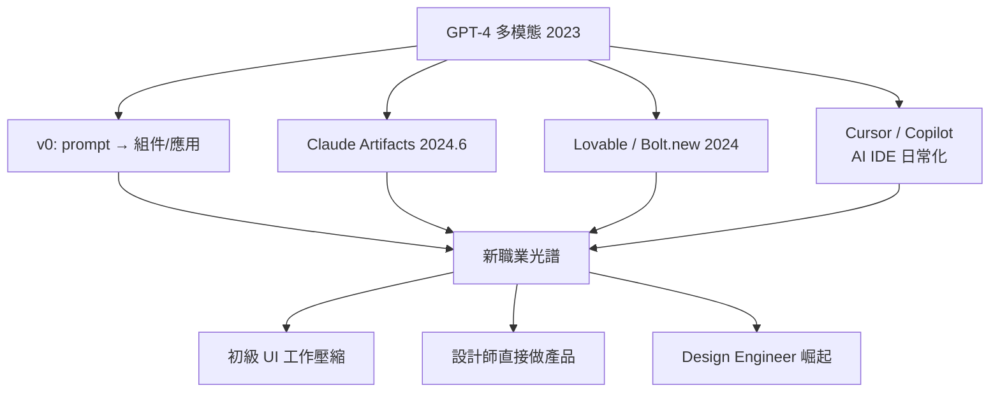

# 從 v0 到 AI 介面生成

2023 年 3 月，GPT-4 發布。演示中一張手繪網站草圖的拍照，幾秒鐘後變成可運作的 HTML 頁面——這短短的 demo 宣告了一件事：UI 代碼，是 AI 最先攻陷的戰場。原因如今回看非常清楚：前端 UI 具有極高的**規律性**——Tailwind 的工具類、shadcn/ui 的組件模式、Flex/Grid 的版型套路，構成了一個封閉、可驗證、訓練語料無窮無盡的領域。AI 不需要理解整個系統，只要畫得像一個網站，就已經有八成像。

Vercel 率先把這個能力做成產品。2023 年，Guillermo Rauch 在 Next.js Conf 上發布 **v0**：輸入一句文字描述，生成 React + Tailwind + shadcn/ui 的組件，可即時預覽、迭代修改、一鍵部署到 Vercel。2024 年起，v0 從「生成組件」擴張為「prompt to app」——帶資料庫、認證、部署的完整全端應用，成為這條路線最具代表性的產品。同一時期，多模態的 Claude 讓「看截圖還原頁面」成為日常工作流；2024 年 6 月，Anthropic 在 Claude 中推出 **Artifacts**：對話中直接渲染出可互動的 UI 副視窗，生成即預覽，數百萬使用者第一次「摸到」AI 介面生成。

浪潮在 2024 年全面爆發。瑞典團隊的 **Lovable**（前身為開源的 GPT Engineer，創辦人 Anton Osika）以對話式介面生成全端應用，2024 年底至 2025 年公開敘事中的 ARR 增速成為 AI 應用平台的標誌性案例（此為當前進展，量級隨時更新）。StackBlitz 的 **Bolt.new** 走了另一條技術路線：用 WebContainer 把 Node.js 跑在**瀏覽器裡**——AI 在本地沙箱中生成專案、安裝依賴、即時預覽，全程不占雲端資源，成本結構因此截然不同。這些「Vibe Coding 平台」把全端開發的門檻壓到一句話。

專業開發者的戰場則由 **Cursor** 統治。這個 2023 年起步、基於 VS Code 分支的 AI IDE，把模型能力織入補全、多檔編輯與代碼庫理解的每一層，2024-25 年間成長為史上最速成長的開發者工具之一（當前進展）；GitHub Copilot 則早已把「AI 寫代碼」常態化。對前端開發的實際滲透最為徹底：生成一個表單、一個儀表板頁面，正確率高、驗證容易、迭代成本低——UI 是 AI 生成曲線上最陡峭的一段。

衝擊沿著職業光譜展開。最底層的是**壓縮**：初級 UI 開發——切版、套組件、調樣式——的工作量被大幅吸收，「十年前需要三個初級工程師的活，如今一個高級工程師加 AI」。中間層是**民主化**：設計師、PM、獨立創業者不再需要工程合夥人就能做出可用的產品，「設計師直接做產品」從口號變成日常。頂層則誕生了一個新頭銜：**Design Engineer**（設計工程師）——既懂視覺語言、又懂代碼架構、還會駕馭 AI 的人，在 Vercel、Linear 等公司被視為核心職位；他們的工作不再是寫每一行 CSS，而是**設計系統、審美判斷與 AI 產出的品質控制**。

以史為鑑，值得冷靜的一筆：這場革命改變的是「誰能做出介面」與「介面做得多快」，尚未改變的是軟體的根本難題——需求定義、資料建模、安全與維運。正如當年 WordPress 讓百萬人做出網站，卻也創造了修 WordPress 的行業，AI 介面生成在降低創造門檻的同時，正在把價值向「判斷力」上移。而當介面的生產成本趨近於零，下一個問題自然浮現：**誰來替使用者操作這些介面？**答案，是即將出場的 Web Agents。
