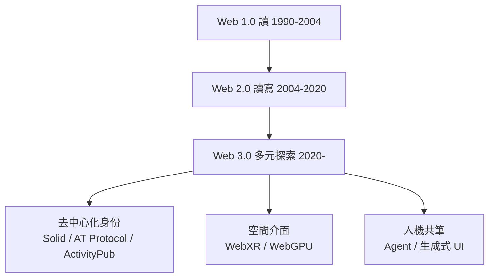

# Web3、WebXR 與人機介線消融

站在 2025 年回望與前瞻，Web 的下一個三十年有三條關鍵脈絡：誰擁有資料、誰定義空間、以及誰在使用網頁。

**去中心化的理想與教訓。**「Web3」一詞早在 2014 年就由以太坊共同創辦人 Gavin Wood 提出，指以區塊鏈為底的去中心化網路，2021 年隨加密牛市爆紅，資本湧入、VC 高喊「Web2 的終結」。但 2022-23 年的加密寒冬給出了殘酷的批註：FTX 崩塌、NFT 市場歸零、大量「去中心化」產品暴露出中心化的實質。更有分量的反駁來自 Web 的發明者本人。Tim Berners-Lee 始終認為問題的根子是**資料所有權**，而非貨幣與投機：2018 年他離開 MIT 的日常職務創辦 Inrupt，推動 **Solid** 專案——個人資料存放在自己控制的 Pod 中，應用經授權存取，而不是把資料抵押給平台。這條路線冷清卻誠實。

與此同時，去中心化社交（Social Web）出現了真實的進展。一邊是 **ActivityPub** 協議驅動的聯邦宇宙（fediverse）：Mastodon 等平台讓不同伺服器上的使用者互相追隨，2022 年 Twitter 收購風波後湧入數百萬使用者；萬維網聯盟（W3C）早在 2018 年就將 ActivityPub 列為推薦標準。另一邊是 Bluesky 的 **AT Protocol**（2023-24 逐步開放聯邦功能）：以「可攜式身分」與演算法選擇權為賣點，成長為數千萬使用者的平台（當前進展）。它們的啟示是：去中心化不必以區塊鏈為前提，協議與生態的良性循環才是根本。

**空間計算與 WebXR。**Web 的介面正在從平面走向空間。W3C 的 **WebXR Device API** 自 2019 年起逐步標準化，讓網頁直接進入 VR/AR：Meta Quest 的瀏覽器可以打開一個網址就進入虛擬空間，無須安裝應用。3D 側，Three.js 長期統治著瀏覽器 3D；2023 年，**WebGPU** 取代 WebGL 成為新一代圖形標準落地於主流瀏覽器，把瀏覽器的圖形與運算能力推近原生水準。蘋果 2024 年的 **Vision Pro** 雖然押注原生應用生態，但其 Safari 對 WebXR 的後續支援仍是空間 Web 的關鍵風向（當前進展）。空間計算能否讓「網頁」進化為「網域」，取決於頭顯的滲透率——這正是 Web 每次介面革命的老問題：技術標準總是先行，硬體普及滯後十年。

**人機介線的消融。**最深刻的變化是使用者的定義。前一章我們看到 agent 成為 Web 的共同居民，這裡把鏡頭拉遠：介面本身正在三個方向液化——其一是**中間層的興起**：搜尋正在變成答案引擎，使用者要的不是十個藍色連結，而是一個綜合了整個 Web 的答案；網站與使用者之間，站進了一個 AI 中間人。其二是**生成式 UI**：介面不再預先設計，而是按需求即時生成——你要比較三款機票，agent 現場生成一個比較表格；這是第 10.1 章技術浪潮的邏輯終點。其三是**無介面**的邊界情境：語音與 agent-first 的互動裡，網頁退化為純粹的資源與服務，介面只是暫時的皮膚。

繞了一個大圈，故事回到了 1990 年那間日內瓦的辦公室。Berners-Lee 的第一個瀏覽器 WorldWideWeb，其實同時是**編輯器**——他的原始夢想是一個人人可讀也可寫的 Web。這個夢想的前半段實現得太好（讀者數十億），後半段卻一路坎坷：wiki、部落格、社交媒體逐步讓人可以「寫」，但平台把寫下的東西圈進了圍牆。三十年後，協作式 Web（即時共筆已是我們的呼吸）與 AI 共筆（人與 agent 一起閱讀、撰寫、建造）以另一種形式接續了那個夢想。

本書開篇說過：Web 是人類文明最大的數位共筆。三十年間，它由物理學家的小工具長成文明的神經系統；它的每次鐘擺——集中與分散、伺服器與瀏覽器、文件與應用、人與機器——都不是進步或倒退，而是這個物種不斷重新協商「如何共同知識、如何共同創造」。下一個三十年，當機器也成為共筆者，筆會交到誰手上？這個問題的答案，仍將由每一個使用它的人寫下。
