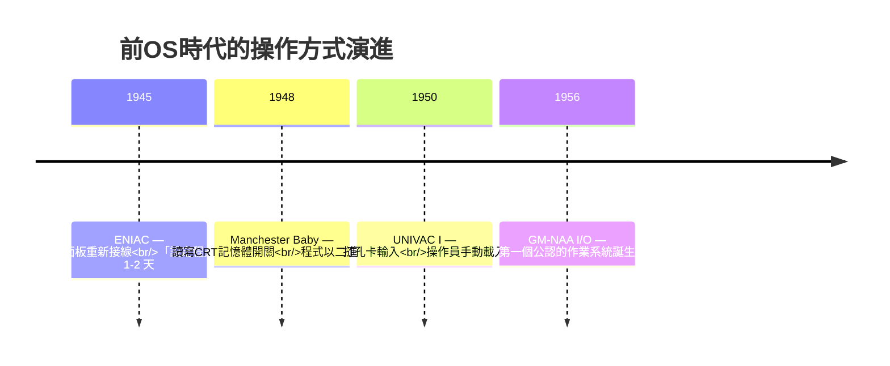
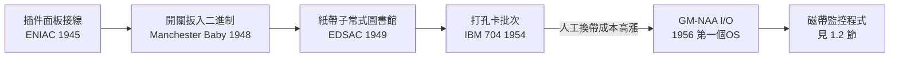

# 插件面板與機械開關：前 OS 時代工程師們用人工換帶的血汗歷史

## 沒有作業系統的世界是什麼樣子

1945 年，賓州大學的 ENIAC 機房裡，六位女性計算員（後世稱為 "ENIAC Six"：Kathleen McNulty、Frances Bilas、Betty Jean Jennings、Ruth Lichterman、Elizabeth Snyder 與 Marlyn Wescoff）正在為一台重達 27 噸、耗電 150 千瓦的巨獸「編程」。她們的工作不是在鍵盤上打字，而是**用雙手重新接線**：拔下電纜、插入插件面板（plugboard）、扳動三千個開關、設定函數表的旋鈕。一次「程式設定」可能耗時一到兩天，而程式本身只跑幾秒鐘。

這就是前作業系統時代的殘酷現實：**程式設計是一種體力勞動**。電腦一次只能做一件事，而「告訴電腦做什麼」這件事本身，比電腦運算還要花時間。

## 開關、紙帶與打孔卡：三代輸入媒介

最早的程式以三種方式進入機器，每一種都是手工血汗：

**第一代：開關與插件面板。** Manchester Baby（1948）與早期的 EDSAC 使用者，要逐個扳動面板開關把二進制指令「按」進記憶體。 Maurice Wilkes 在《Memoirs of a Computer Pioneer》裡回憶，當時程式設計師得用指甲或鉛筆尖精準地撥動開關，錯一格就要重來。

**第二代：紙帶。** 程式打在紙帶上，由光電或機械讀帶機讀入。紙帶的問題是**無法修改**——改一行程式，輕則剪貼修補，重則整卷重打。英國劍橋的 EDSAC 團隊開發出「子常式圖書館」（subroutine library）打在紙帶上由操作員合併，這是人類第一次意識到：**程式碼可以重用，那麼「合併程式的流程」本身也可以自動化**——這正是後來連結器與載入器的思想源頭。

**第三代：打孔卡（Herman Hollerith 的遺產）。** Hollerith 為 1890 年美國人口普查設計的打孔卡技術，到了 1950 年代成為資料輸入的霸主。一疊卡片就是一個程式，卡片順序就是程式邏輯。傳說中有程式設計師抱著整疊卡片走向機房時絆倒，撿起來後得花幾小時用卡片分類機恢復順序——這個（真實發生過許多次的）災難，直接催生了卡片角落斜切與序號欄的發明。

## 操作員：機房裡的祭司階級

在 1950 年代的 IBM 701、704 機房裡，社會分工壁壘分明。程式設計師把打孔卡疊交給**操作員（operator）**，然後離開，等上幾個小時甚至一天再回來看結果。如果程式在第三張卡片就崩潰，操作員只會給你一張印著 core dump 十六進位的報表——你浪費了一整天的排程時段，換來一行錯誤碼。

這個制度造就了著名的「一週迴圈」：程式設計師白天寫程式、晚上交件、隔天下午看結果、發現錯誤、再寫一天。**一次除錯的來回要 24 小時**，而機器本身每秒能執行數千條指令。昂貴的 CPU 大部分時間在等你換卡片、換磁帶、等印表機。

> 經濟視角：一台 IBM 7090 要價約 230 萬美元（1960 年），以每小時數百美元出租。機器閒置一分鐘就是真金白銀的損失。「提高機器利用率」成為壓倒一切的目標——這個經濟壓力，正是作業系統誕生的第一推力。

## 從血汗到自動化：思想已在萌芽

到了 1950 年代中期，三個分散在不同機構的團隊同時領悟到同一件事：

1. **通用 Motors 研究實驗室**（1956，與 Northrop 合力）開發了 GM-NAA I/O——公認史上第一個作業系統，目的只是自動載入程式、統一處理 I/O 常式。
2. **SAGE 軍事系統**的工程師為了管理多工，寫出了早期的系統管理程式。
3. **學界**開始討論「監督程式」（supervisor/monitor）的概念：讓一個常駐程式替人類管理機器。

思路是一致的：與其讓人類操作員手動執行每個步驟，不如寫一個**常駐記憶體的程式**，它知道每個工作的開頭與結尾，自動讀入下一個工作、自動處理錯誤、自動釋放資源。人類第一次把「管理機器」這件事交給機器本身——這個看似樸素的念頭，正是作業系統作為「數位國度憲法」的起點。

## 歷史的弔詭：被解放的與被異化的

諷刺的是，這段歷史也埋下了兩個影響深遠的文化種子。其一，ENIAC Six 證明了「程式設計」可以由女性出色完成——戰後這群人轉入民間產業，成為最早一代軟體工程師。其二，「把操作細節交給系統、把思考留給程式設計師」的分工哲學，從此成為作業系統設計的永恆主題：每一次抽象層次的提升，背後都是一段「人類不想再做某件重複勞動」的歷史。

當我們今日在終端機上輸入 `./a.out` 而程式瞬間載入時，很難想像七十年前，這個動作意味著操作員抱起一疊卡片、走過冰冷的機房地板、按下一疊按鈕——而那時的人類，正夢想著讓機器自己學會這一切。
