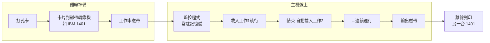
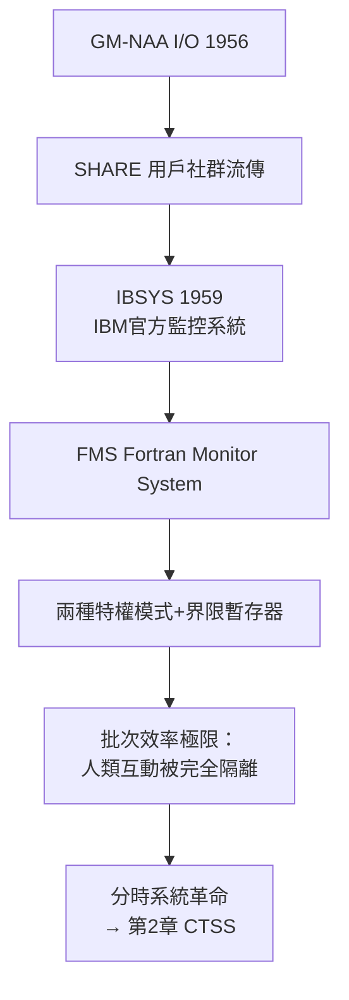

# 磁帶監控程式：最早期的自動化作業載入與連續運行嘗試

## 從「換卡片的人」到「常駐的監督者」

1950 年代中期，機房的痛點已經無法忽視：一台價值數百萬美元的主機，CPU 有將近一半時間在等待操作員換卡片、掛磁帶、換印表紙。IBM 與各大電腦使用單位（尤其是通用汽車、波音這類同時擁有龐大運算需求與雄厚財力的企業）開始思考一個激進的問題：**能不能讓機器自己排隊？**

答案是「監控程式」（Monitor）。它的邏輯極其樸素：把多個工作（job）預先打在磁帶上，形成「工作串」（job stream）；一個常駐記憶體的小程式依序讀取工作、載入執行、記錄結果到輸出磁帶，工作結束後自動跳到下一個。操作員的角色從「每五分鐘操作一次」退居為「每幾小時換一次磁帶」。

## GM-NAA I/O：公認的第一個作業系統

1956 年，通用汽車研究實驗室的 Robert L. Patrick 與 Northrop Aviation 合作，為 IBM 704 開發了 **GM-NAA I/O**。它的出發點不是學術野心，而是純粹的工程痛點：通用汽車的研究員們各自重複撰寫相同的 I/O 常式，浪費時間又容易出錯。GM-NAA I/O 把這些常式統一收編，加上工作排隊與自動載入的功能，讓每個工作結束後系統自動接手。

它的歷史意義在於**示範效應**：GM-NAA I/O 在 SHARE（1955 年成立的 IBM 用戶交流組織）中流傳，其他會員企業紛紛仿效。到 1958 年，SHARE 會員間流通的系統程式已形成一個小型的「自由軟體圈」——比自由軟體運動早了二十五年。這是制度史的有趣一頁：**企業用戶社群（而非學界或政府）率先建立了軟體共享文化**，因為每家公司都發現，與其各自養一個系統程式團隊，不如合力改良一個。

## 監控程式的技術內涵：三個影響深遠的發明

這些今天看來粗糙的系統，卻孕育了作業系統的三大基石：

**1. 常駐核心（Resident Kernel）的觀念。** 監控程式佔據記憶體的固定區域（通常是低位址），使用者程式載入其上。這個記憶體佈局圖——核心在下、應用在上——從 1956 年的 GM-NAA I/O 一路延續到今日的 Linux。

**2. 硬體保護的誕生：兩種模式。** 新的問題隨之而來：如果使用者程式故意或意外覆蓋了監控程式怎麼辦？1950 年代末，機器開始提供**兩種特權等級**：監控態（supervisor mode）與使用者態（user mode），配合界限暫存器（bound register）防止使用者程式越界。這是「硬體為軟體契約背書」的開端——作業系統的權威第一次獲得 CPU 硬體的物理保證。Atlas 電腦（曼徹斯特，1962）更進一步，由 Ferranti 的工程師設計出完整的中斷驅動監督程式與虛擬記憶體，將此思想推向成熟。

**3. Job Control Language（JCL）：最早的「殼」。** 使用者用一種描述語言（IBM 7090 上的 IBSYS 用卡片上的控制卡）宣告「我要用 Fortran 編譯器」「接著執行」「用什麼資料」。這些以 `$` 開頭的控制卡，就是命令列直譯器與現代 shell script 的遠古祖先。

## 政治與經濟的推力：反壟斷陰影下的軟體免費時代

監控程式時代的軟體生態，由一個後世看來匪夷所思的制度決定：**軟體不賣錢**。IBM 為了賣硬體，把作業系統（如 IBSYS，1959）與編譯器捆綁免費贈送；1956 年 AT&T 的同意判決更禁止貝爾實驗室販售軟體。這個「免費軟體、昂貴硬體」的商業模式，一方面讓系統軟體得以快速擴散（沒有人需要考慮授權費），一方面也埋下隱患：到了 1968 年，美國司法部對 IBM 的反壟斷訴訟開打，IBM 於 1969 年宣布「分開計價」（unbundling）——軟體從此成為獨立商品。軟體產業的誕生，反過來又刺激了對「更好作業系統」的商業競爭。

## 效率的帳本：為什麼這一步無法跳過

用今天的目光看，監控程式依然是「批次」的：一次一個工作、無互動、等結果要幾小時。但它解決了當時最致命的浪費。統計數字說明一切：在手動操作時代，704 這類機器的有效利用率常低於 50%；導入磁帶工作串與監控程式後，利用率可逼近 90%。對以小時計費的租賃機器而言，這幾乎是憑空多出一倍的算力。

但批次模式也製造了新的社會矛盾：**程式設計師與機器的時間被制度性地對立**。機器效率越高，人類回饋迴圈越長。1950 年代末，MIT 的一群年輕研究者（包括後來設計 CTSS 的 Fernando Corbató 與 John McCarthy）開始公開質疑：「為什麼不能讓每個人直接用自己的鍵盤連上機器？」——這個異端思想，將在第二章掀起分時系統的革命。

監控程式是作業系統的第一塊基石：它證明了「軟體管理硬體」可行、有利可圖、且需要硬體保護機制配合。但它同時也製造了新的不滿——當機器被鎖進玻璃機房、人類被隔離在排隊隊伍中時，另一種更激進的夢想已在醞釀：讓每個人都擁有一台「自己的」電腦的幻覺。
