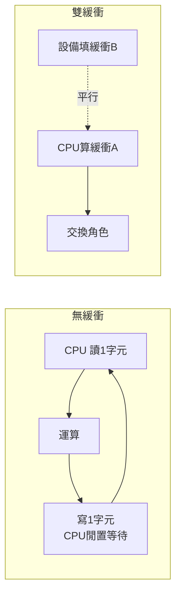
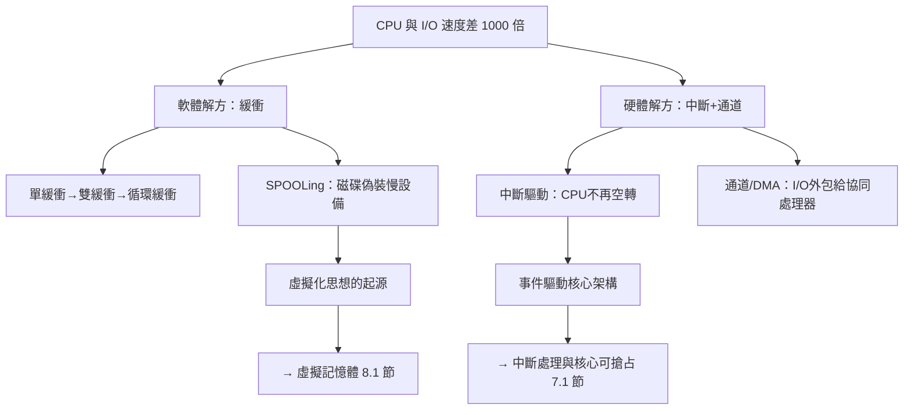

# 巨型主機的效率危機：當 CPU 苦苦等待緩慢的 I/O 設備時，如何透過緩衝區解救算力浪費？

## 一個荒謬的比例：百萬美元的 CPU 陪著千美元的印表機打轉

1950 年代末的機房裡藏著一個尷尬的現實：IBM 709 的 CPU 每秒能執行數萬條指令，但它面前的 IBM 726 磁帶機每秒只讀 12,500 個字元，1403 印表機每分鐘印 600 行，讀卡機每分鐘吞 250 張卡片。**CPU 與 I/O 的速度差距達到兩到四個數量級**。程式每印出一行結果，CPU 就要空轉數千個週期；每讀一疊卡片，百萬美元的機器就像停屍間一樣安靜。

這不只是技術問題，而是嚴重的經濟問題。以租賃模式計費的主機，每小時成本數百美元；利用率每下降 10%，年損失就是一座小型工廠的利潤。「讓快慢之間的鴻溝消失」成為系統程式設計師的首要戰役，而這場戰役的武器，就是**緩衝**（buffering）與其後繼者**Spooling**。

## 緩衝區：用一小塊記憶體買來時間差

緩衝的核心思想是**讓快的一方與慢的一方脫鉤（decouple）**。與其讓 CPU 讀一個字元、算一個字元，不如：

1. **單緩衝**：先一口氣把一大塊資料搬進記憶體緩衝區，CPU 專心運算；運算完再一口氣寫出。I/O 與計算輪流進行，仍舊互相等待，但每次等待的次數大幅減少。
2. **雙緩衝（double buffering）**：準備兩塊緩衝區。CPU 讀取緩衝區 A 的同時，I/O 設備正把下一批資料填入緩衝區 B。**讀取與運算首次真正重疊**——這是管線（pipelining）思想在系統軟體中的最早體現。
3. **循環緩衝（circular buffer）**：緩衝區首尾相接成環，生產者與消費者沿環追逐。這個資料結構日後成為作業系統課程的經典習題，也是 Dijkstra 信號量（1965）最著名的應用範例——**生產者-消費者問題**。

## Spooling：磁碟接生了「假離線」革命

緩衝區解決了小塊資料的問題，卻解決不了讀卡機與印表機這類「整批慢設備」。真正的突破發生在磁碟出現之後：**磁碟夠大又夠快，可以同時扮演多個慢設備的替身**。

這就是 SPOOL（Simultaneous Peripheral Operations On-Line，假離線）：

- **輸入側**：一台便宜的專用小電腦（如 IBM 1401）把成山的打孔卡預先抄進磁碟；主機開機後直接從磁碟高速讀取工作串。讀卡機再也不與主機搶時間。
- **輸出側**：主機把要列印的結果快速傾倒到磁碟上的佇列；另一台小機器（或稍後的主機排程空檔）再慢慢把佇列印出。CPU 「以為」自己有一台飛快的印表機。

世上第一台配備磁碟的機器 IBM 350 RAMAC（1956）問世後，Spooling 迅速成為標配。它在概念上的深刻之處在於：**作業系統用「佇列 + 中介儲存」創造了設備的虛擬幻象**——印表機明明只有一台，每個工作卻都覺得自己「立刻印完了」。這個幻象製造術，正是日後虛擬記憶體、虛擬機器、乃至容器的思想雛形：**用排隊與中介層，把稀缺資源偽裝成充足資源**。

## 中斷與通道：把等待的責任從 CPU 搬走

軟體技巧之外，硬體也在 1950 年代末經歷了一場關鍵演化。

**中斷（interrupt）**：1954 年前後，MIT Lincoln 實驗室為了 SAGE 對 RADAR 的即時需求，在 Whirlwind 系譜的 AN/FSQ-7 上實現了實用的中斷機制。有了中斷，CPU 可以發出 I/O 命令後繼續運算，設備完成時「舉手」打斷 CPU。**忙碌等待（busy waiting）成為可恥的浪費**，事件驅動的核心架構自此奠基。

**通道（channel）與 DMA**：IBM 在 7090/7094 世代引進**資料通道**——一種專責 I/O 的協同處理器，CPU 只需下達「把這 8000 字元從磁帶搬到記憶體位址 X」的指令，通道就自行搬運完畢再中斷 CPU。這就是直接記憶體存取（DMA）的商業化開端。IBM 為此設計的通道命令字（CCW）指令集，讓 I/O 程式設計本身變成一門專業——日後 IBM System/360 的 I/O 體系（Channel Program、CCW 鏈）直接主導了整個主機產業。

## 多道程式設計：把等待時間變成別人的運算時間

當緩衝、Spooling、中斷、DMA 全部到位，一個更激進的推論呼之欲出：**既然 CPU 等待 I/O 的時間不可避免，為什麼不讓它在等待時跑另一個程式？**

這就是**多道程式設計（multiprogramming）**：記憶體中同時駐留多個工作，當工作 A 等待磁帶時，CPU 切換去跑工作 B。統計上，典型批次工作約有 80-90% 的時間在等 I/O；記憶體裡若同時放四個工作，CPU 閒置機率驟降。但要實現它，必須先回答三個致命問題：

1. **記憶體保護**：工作 B 會不會覆蓋工作 A 的資料？（催生界限暫存器與重定位暫存器，通往第八章的虛擬記憶體）
2. **切換機制**：如何保存 A 的暫存器狀態、恢復 B 的狀態？（催生行程概念與上下文切換，通往第七章）
3. **排程策略**：先跑誰？跑多久？（催生排程器理論，通往 7.3 節）

歷史的因果鏈在此清晰可見：**效率危機 → 緩衝與 DMA → 多道程式 → 保護與排程 → 現代作業系統的完整骨架**。1960 年代的 IBM OS/360 將把這套骨架鍛造成產業標準，而 MIT 那群受不了批次隔離的研究者，則會沿著另一條路——分時系統——走向同樣的終點。

## 歷史的註腳：效率邏輯的永恆回歸

有趣的是，這場 1960 年代的戰役從未結束，只是不斷換裝重演：網路時代的 Nginx 用 epoll 解決「一個連線一個行程」的浪費；今日資料庫與 AI 推理系統用零拷貝（zero-copy）與 kernel bypass 對抗 PCIe 延遲；GPU 排程器用 batching 對抗核心啟動開銷。**快慢之間的鴻溝永遠存在，只是主角更替**。理解緩衝與 Spooling 的原始動機，就理解了作業系統半部設計史：作業系統的本質，就是在不對稱的速度世界裡，替每一次等待尋找有人幹活的去處。
