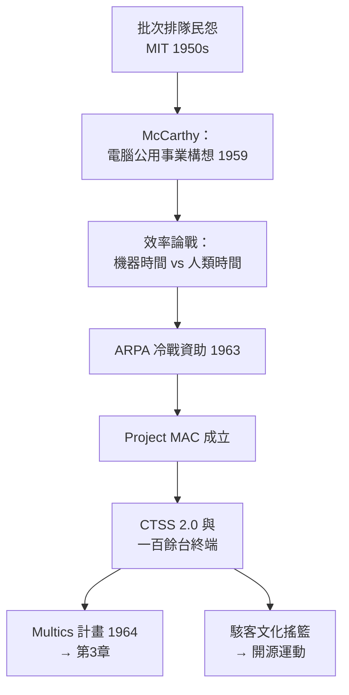

# 費爾巴哈與 MIT Project MAC：打破批次壟斷、讓多人同時連線的瘋狂想法

## 麻省理工學院裡的民怨：排隊文化與「電腦公用事業」之夢

1950 年代末的 MIT 計算中心，是全美最大的學術運算設施之一，卻也是怨聲最載道的地方。研究生提一疊卡片排隊，等 8 到 24 小時拿回一頁 core dump；教授的計畫要排期數週。John McCarthy（後來的 Lisp 之父、人工智慧術語的發明人）在 1959 年前後提出了一個當時聽來瘋狂的構想：**讓幾十個人同時坐在各自的電傳打字機前，直接與同一台電腦對話**。

McCarthy 用了一個改變後世產業格局的比喻：電腦應該像**公用事業（utility）**——如同電話與電力，隨插隨用、按量計費。1961 年他在 MIT 的演講中公開鼓吹「computing as a public utility」，這個願景在六十年後以「雲端運算」的名字捲土重來。

工程實現的重擔落在 **Fernando Corbató（費爾巴哈，Fernando José "Corby" Corbató）** 肩上。這位 MIT 計算中心的資深研究者性情沉穩、以「Corby」聞名於系，他與 McCarthy 在分時的思想上齊頭並進，但負責把它變成跑得動的系統——後世因此把「分時系統之父」的頭銜同時歸給兩人，而工程桂冠屬於 Corbató。

## 批次陣營的反撲：一場真實的論戰

分時的想法並非人人叫好。當時的主流意見認為這是揮霍：批次系統是「效率工程學」的勝利（見 1.3 節），把昂貴的機器切成幾十份給終端機前的文人，CPU 利用率必然崩盤。批評者的算術很簡單：一台機器每秒能做十萬次運算，五十個人輪流用，每人每秒只有兩千次——這夠誰用？

Corbató 陣營的答覆基於一個敏銳的行為觀察：**人類思考與打字的間隙極長**。使用者在鍵盤前 95% 的時間根本不需要 CPU——在看輸出、在思考、在發呆。如果排程器能捕捉這些空隙，五十個「輪流」的使用者體驗到的，是各自專屬一台中速機器的幻覺。效率論戰的本質，是兩種度量標準之爭：批次陣營度量「機器忙碌的百分比」，分時陣營度量「人類等待的秒數」。歷史最終證明，**人的時間比機器的時間昂貴**——這是電腦史上最重要的經濟學轉向之一。

## Project MAC： DARPA 的豪賭與機房政治

1963 年，MIT 獲得美國國防部高等研究計劃署（ARPA，後來的 DARPA）的資助，成立 **Project MAC**（Mathematics and Computation，後來官方改名 Multiple Access Computer）。MAC 的規模驚人：首年即獲約 200 萬美元，租用一台最新的 GE 645 前身 GE 635，並在幾年內擴張到一百多台終端。ARPA 的動機毫不含糊：冷戰時代的軍事運算（SAGE 的後續需求）需要即時互動能力，而分時技術正是關鍵基礎設施。**越戰前黃金年代的國防預算，成為分時系統的搖籃**——這是政治驅動科技的又一例證。

Project MAC 的組織文化同樣開創性：它匯集了 CTSS 團隊、McCarthy 的 AI 研究群（1962 年 McCarthy 離開 MIT 赴史丹佛）、以及後來寫出 Emacs 的 Richard Stallman 的精神前輩們。MAC 機房成為駭客文化的發源地之一：終端機全天開放，研究生可以半夜登入——**「上機權」從特權變成權利**，這個制度變革孕育了日後整個開放文化。

## Corbató 的兩個遺產：on-the-fly 切換與《On Building Systems That Will Fly》

Corbató 對工程史的直接貢獻，是把「切換」做到極致。CTSS 的團隊發明了**過程交換（process swapping）**的實踐雛形：把整個使用者程式連資料搬到磁鼓、換下一個使用者上場，全程瞬間完成、使用者無感。他後來把這套思想總結為影響深遠的工程論文，並在 1990 年圖靈獎演說《On Building Systems That Will Fly》中留下名言——**「不要一開始就追求完美，要讓系統能飛」**（大意為：系統必須在演進中求生，而非在設計圖上完美）。這句話與他在 1965 年提出的「**Corbató 定律**」——同一個人一天能寫出的程式行數是常數，無論語言多先進——至今仍是軟體工程課堂的經典。

1990 年，Corbató 獲頒圖靈獎，頌詞表彰「開創分時系統的先鋒性工作」。2019 年他以 93 歲高齡辭世時，《紐約時報》的訃聞標題寫著：「讓數百萬人共享電腦的工程師」。從今天回望，Project MAC 的瘋狂想法成就了三件大事：證明互動運算可行、開創電腦公用事業的願景、以及訓練出橫掃 1970 年代系統界的整代人才。而它野心最大的繼承者 Multics，將先經歷一場轟轟烈烈的失敗——然後在廢墟上，意外地長出 UNIX。
