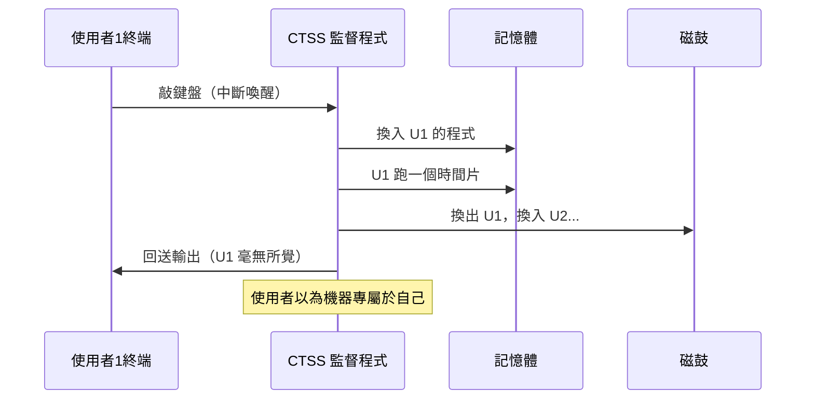
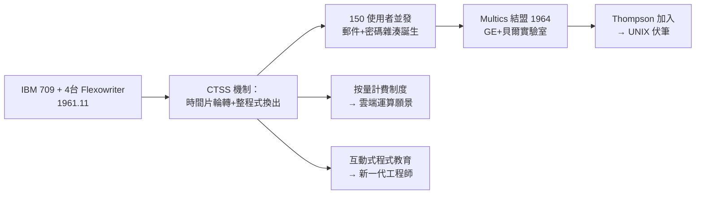

# 兼容時分系統（CTSS）：人類歷史上第一次實現 CPU 時間分片與遠端終端互動

## 1961 年 11 月：四個終端機上的歷史時刻

1961 年 11 月，MIT 計算中心一樓，一台改裝過的 IBM 709 前連著四台 Flexowriter 電傳打字機。Fernando Corbató 的團隊啟動了 **CTSS**（Compatible Time-Sharing System，「兼容」指它與 IBM 的 Fortran Monitor System 批次系統共存於同一台機器——工程上的政治智慧：不推翻舊秩序，而是與它分時共享機器）。這是人類史上第一個對一般使用者開放的分時系統投入運作。

CTSS 的核心機制如今已是教科書常識，但在當年是石破天驚：**把 CPU 時間切成極短的片（time slice），在多個使用者之間輪轉**。每個使用者的程式與資料在輪到自己時被搬入記憶體（低階機器沒有足夠記憶體同時容納所有人），到期後被「換出」到磁鼓，下一位登場。電傳打字機慢到每秒只印十幾個字元，使用者敲鍵盤與讀輸出的空隙，足以讓系統神不知鬼不覺地完成多次切換。

## 技術細節：為什麼 4K words 也敢做分時

CTSS 原始版本的硬體寒酸得驚人：IBM 709 約 32K words 記憶體，還得與批次系統共享。Corbató 團隊的工程手段成為後世範本：

- **Aconic 切換與專用硬體**：後來的 IBM 7094 加上一個僅含兩個字的「交換暫存器」專供監督程式使用，這個為分時而添的硬體小改動，是**硬體為 OS 需求服務的最早實例**之一。
- **檔案系統**：CTSS 首創帶使用者名稱的階層式檔案命名（如 `USER1 PROG1 MAD`），這個命名法直接啟發了後代 Multics 與 UNIX 的樹狀檔案系統。
- **郵件系統**：1965 年，Tom Van Vleck 與 Noel Morris 在 CTSS 上寫出史上第一個**電子郵件程式**之一——分時系統不經意地創造了人類新的通訊方式。
- **密碼檔案**：CTSS 還因一個事故留名史冊——1960 年代中期，曾有人在磁帶上發現整個密碼檔案明文列印的紀錄，此事故促使 Phyllis Fox 等人推動**單向雜湊密碼**的研究（ Salt 與 hash 之思想源頭），影響了 Multics 與 UNIX 的密碼設計。

## 效果驚人：150 個使用者與圖形介面的曙光

到 1963 年，CTSS 支援約 30 個並發終端、註冊使用者數百人；到 1960 年代中期，單機同時服務 150 個使用者。更關鍵的是**生產力證據**：McCarthy 的 AI 學生可以互動式地跑 Lisp（CTSS 上的 Lisp 是最早的人機互動語言環境之一）；Sketchpad 之父 Ivan Sutherland 的前身專案、以及 Douglas Ross 的 MAD 語言編譯器，都在互動模式下以「分鐘級」迴圈完成開發——而批次時代這是「一天級」的流程。

1968 年，計算機協會 ACM 的会议上一段 CTSS 影像與演示震撼學界。不過 CTSS 最重要的後裔是 1964 年啟動的 **Multics**：Project MAC 與奇異公司（GE）、貝爾實驗室結盟，要把分時推到「一台機器服務整座城市」的規模。貝爾實驗室派來的年輕工程師中，有一位剛從加州大學柏克萊分校畢業的 Ken Thompson——他將在 Multics 的廢墟上點燃 UNIX 的火種（第 3 章）。

## 制度遺產：按時計費與電腦公用事業的先聲

CTSS 不只是技術系統，還是一套社會制度。它是**最早實行「按使用量計費」的系統之一**：連線時間、CPU 秒數、紙張張數都記帳，學生有配額。這個「運算即水電」的計費模型，正是 McCarthy「電腦公用事業」構想的第一個落地實驗——六十年後的 AWS 按秒計費，血緣直追 CTSS 的帳本。

教育層面的影響同樣深遠：**第一批透過終端機學會程式設計的學生**誕生於 CTSS 之上。互動式學習改寫了教育法：錯了馬上改、改了馬上跑。1960 年代末，這批在終端機前長大的學生散佈到全美，成為分時產業（TSS、GE Information Services、Tymshare）與學術界的骨幹——分時系統不只分配了 CPU 時間，更分配了未來一代人的知識結構。

## Corbató 的晚年總結

Corbató 晚年回顧 CTSS 時說過一句話，道盡分時革命的本質：「我們當時的目標很謙卑——**縮短人的等待**。沒想到縮短等待之後，人類與電腦的關係整個改變了。」2012 年 IEEE Computer Society 以電腦先驅獎表彰他時，使用的措辭是：他讓電腦從「計算的機器」變成「溝通的場所」。分時系統的時間片，切開的不只是 CPU 的秒數，而是一個全新數位文明的分娩時刻。
