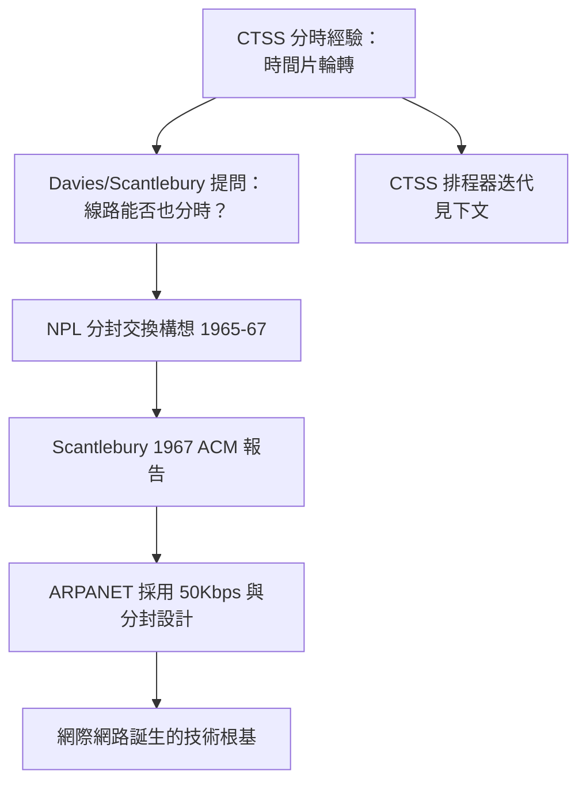
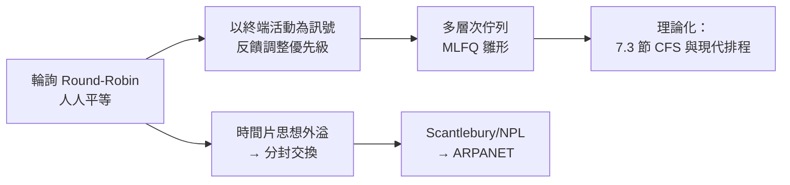

# 羅傑·斯坎特伯里與早期排程雛形：如何公平分配寶貴的計算時間？

## 排程問題：分時系統的靈魂考題

批次時代的工作排程很簡單：先到先做，做完換人，反正沒人等著互動。分時系統把難度瞬間拉高一個量級：**十幾、幾十個活人同時在線，每個人都期待「機器在回應我」**。誰先跑？跑多久？被換下場的程式狀態放哪？這就是排程（scheduling）問題，而它在分時黎明期的答案，決定了此後六十年作業系統的形狀。

本節聚焦兩條線索：MIT CTSS 團隊內部的排程實驗，以及一個常被忽略的英國支線——**Roger Scantlebury**（羅傑·斯坎特伯里）在倫敦 National Physical Laboratory（NPL）的工作。這條支線把「公平分配計算時間」與「分封交換網路」連結起來，揭示了排程思想如何在英美兩岸同時演化。

## NPL 與 Scantlebury：英國的時間分片實驗室

英國國家物理實驗室（NPL）在 1960 年代由 **Donald Davies** 領導進行分時研究，年輕工程師 Roger Scantlebury 是團隊核心成員。NPL 建造了 **NPL 分時系統**（搭載 Ferranti Pegasus 與之後的 KDF9），並在此基礎上孕育了一個影響遠超作業系統的發明：**分封交換（packet switching）**。

Davies 團隊的推理鏈精彩絕倫：分時系統的經驗證明，通訊線路與 CPU 一樣，可以切成小片輪流服務多個使用者——那麼**跨機器的電報線路**為什麼不行？1965 年前後，Davies 與 Scantlebury 等人提出把資料切成固定小塊（他們借鑒了分時的「時間片」概念，Davies 最初稱之為 packets 的構想由 UCLA 的 Leonard Kleinrock 排隊論予以理論化）在網路中各自路由。Scantlebury 在 1967 年 ACM 計算機會議上發表 NPL 的分封交換論文，並與美國方（ARPA 的 Lawrence Roberts）建立聯繫——ARPANET 的設計中，**NPL 建議的每秒 50 Kbps 線路速率與資料大小參數被直接採納**。

## CTSS 的排程演化：從輪流到階層

CTSS 團隊對排程的理解是逐步加深的，幾個真實的迭代值得記錄：

**1. 純輪詢（round-robin）的失敗。** 最初版本讓所有登入者輪流各跑一小片。問題立刻浮現：如果某使用者只是掛著終端發呆，系統仍浪費整段換入換出時間（CTSS 換出整個程式的成本高昂）。**互動系統的排程不該只看「誰在線」，該看「誰真的需要 CPU」**。

**2. 以「終端活動」為訊號。** CTSS 改為觀察鍵盤與輸出狀態：剛敲完鍵的使用者優先級提升，持續計算的重工作降級。這是**反饋式排程（feedback scheduling）**的最早實踐之一——用行為訊號動態調整優先級，而非靜態排隊。

**3. 多層次佇列的誕生。** CTSS 後期版本把使用者分入多個佇列：新互動使用者進最高優先級短時間片佇列；長時間佔用 CPU 的程式被降到低優先級、長時間片的批次佇列。這個結構正是後世**多級反饋佇列（MLFQ）**的直接祖先（7.3 節將完整展開其理論化過程）。Corbató 團隊在 1962 年 AFIPS 會議的 CTSS 論文中詳細記載了這些設計取捨，成為排程理論的開山文獻之一。

**4. 換頁式排程與「公平」的量化。** 由於 CTSS 需要整程式換出，排程器必須同時決定「誰進記憶體」——這實質上是最早的**中期排程（medium-term scheduling）**。團隊用簡單的效用公式平衡「最久未被服務者」與「互動敏感者」，首次把「公平」變成可計算的量。

## 公平的哲學：排程即政治

排程器的每個參數都是價值判斷：**最短工作優先**偏袒短程式、懲罰長程式；**先來先服務**尊重先到者但讓全隊平均等待變長；**時間片輪轉**人人平等但重工作受苦。1960 年代的系統建造者已意識到：**排程器是一台機器裡的分配正義機制**。

這個洞見在後世不斷回響：1968 年提出了「長期、中期、短期」三層排程的教科書框架；1990 年代 BSD 與 Linux 為桌面互動性調整動態優先級；2000 年代 Google 對資料中心工作採取支配資源公平（Dominant Resource Fairness）的博弈論模型；到 2020 年代，Kubernetes 的 ResourceQuota 與 AI 集群排程器仍在爭論同一個 CTSS 時代的問題——**稀缺算力該依什麼原則分給誰？**

## 歷史定位：排程器是分時革命的真正遺產

CTSS 的排程程式只有幾百行組合語言，卻開創了一門延續至今的學問。Scantlebury 的故事則提醒我們：**排程思想最大的外溢效應不在 CPU，而在網路**——分封交換本質上是「對線路做分時」，網際網路因此可視為一個行星尺度的排程系統。1990 年 Corbató 拿下圖靈獎；Donald Davies 因分封交換獲頒大英帝國勳章與多項國際榮譽；Scantlebury 晚年仍常被網路史學界請出來講述 1967 年那場報告。三條線索在 1960 年代交匯，指向同一個母題：**當資源稀缺而需求者眾多，文明必須發明分配演算法**。作業系統的排程器，正是這個母題在矽晶片上的第一次完整演繹。
