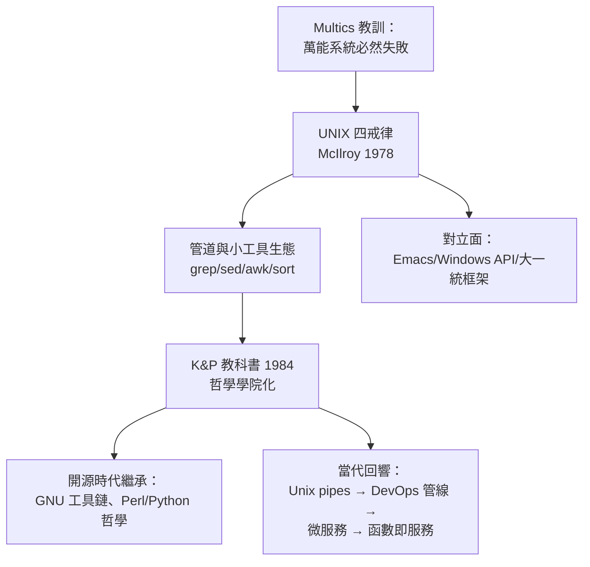

# UNIX 程式設計哲學的誕生：「做好一件事情（Do One Thing and Do It Well）」與簡潔美學

## 一條戒律的誕生：Multics 屍檢報告

UNIX 哲學不是憑空發明的美學宣言，而是**從 Multics 屍體上解剖出的教訓**。Multics 試圖打造一個無所不能的系統：內建一切、服務一切、保護一切——結果是十年的難產與撤退。Thompson 與 Ritchie 在設計新系統時，心中有一張明確的「不做清單」：不做全域的資源管理、不做多層保護環、不搞複雜的檔案類型系統。

這條道路的第一次完整表述，出現在 1978 年 Doug McIlroy（貝爾實驗室計算科學研究中心主任、管道概念的發明人）的總結中，後來成為經典的「UNIX 哲學四條」：

1. **讓每個程式做好一件事。** 若要做新工作，不要添加新功能到舊程式，而是寫新程式。
2. **期待每個程式的輸出成為另一個程式的輸入。** 不要在輸出中塞入無關的雜訊。
3. **設計與試作軟體要儘早，最好在幾週內。** 不要猶豫，扔掉笨重的版本重建。
4. **使用工具而非缺乏知識的旁門左道來減輕程式設計工作。** 寧可把建立工具的任務交給別人。

這四條戒律的背後，是一整套關於**軟體複雜性的經濟學**：與其造一台全能機器（複雜度指數增長、除錯成本失控），不如造一堆小零件（每個都可獨立測試、可替換、可組合）。

## 《The UNIX Programming Environment》：哲學的教科書化

1984 年，Brian Kernighan 與 Rob Pike 出版《The UNIX Programming Environment》，把散落十年的設計習慣系統化為可傳授的學問。書中示範的經典組合至今仍是 UNIX 教材的標準開場：

```bash
# 統計一份文件最常用的 20 個詞——四個小工具的組合
cat 文件 | tr -cs A-Za-z '\n' | tr A-Z a-z | sort | uniq -c | sort -rn | head -20
```

這一行命令的震撼之處不在結果，而在**零程式設計**：八個程式，每一個只做一件事（切詞、轉小寫、排序、去重、計數），組合起來卻完成了「文字統計引擎」。Kernighan 與 Pike 稱之為「工具箱思維」：程式設計師的功力體現在**選擇與連接工具**，而非重造工具。

1986 年前后，Rob Pike 在《Notes on Programming in C》中寫下更精煉的表述，後經 Kernighan 概括為軟體工程界最著名的格言之一：**「複雜的資料結構配上簡單的演算法，勝過簡單的資料結構配上複雜的演算法。」**（"Data dominates"——先設計好資料結構，程式自然清晰。）這與 Fred Brooks 在《人月神話》中的名言「Show me your tables, and I won't usually need your flowcharts」互為呼應，共同構成 1980 年代軟體思想的雙璧。

## 文化土壤：貝爾實驗室的工匠傳統

UNIX 哲學能被堅持，離不開貝爾實驗室的組織文化。這個以「晶體管發明地」聞名的工業實驗室，內部有兩條並行的傳統：一是基礎研究的貴族式自由（見 1.2 節的反壟斷紅利），二是電話工程師的**系統可靠性美學**——電話網路要求七個九的可用性，工程師信奉「簡單的東西才可靠」。Thompson 曾說他追求的是「系統的每一行都能被一個人理解」；Ritchie 則反覆強調，簡單不是起點的簡陋，而是「每個部件簡單到能被信任」。

教育層面，《The C Programming Language》（K&R，1978）只有 228 頁，卻教會了整整一代人 C 語言——它的薄本身就是 UNIX 哲學的展示：**真正的理解不需要大部頭**。1980 年代全球大學的作業系統課程以 UNIX 為活體教材（John Lions 的註解本在澳洲地下流傳），UNIX 哲學隨教材滲透進每一個計算機系的課堂，塑造了兩代工程師的直覺。

## 哲學的戰場：它並非沒有敵人

UNIX 哲學在歷史上屢遭挑戰，每次挑戰都彰顯了其內在張力：

- **emacs 對 vi**：Richard Stallman 的 Emacs 是「一切皆可擴展的龐然大物」，公然違背「做好一件事」。有趣的是，emacs 的擴展語言 Lisp 反而自證了哲學的另一面——用小語言組合出大能力。
- **X Window System**：1984 年 MIT 的 X 視窗系統堅守哲學（伺服器/客戶端分離、機制與政策分離），但桌面時代的整合需求最終讓「大而全」的 GNOME/KDE 勝出——**哲學在系統層勝利，在體驗層妥協**。
- **微軟模式**：Windows 的 API 哲學是「一個巨型介面包辦一切」，商業上大獲成功。這證明哲學之爭不只是美學，更是**市場結構之爭**：開放的小組件利於協作生態，封閉的大平台利於商業控制。



## 當代迴響：從管道到微服務

UNIX 哲學的壽命遠超其創造者的預期。1990 年代，Perl 的發明人 Larry Wall 把它轉譯為語言設計原則；2000 年代，DevOps 運動用「管線」（pipeline）重述了 McIlroy 的第二戒律；2010 年代，微服務架構（把單體應用拆成單一職責的小服務）與 AWS Lambda（函數即服務）在架構層重演了「小工具組合」；甚至 Google 的 MapReduce 論文（2004），其 map 與 reduce 的命名直接致敬 Lisp 與 UNIX 的函數式傳統。2017 年 Thompson 與 Pike 再度聯手推出 Go 語言，其標準庫的組合式設計與「少即是多」的介面哲學，可視為 UNIX 哲學在雲端時代的第三次轉世。

五十年後回望，「做好一件事」之所以不朽，因為它對抗的是軟體工程最古老的敵人——**複雜性**。Brooks 在 1986 年說「沒有銀彈」，但 UNIX 哲學大概是最接近銀彈的思想武器：它從不承諾消滅複雜性，只承諾**把複雜性關進每個小盒子裡，讓盒子之間的介面保持簡單**。這既是工程戒律，也是一種世界觀。
