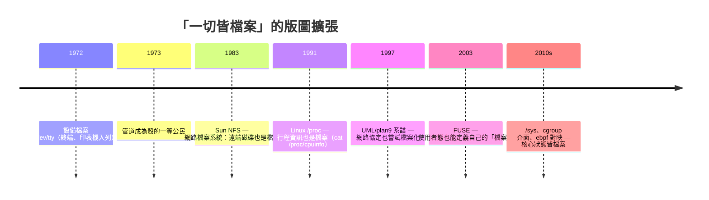
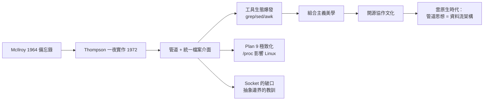

# 一切皆檔案（Everything is a file）與管道（Pipe）：將設備、行程與數據流完美統一的偉大抽象

## 管道的誕生：McIlroy 的十年執念

管道（pipe）的發明史，是一段「想法等硬體」的歷史。1964 年，貝爾實驗室的 **Doug McIlroy** 在一份內部備忘錄中寫下構想：「我們應該有一些機制，像園藝水管一樣把程式串接起來——讓 `sort | grep | wc` 這樣的直寫成為可能。」他多次向 Thompson 與其他同事鼓吹這個想法，但始終沒有人動手實作。

轉機出現在 1972 年。Thompson 聽完 McIlroy 又一次（據 McIlroy 回憶，是「近乎說教式的」）陳述後，當天晚上回去，**用一個通宵把管道寫進了系統**，並修改了殼使其支援 `|` 語法。次日，Thompson 與幾位同事用它重寫了多個工具，管道立即成為系統的靈魂。McIlroy 後來自嘲道：「這教訓很清楚——**一個想法若只是被期待，永遠不會發生；得有人一時衝動把它做出來**。」管道的符號 `|` 則是 McIlroy 選的——他認為該符號「順眼且好打」。

管道的技術本質極其優雅：`prog1 | prog2` 時，核心建立一個**核心緩衝區佇列**，把 prog1 的標準輸出接到 prog2 的標準輸入，兩個行程**並行執行**，以生產者-消費者方式同步（緩衝滿則寫方阻塞、緩衝空則讀方阻塞）。這正是 1.3 節循環緩衝思想的行程化昇華。

## 「一切皆檔案」：把宇宙收進一個介面

如果說管道統一了**行程與數據流**，那麼「一切皆檔案」統一了**設備與資源**。UNIX 早期只有兩類「檔案」：磁碟上的普通檔案與目錄。1972 年前後，Thompson 與 Ritchie 做出影響深遠的決定：**把硬體設備也表示為特殊檔案**。終端機是 `/dev/tty`、印表機是裝置檔案、磁帶機也是裝置檔案——讀寫設備與讀寫磁碟檔案，呼叫的是同一組系統呼叫：`open`、`read`、`write`、`close`。

這個抽象的威力在於**程式的無知即是美德**：`wc` 根本不知道自己讀的是鍵盤、磁碟還是另一個程式的輸出，它只管「讀到檔案結尾為止」。於是同一個工具天然可用於互動、批次、管道三種場景。此後數十年，這個思想不斷擴張版圖：

## Plan 9 的極致與反例：抽象的邊界

貝爾實驗室自己也曾檢討「一切皆檔案」的不徹底之處。1980 年代末，Thompson、Pike 等人開發 **Plan 9 from Bell Labs**，把哲學推向極致：**不僅設備，連網路、行程控制、視窗系統全部以檔案系統介面呈現**（如 `/proc` 目錄使每個行程的記憶體與狀態可被讀寫）。Plan 9 商業上乏人問津，但其 `/proc` 與 9P 協議深刻影響了 Linux（`/proc`、`/sys`、FUSE）與虛擬化技術。

反例同樣發人深省：**網路 Socket 並非檔案**。BSD 引入 socket API 時（4.2BSD，1983），設計者認為 socket 的語義（如 `accept`、帶位址的 `bind`）與檔案介面差距太大，於是另起爐灶。這個妥協被後世視為 UNIX 抽象史上最著名的破口——1990 年代有人（包括 Plan 9 團隊）主張若網路也是檔案，分散式運算會簡單得多。抽象的邊界，就是工程取捨的墓碑與豐碑。

## 經濟與文化效應：小工具的大生意

管道與統一檔案介面徹底改寫了軟體的生產函數。因為 I/O 介面統一，任何新工具立即與全部舊工具「互通」——**工具的價值隨生態位數超線性增長**（梅特卡夫定律的軟體版）。貝爾實驗室在 1970 年代用極少的人力維護著一個不斷增長的工具庫（grep 1973、awk 1977、sed 1974……），這種「槓桿率」令同時代的 OS/360 開發團隊（五百人年）瞠目結舌。

文化上，管道催生了**組合主義**的工程美學：對抗「not invented here」、推崇「my program reads stdin, writes stdout」。這種美學後來直接孕育了開源文化的協作模式——正因為模組夠小、介面夠穩，陌生人才能接手彼此的程式碼。1998 年 Eric Raymond 在《The Cathedral and the Bazaar》中把 UNIX 傳統與開源運動接續起來，其底層邏輯正是三十年前那根 `|` 豎線。

## 尾聲：兩個偉大抽象的合流

管道與檔案抽象最終在現代系統中合流為一種世界觀：**計算是流的變換，資源是檔案的讀寫**。當你在 shell 裡寫下 `curl ... | jq ... | redis-cli`、當 Kubernetes 把日誌從容器導入聚合器、當 AI 資料管線把預處理器串成 DAG——你都在使用 1972 年那個通宵的遺產。Ritchie 在 1984 年的圖靈獎演說（與 Thompson 共同獲獎）中說，UNIX 的成功祕訣是「**讓程式設計師真心想用的環境**」，而達成之道是兩個字：**統一（uniformity）**。把設備、行程與數據流收進同一組介面，人類就用最小的概念負擔，撬動了最大的系統複雜性——這是作業系統史上性價比最高的一筆抽象投資。
