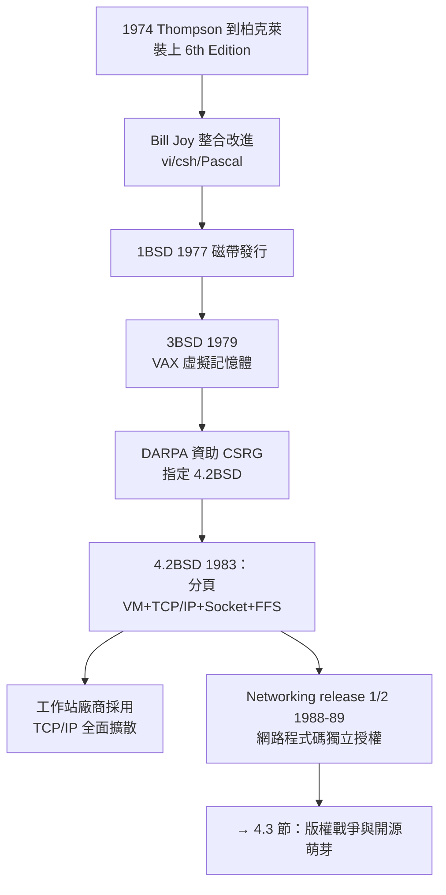

# 柏克萊的 Bill Joy 與 BSD UNIX：將記憶體分頁與 TCP/IP 納入核心

## 從貝爾實驗室到柏克萊：一次學術授權的漣漪

1974 年，Ken Thompson 以休假（sabbatical）身份到加州大學柏克萊分校任教一年，順手把第六版 UNIX 裝上了校內的 PDP-11/70。這個舉動點燃了西岸的系統熱。1975 年，研究生 **Bill Joy**（William Nelson Joy）與 Chuck Haley 加入強化系統的行列：Joy 重寫了 ex 編輯器（後來分支出 vi）、編寫了 csh 殼，並於 1977 年整理出 **1BSD**（First Berkeley Software Distribution）——最初只是一捲磁帶，內容是 Pascal 編譯器與編輯器等附加工具，附上「隨意拷貝」的授權。

Joy 的角色遠超程式設計師。他是系統的**產品經理與佈道者**：以驚人的速度吸收貝爾實驗室的更新、整合校內貢獻、發行帶完整手冊的版本。到 1978 年的 3BSD 時，BSD 已是功能上領先 AT&T 原版的系統。柏克萊能拿到源碼，源於 AT&T 因 1956 年同意判決無法營銷軟體、只得以象徵性費用授權學術機構（見 1.2 節）——**一個反壟斷判決，意外在西岸大學催生了最強的 UNIX 分支**。

## 虛擬記憶體：3BSD 與 DARPA 的豪賭

BSD 的第一個技術躍遷是**虛擬記憶體**。1970 年代末，VAX-11/780 硬體提供了分頁式虛擬記憶體，但 AT&T 的 32V 版本不支援。柏克萊團隊（Ozan Babaoglu 等人）在 3BSD（1979）中實現了完整分頁虛擬記憶體。

這項工作吸引了關鍵的制度推手：DARPA 的 **Information Processing Techniques Office（IPTO）** 資助了柏克萊計算機系統研究組（CSRG，以 Bob Fabry 為首），並在 1980 年指定 **4.2BSD** 為其標準研究平台。DARPA 的要求清單充滿野心：虛擬記憶體、高速網路、改善的行程間通訊。資助金額在五年間累計約千萬美元級——**軍方研究經費再次成為作業系統演化的引擎**（與 Project MAC 的 ARPA 資助遙相呼應）。

4.2BSD（1983）交出的成績單改寫了行業標準：

- **分頁虛擬記憶體**：完整的 demand paging 與先進的置換演算法，成為虛擬記憶體教科書的藍本（見 8.1 節）。
- **TCP/IP**：整個網路協議棧由 Joy 領隊實作（Bolt Beranek and Newman 的 Rob Gurwitz 提供原型協助），內建 socket API——UNIX 從此成為網路作業系統。
- **fast file system（FFS）**：Marshall Kirk McKusick 設計的快速檔案系統，以磁柱群（cylinder group）大幅提升磁碟效率，其設計論文至今是檔案系統課程經典。

## TCP/IP 與 Socket：把 UNIX 變成網際網路的載體

4.2BSD 的最大歷史功績，是**把 TCP/IP 綁定進作業系統**。1983 年 1 月 1 日，ARPANET 強制切換到 TCP/IP；同年 4.2BSD 發行，socket API（`socket`、`bind`、`listen`、`accept`、`connect`）讓任何程式都能透過類檔案的介面使用網路。由於 BSD 授權允許自由再散布（僅需附上柏克萊版權聲明），**數十家工作站廠商（Sun、DEC、HP…）競相採用 BSD**，TCP/IP 隨之滲透每一台 UNIX 機器。

網路史學者幾乎一致認定：**沒有 4.2BSD，網際網路的普及會晚五年以上**。1988 年，CSRG 更進一步把 TCP/IP 程式碼單獨抽出、以極寬鬆條款授權（Networking release 1），連 MS-DOS 與 IBM 主機都能移植——這是史上第一個「上傳到網路供自由取用」的大型軟體發行，開源發行的先聲。

## Sun Microsystems：BSD 的商業化身

1979 年，Bill Joy 獲 DARPA 支持整合 3BSD 為 DARPA 標準版本後，離開柏克萊參與創辦 **Sun Microsystems**（1982，與 Vinod Khosla、Scott McNealy、Andy Bechtolsheim）。Sun 的 SunOS 直接植基於 BSD，並以「網路即電腦」為口號販售 NFS（Network File System）——BSD 的網路技術成為 Sun 站上 workstation 市場王座的引擎。Joy 因早期的股份成為億萬富翁，這是**學術系統軟體轉化為商業帝國**的經典案例，也預示了日後矽谷「技術開放、商業封閉」的雙重性。

## 工程文化的遺產

柏克萊 CSRG 的工作方式同樣影響深遠：以郵件列表協調全球貢獻者、以磁帶與後來的網路發行版本、以「發行+手冊」為交付單位——這是**分散式協作開發**的早期實踐。1994 年 CSRG 解散，最後的 4.4BSD-Lite 成為 FreeBSD、NetBSD、OpenBSD 的共同祖先；這三支血脈至今支撐著 macOS（XNU 混合核心中的 BSD 層，見 9.2 節）、Netflix CDN（FreeBSD）與大量網路基礎設施。

從歷史因果看，BSD 的故事是一連串制度紅利的疊加：AT&T 的反壟斷枷鎖放出源碼、DARPA 的軍費澆灌出虛擬記憶體與 TCP/IP、柏克萊的學術授權文化打造了寬鬆許可證。**一個法律判決、一份軍方資助、一所大學的講台——三者合力，把 UNIX 從實驗室玩具鍛造成網際網路的地基**。而當 AT&T 終於驚醒、舉起版權大錘時，這套生態已強大到足以孕育出自己的法律反擊與真正的開源運動——那將是下一章的故事。
