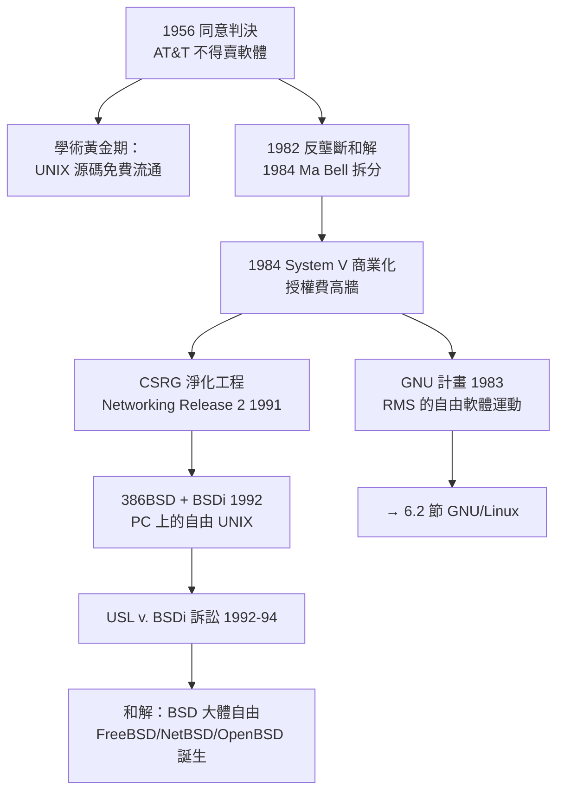

# AT&T 的版權重錘與早期開源運動的萌芽

## 制度轉折：從「不能賣」到「拚命賣」

UNIX 生態在 1970 年代的黃金自由，建立在一個法律異象之上：AT&T 受 1956 年同意判決約束，不得將軟體商品化。但這個異象註定短命。1974 年，司法部啟動對 AT&T 的反壟斷訴訟；漫長的訴訟在 1982 年以**同意拆分**告終——1984 年 1 月 1 日，AT&T 被拆為一家長途電話公司與七家區域貝爾公司（"Ma Bell" 分家）。傳奇的是，**解體協議解除了 1956 年判決對 AT&T 的商業限制**：它終於可以賣軟體了。

拆分生效的同一個月，AT&T 宣布 UNIX System V 成為其商業產品，授權費驚人：教育機構數千美元，企業動輒數萬美元起跳，且**原始碼需要更昂貴的授權**。一夕之間，二十年來「免費拿、隨便改」的學術生態面臨法律清算。

## USL 對 BSDi：一場決定開源命運的訴訟

戰火在 1992 年正式點燃。柏克萊 CSRG 於 1989-1991 年先後發行 Networking Release 1/2，其中 **大部分 AT&T 原始碼已被清除**（由 Keith Bostic 領導的淨化工程，團隊以電郵向全球徵集重寫程式碼——史上第一次群眾外包的系統軟體）。1992 年初，William Jolitz 發表 386BSD 並在雜誌連載《Porting UNIX to the 386》，讓任何人在 PC 上即可跑起自由的 UNIX；同年，前 CSRG 成員創辦 **Berkeley Software Design Inc.（BSDi）**，以 995 美元販售「386/BSD 系統+原始碼+支援」——價格只有 AT&T 同級產品的零頭。

AT&T 的子公司 **UNIX System Laboratories（USL）** 於 1992 年 4 月起訴 BSDi 與加州大學董事會，指控侵犯版權與商業祕密。訴訟凍結了 BSD 的發展（386BSD 的停滯直接催生了 FreeBSD 與 NetBSD 於 1993 年分家），也在整個產業投下寒蟬效應。

**轉折出現在庭審證據階段。** 加州大學的律師在 USL 提交的證據中發現：被指控侵權的程式碼裡，有大量來自 **USL 自己的開發者曾先後參考柏克萊改進而未署名回饋的內容**——USL 在多年商業授權中吸收了柏克萊的改良卻違約未在版權聲明中致謝。1994 年 1 月，雙方在庭審前和解：**加州大學僅需移除約 3 個檔案、為 11 個檔案加入致謝，其餘程式碼自由無恙**；USL 同時不得再訴。BSD 陣營實質上大獲全勝。

## 另一條火線：Richard Stallman 與 GNU 的誕生

法律訴訟之外，思想戰場上也在醞釀革命。1983 年 9 月，MIT 人工智慧實驗室的 **Richard Stallman** 公布 GNU 計畫（GNU's Not Unix，遞迴縮寫），動機是一樁職業倫理事件：實驗室的新型 Xerox 印表機驅動程式被廠商封閉，他無法修正卡紙問題，而曾經互助的駭客文化正在商業化中瓦解（許多同事跳槽去寫專有軟體）。

Stallman 的方案是釜底抽薪：**寫一個完全自由的 UNIX 相容系統**。1985 年他成立自由軟體基金會（FSF），並由法律學者協助設計出天才的法律武器——**著作權左派授權（copyleft）**：

- 1989 年 **GPL v1**、1991 年 **GPL v2**：任何人可自由使用、修改、散布 GNU 軟體，**但衍生作品必須同樣以 GPL 授權**。版權法反被用來鎖死封閉化——「以子之矛，攻子之盾」。
- GNU 工具鏈在此後十年攻城略地：GCC（1987）、Emacs、glibc、bash、coreutils……到 1990 年代初，GNU 已備齊一個完整作業系統的一切——**除了最難的核心**。GNU 的核心 Hurd 因微核心架構的工程困境長期難產（見 5.3 節的微核心宿命）。

歷史在 1991 年完成了著名的交會：芬蘭大學生 Linus Torvalds 釋出 Linux 核心， GNU 的使用者態工具恰好缺一個核心——**GNU/Linux 的結合水到渠成**（6.2 節將完整展開）。

## 訴訟時代的深遠影響：三個制度發明

USL 訴訟與版權重錘間接催生了三項至今仍在運作的制度：

1. **寬鬆許可證（permissive license）的價值發現**。BSD 四條款授權被證明能穿透商業高牆——微軟 Windows 的 TCP/IP 栈、蘋果 macOS 的 BSD 層，皆得益於此。後來的 Apache/MIT 授權皆承其緒。
2. **開源定義與 OSI（1998）**。Eric Raymond 與 Bruce Perens 有感於「free software」在商業場合遭誤解，另立「open source」旗號，制定開源定義、成立開放原始碼促進會。同年 Netscape 開源瀏覽器，開源運動正式登上主流舞台。
3. **著作權左派的理論武庫**。GPL 以版權法強制自由傳遞的機制，成為此後 Linux 生態的法律基石，也引發延續至今的合規（compliance）產業。

## 歷史的辯證

回望這段歷史，最深刻的教訓是**制度的意外作用**：1956 年的反壟斷判決「不小心」播下自由軟體的種子；1984 年的拆分「不小心」解除了限制、逼出生了防禦性的許可證發明；1992 年的訴訟「不小心」凍結了 BSD、把人才與舞台讓給了 Linux。**軟體自由從來不是純粹的技術演化，而是一部由法院、企業與理想主義者共同書寫的制度史**。1994 年 USL 訴訟和解時，Stallman 評論 BSD 自由的恢復「值得慶賀」——而真正的大戲，正在赫爾辛基一張大學宿舍的書桌上醞釀。
