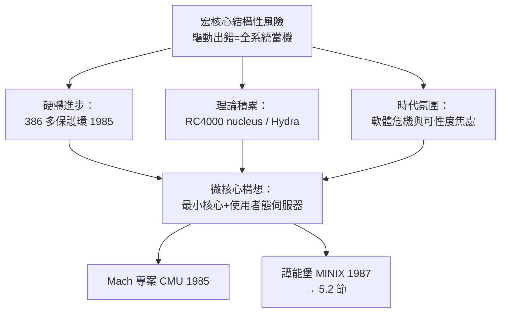

# 核心膨脹與穩定性危機：為什麼傳統宏核心一旦有一個驅動出錯就會整個系統當機（Kernel Panic）？

## 什麼是宏核心：把一切都塞進特權模式

到 1980 年代，UNIX 的宏核心（monolithic kernel）架構已臻成熟：**檔案系統、網路協議棧、行程排程、記憶體管理、所有硬體驅動程式——全部編譯成同一個核心映像，運行在 CPU 的特權態（ring 0）**。它們之間以函式呼叫溝通，共享同一個位址空間。

這個設計的優點直截了當：函式呼叫幾乎零開銷，元件間互動高效，程式碼緊湊。UNIX 之能在小小的 PDP-11 上跑出優雅的系統，宏核心功不可沒。但它的代價同樣直截了當：**共享位址空間意味著共享命運**。任何一個元件的野指標、越界寫入或空指標解引用，都可能踩壞核心的任意資料結構——排程佇列、頁表、檔案系統快取——瞬間讓整個系統崩潰。

UNIX 傳統對此有自己的幽默：**Kernel Panic**。這個術語最早出現在早期 UNIX 原始碼中——`panic("...")` 函式印出訊息後直接停機。原始碼中的註解坦白得可愛：「這是一個永遠不該到達的地方。」當驅動程式踩壞了核心，系統別無選擇，只能舉白旗。

```mermaid
flowchart TD
    subgraph 宏核心 Ring 0（同一位址空間）
    A[排程器] --- B[虛擬記憶體]
    B --- C[檔案系統]
    C --- D[網路協議棧]
    D --- E[驅動程式A]
    E --- F[驅動程式B<br/>含一個野指標]
    end
    F -->|越界寫入| B
    B -->|資料結構損毀| X[Kernel Panic<br/>全系統崩潰]
```

## 為什麼驅動程式是最大的地雷區

統計數據讓問題的嚴重性一目瞭然。微軟在 2000 年代的 Windows 崩潰分析中發現，**大約 85% 以上的系統當機源自第三方驅動程式**；Linux 的核心臭蟲報告中，驅動程式占程式碼量的大頭（今日 Linux 核心逾三千萬行，驅動程式占六成以上），也占臭蟲的主要來源。原因在於驅動程式的三重惡性：

1. **數量龐大**：每種硬體都要一個驅動，而硬體供應商的程式水準參差不齊。
2. **品質最難保證**：驅動與硬體深度耦合，除錯需要實機與特殊工具。
3. **特權最高**：驅動跑在 ring 0，擁有與排程器同等的權力——**最不可靠的程式碼握有最大的破壞力**。這是架構上的權責倒錯。

宏核心陣營的防禦手段（程式碼審查、測試、編譯器警告）都屬於「降低出錯機率」，但無法改變**出錯後的破壞半徑等於全系統**這一結構性事實。

## 歷史背景：Core 災難與「軟體危機」的時代氛圍

1980 年代的軟體工程界正深陷「軟體危機」的焦慮：專案超支、品質失控、Fred Brooks 的《人月神話》（1975）宣告「沒有銀彈」。硬體端的對照則是微型電腦革命的來臨：Intel 80386（1985）提供了四個保護環（protection rings），VAX 有多層模式——**硬體第一次提供了把系統切成多個保護域的便宜機制**。

理論界的呼應同樣及時。1970 年代，CMU 的 **Hydra**、Rochester 的 **RC 4000 Multiprogramming System**（Per Brinch Hansen 的 nucleus，1969）與 KeyKOS 等實驗系統反覆驗證了一個思想：**作業系統可以拆成一個極小的「核心之核」（nucleus/microkernel）加上一堆跑在使用者態的伺服器行程**。檔案系統變成一個普通行程，驅動程式也是普通行程——它們崩潰時，只是那個行程死了，重啟即可，系統主體毫髮無傷。



## 核心的「憲政危機」：權力集中與權力分散之爭

用本書的憲法比喻來說，宏核心與微核心之爭，本質是**政體設計之爭**：

- **宏核心**像中央集權的政府：所有部會（驅動、檔案系統、網路）都在王宮裡辦公，效率極高，但一場火災可能燒掉整個宮殿。
- **微核心**像聯邦制：王宮（微核心）只保留軍隊（排程）、監獄（記憶體管理）與郵政（IPC），教育部（檔案系統）、交通部（驅動）各自獨立辦公——一棟樓著火不會燒掉國家，但**部門之間送公文（行程間通訊，IPC）的成本遠高於同樓層喊話**。

這個比喻也點出了後來論戰的核心：微核心的隔離優勢要以 IPC 效能為代價。CMU 的 **Mach**（1985，Richard Rashid 與 Avie Tevanian 主導）是微核心陣營的技術旗艦——它後來成為 NeXTSTEP 與蘋果 macOS XNU 核心的基礎之一（9.2 節），證明微核心思想並未戰死，而是以混合形式存活。但 1980 年代的 Mach 本身也面臨效能困境，單次 IPC 需數百個週期，而宏核心的函式呼叫只需數個。

## 一個務實的插曲：可載入模組的折衷

宏核心陣營並非坐以待斃。UNIX System V 與 SunOS 在 1980 年代末引入**可載入核心模組（loadable kernel module, LKM）**：驅動程式可以在系統運行時動態載入與卸載，不必重編核心。這解決了「換網卡要重裝系統」的工程痛點，但**沒有改變隔離性**——載入的模組照樣跑在 ring 0，野指標照樣能 panic 全系統。LKM 是「行政改革」而非「憲政改革」：權力集中依舊，只是人員流動更方便了。

## 鋪墊：一場聖戰即將開打

到 1986 年前後，棋盤上的棋子已各就各位：理論上有 nucleus 思想與 Mach 實作，硬體上有 386 的保護環，產業上有對可靠性的飢渴，教育界則缺一個**能讓學生親手拆解的微核心教學系統**。填補最後一塊拼圖的人，是荷蘭阿姆斯特丹自由大學（Vrije Universiteit）的教授 Andrew Tanenbaum——他將用一套 16,000 行的 MINIX，同時改寫作業系統教育的教科書，並在不經意間，為史上最著名的學生專案提供起跑點。宏核心與微核心的世紀聖戰，以及 Linux 的橫空出世，都將從那套教材的書頁間爆發。
