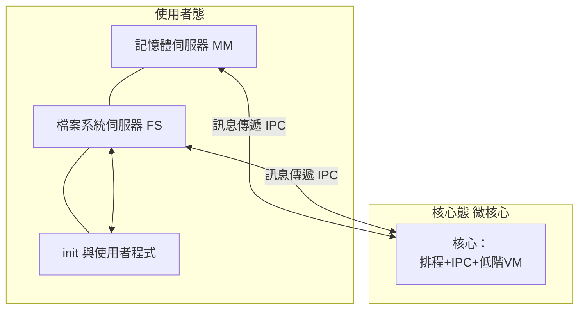
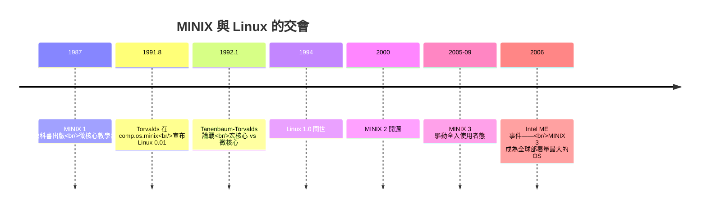

# 譚能堡教授與 Minix：為了教學而生、將服務移出核心的純粹微核心實驗

## 一位教科書作者的轉念

Andrew S. Tanenbaum（安德魯·譚能堡）是阿姆斯特丹自由大學（VU Amsterdam）計算機科學教授，1987 年前後已以兩部教科書聞名全球：《Computer Networks》（計算機網路）與《Structured Computer Organization》。1980 年代中期，他為撰寫《Operating Systems: Design and Implementation》（作業系統：設計與實作，1987 年初版）而陷入兩難：**教科書需要一個學生讀得懂的作業系統原始碼，但當時不存在這種東西**。

AT&T 的 System V 源碼授權昂貴且受法律限制（大學課程不能隨意拆解散布）；BSD 雖相對自由，但 VAX 版本的規模與法律陰影同樣不適合教學。Tanenbaum 做出了一個影響歷史的決定：**自己從零寫一個 UNIX 相容的教學系統**，在 IBM PC 的 8088 上運行——因為學生宿舍裡最多的就是 PC。

他的設計原則由教學目的倒推：

- **程式碼必須小**：全系統約 12,000-16,000 行 C 與組合語言，整本教科書連原始碼一起印刷。
- **必須完整**：磁碟、檔案系統、行程、記憶體管理一應俱全，能真的編譯與執行其他軟體。
- **必須體現好設計**：Tanenbaum 是微核心思想的信徒（見 5.1 節的時代氛圍），他決定採用教科書級的純粹微核心架構。

## MINIX 的架構：微核心的教科書式演繹

MINIX（MINI-uniX）的架構是微核心思想的乾淨示範：**核心只做三件事**——行程管理、低階記憶體管理、行程間通訊（IPC）。其餘一切全部移出核心，成為使用者態的伺服器行程：

驅動程式雖然此版仍編譯進核心位址空間（受 8088 無保護機制所限），但以訊息傳遞隔離互動；MM 與 FS 之間、伺服器與核心之間，一律以 **Tanenbaum 式的訊息傳遞（send/receive）**溝通。檔案系統崩潰不會拖垮記憶體伺服器——**故障隔離**這個微核心的核心賣點，在 MINIX 上以最簡形式呈現。

## 出版與擴散：一套教材的病毒式傳播

《Operating Systems: Design and Implementation》1987 年由 Prentice Hall 出版，附磁片發售。定價策略頗具巧思：**買教科書即合法取得完整的系統原始碼**——透過出版合約繞過了 AT&T 的授權泥沼（Prentice Hall 與 AT&T 談判了「教學用途」的清潔授權）。書出版後迅速成為全球標準教材：據 Tanenbaum 估計，到 1990 年代中期已有超過 50 萬美元版稅與數以十萬計的讀者；中國大陸與台灣的系統課程紛紛採用（清華大學等校的 MINIX 教學傳統延續至今）。

1997 年第二版改寫為 MINIX 2（移植到 386 保護模式）；2000 年，Tanenbaum 應社群請求將 MINIX 2.0 以開放授權釋出；2005-2009 年的 MINIX 3 更進一步貫徹微核心理想——**驅動程式全部移入使用者態，任一驅動崩潰由重啟伺服器（reincarnation server）自動復原**。這個「不死系統」的示範，是微核心思想最純粹的實踐之一。

## 歷史最著名的學生：赫爾辛基的 Linus Torvalds

MINIX 對歷史的最大影響，發生在 1991 年的赫爾辛基大學。Linus Torvalds 在大學的計算機課程使用了 Tanenbaum 的教科書，買了一台 386 PC，**花錢購買了 MINIX 磁片**以在自家機器上執行與研究。他後來在自傳《Just for Fun》中記述：透過 MINIX 他學會了 386 保護模式的細節、任務切換、終端驅動的寫法。

1991 年 8 月 25 日，Torvalds 在 comp.os.minix 新聞群組發出那則著名的貼文：「我正在做一個（自由的）作業系統……只是愛好，不會像 GNU 或 386BSD 那樣大而專業。」——**他選擇在 MINIX 社群發布，因為那裡聚集著全球最有興趣研究小型系統的人**。初代 Linux 甚至「寄生」在 MINIX 上：用 MINIX 編譯、以 MINIX 檔案系統格式儲存、在 MINIX 使用者態下啟動。

## 一場改變歷史的論戰：Tanenbaum-Torvalds Debate

1992 年 1 月 29 日，Tanenbaum 在 comp.os.minix 發表題為《LINUX is obsolete》的長文，公開批評 Linux 的設計：

1. **「使用 1991 年還寫宏核心，是 1970 年代的老古董」**——微核心才是正道；
2. **「對 x86 的可移植性綁架」**——i386 架構是「1970 年代設計的殘骸」，綁定它沒有未來；
3. **「單人無法維護的系統」**——現代系統需要模組化設計，而 Linux 的巨石結構做不到。

Torvalds 次日回帖，以一貫的直率反擊：MINIX 是教學系統而 Linux 是為真實使用而生；「如果 GNU 的 Hurd 就緒，我會很高興，但它還沒就緒」。論戰綿延數十帖，Ken Thompson 也在群組旁觀並留言（他批評了雙方一些細節，並提到計畫中的 Plan 9）。這場辯論日後被稱為 **Tanenbaum-Torvalds debate**，是系統史上最重要的公開論戰。

## 歷史的吊詭：被戰勝的老師、最大的部署量

論戰的「勝負」在實務上早已分明：宏核心的 Linux 統治了伺服器與行動世界，而純微核心始終未能成為主流伺服器架構（5.3 節將解剖原因）。但吊詭的結局在三十年後降臨：**2006 年起，Intel 在自家晶片組的管理引擎（Intel Management Engine）中採用了 MINIX 3 作為內嵌系統**。此事 2017 年經 Google 專案經理 Ronald Minnich 在黑客松演講披露後震驚業界——據此推算，MINIX 3 成為**全球安裝量最大的作業系統**（幾乎每台 2008 年後的 Intel x86 晶片都內含一份）。Tanenbaum 對此回應幽默而達觀：「Ken Thompson 說過，要數出自己的影響力，看誰在用你的程式碼。」

Tanenbaum 本人也始終保持學者的坦率。2010 年代他多次公開表示，Linux 的成功有歷史偶然性，而他與 Torvalds 的私人關係一直友好——2018 年 IEEE 疑似以匿名論文形式出現的《A fictional reconciliation》之外，真實的和解證據是兩人在多個場合的互相致意。**教育者的勝利從來不在論戰的當下，而在他教出的學生統治了世界**：沒有 MINIX，就沒有那本教科書；沒有那本教科書，赫爾辛基宿舍裡的 Linus 可能永遠不會寫下第一行程式碼。
