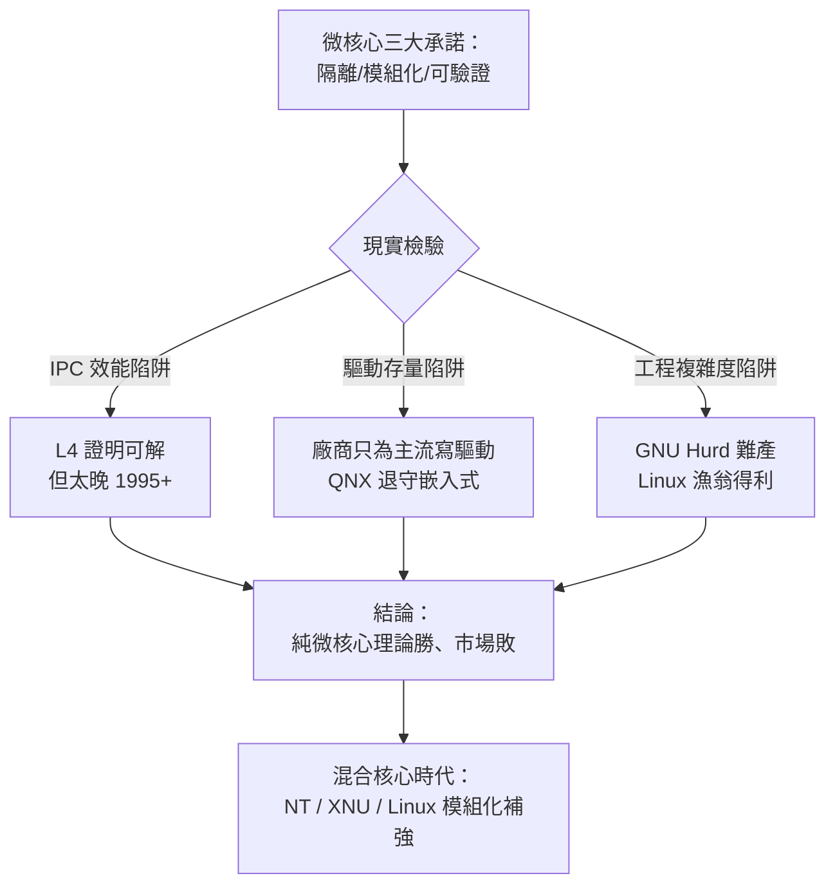

# 宏核心 vs 微核心論戰：「理論上優雅但效能低落」的微核心，為何在實務上敗給了實用主義？

## 聖戰的完整戰場

1992 年的 Tanenbaum-Torvalds 論戰（見 5.2 節）只是世紀之爭的一場公開戰役。完整的戰線橫跨二十年：

- **理論方**：Tanenbaum 的 MINIX、CMU 的 Mach、卡內基美隆的 Hydra、IBM 的微核心研究、以及學界大量論文。
- **實務方**：UNIX 家族、Linux、Windows NT（自稱「混合核心」）、macOS 的 XNU（Mach+BSD 混合）。
- **純粹主義的絕唱**：卡內基美隆之後的 **GNU Hurd**（1990 年啟動，至今未達生產品質）、QNX（1982，成功於嵌入式）、L4 家族（Jochen Liedtke，1995 起，證明微核心可以極快但為時已晚）。

論戰的核心其實可以濃縮成一個工程問題：**把一次函式呼叫（數個 CPU 週期）換成一次跨行程 IPC（數百週期），你換回了什麼？值得嗎？**

## 微核心的三個理論優勢與現實的三個陷阱

微核心的承諾一直極具吸引力：

1. **故障隔離**：驅動崩潰只死一個行程，系統重啟該伺服器即可。
2. **強制模組化**：介面即 IPC 協議，強迫設計清晰。
3. **安全與驗證**：核心極小，可被數學方法證明正確。

但三個現實陷阱讓這些承諾在 1990 年代難以兌現：

**陷阱一：IPC 效能的數學。** 微核心系統中，一次「讀檔案」要穿越多層：應用 → 檔案伺服器 → 磁碟驅動 → （再回程）。每跨一層就是一次上下文切換加上訊息複製。Liedtke 的 L4 用驚人的組合語言技巧把 IPC 壓到數十週期，證明「微核心必慢」不是物理定律——但 L4 證明這點時，宏核心陣營已贏下整個市場。**工程史殘酷之處在於：證明正確太晚，等於錯誤**。

**陷阱二：驅動程式的存量現實。** 硬體廠商只為主流系統寫驅動。1990 年代的微核心系統要生存，必須自己寫數百個驅動——這是純粹主義者無法完成的軍備競賽。QNX 之所以成功，正因為它放棄桌面、專攻嵌入式市場，只需覆蓋有限硬體。

**陷阱三：GNU Hurd 的教訓。** Stallman 的微核心選擇（Mach）導致 Hurd 難產十五年：多伺服器架構的除錯地獄（一個 bug 的因果鏈橫跨數個行程）、Mach IPC 的效能缺陷、以及志願者天然逃避最枯燥的工作。**Hurd 的難產反而是 Linux 的最大助攻**——1990 年代初，自由的作業系統急需一個核心，而 Hurd 缺席，市場空位由 Linux 填補。

## 實用主義的勝利密碼：三個歷史決定

Linux 戰勝純微核心，不是因為宏核心理論更優，而是三個歷史決定的疊加：

**1. Linus 選了 386 而非可移植性。** Tanenbaum 批評 Linux 綁定 i386 是短視，但正因如此，Linux 在 PC 爆發期（1993-1995，Windows 95 之前的伺服器真空期）提供了**免費、即時可用**的系統。可移植性可以後補（1994-1995 年 Linux 迅速移植到 Alpha、SPARC、PowerPC），市場時機不能重來。

**2. 網路協作模式補強了宏核心的弱點。** 宏核心的品質風險（5.1 節）由「全球眼睛」的開發模式對沖：數千志願者各自維護自己有硬體的驅動程式。**驅動程式的分散式開發，恰好是開源模式的天然強項**——每個人只寫自己擁有硬體的那一塊。

**3. 「Bazaar 眼睛」對 Kernel Panic 的免疫神話。** 「足夠多眼睛，臭蟲無所遁形」（Linus's Law，見 6.3 節）在驅動品質上部分成立，但真正的殺手鐧是**修復速度**：宏核心崩潰固然糟糕，但 Linux 社群能在數小時內提出修補，而微核心系統的開發者人手不足，隔離性再好也補不完功能差距。**可靠性競賽的決勝點不是單次故障的破壞半徑，而是修復的時間常數**。

## 敗者的勝利：微核心思想的三次轉世

歷史對微核心的判決並非死刑，而是轉世：

**第一次轉世：混合核心。** 蘋果的 XNU（Mach 微核心 + BSD 宏核心 + IOKit 驅動框架，1999 起）與 Windows NT 的設計（核心態內的「執行體」分層，近似模組化宏核心）都是妥協產物。macOS 與 iOS 的穩定性證明：**Mach 的訊息傳遞與 BSD 的效率可以在同一核心共存**——Dave Zarzycki 等蘋果工程師後來坦承，他們大量簡化了 Mach 的原始設計。

**第二次轉世：虛擬化的降維打擊。** 微核心夢想的一切——故障隔離、小信任基、服務可重啟——被 **hypervisor 與容器**以更務實的路徑實現了。QNX 在汽車與醫療設備中依然稱王；Xen（2003）與 KVM 讓「隔離」不再需要重寫整個 OS；而 Docker（2013）用 namespaces/cgroups 在宏核心裡製造出微核心式的隔離幻象（10.1 節）。**微核心的目標以宏核心的手段達成——這是工程史最諷刺的結局之一**。

**第三次轉世：形式化驗證的勝地。** 2009 年，澳洲 NICTA 的 seL4 團隊發表世界上第一個**被完整機器證明功能正確性的微核心**（用 Isabelle/HOL 證明約 9,000 行 C 程式碼）。seL4 如今用於安全關鍵領域（無人機、汽車、衛星）。微核心「可驗證」的理論承諾，最終在它最純粹的形式中兌現——只是戰場從伺服器換到了安全晶片。

## 結語：優雅與實效的永恆張力

回望這場聖戰，最公允的判詞也許是：**雙方都對，只是問題問錯了**。「宏核心還是微核心」是錯的問題，對的問題是「**在給定的經濟約束下，哪種架構的總成本最低**」。1990 年代的約束（硬體便宜軟體貴、驅動是瓶頸、開發者稀缺）青睞宏核心；2020 年代的約束（安全需求暴增、虛擬化免費、硬體堆疊複雜）讓微核心思想遍地開花——只是沒人再叫它微核心。Tanenbaum 在 2006 年 MINIX 3 發布時自嘲：「我 1987 年的教科書裡寫的架構，二十年了還是沒人聽。」但歷史補償了他：今日每一部 Intel 晶片裡的 MINIX、每一台蘋果手機裡的 Mach 遺產、每一個 seL4 驗證的加密模組，都在為那場「失敗」的理論平反。
