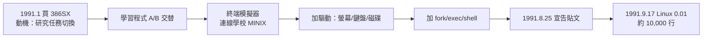
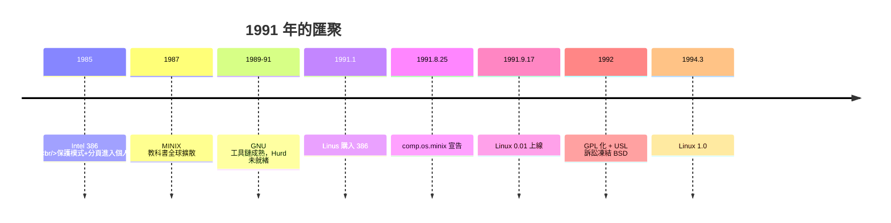

# 赫爾辛基大學學生的週末玩具：林納斯用 386 組合語言寫出的初代 Linux 核心

## 一台 386 與一本 MINIX 教科書

1991 年 1 月 5 日，21 歲的赫爾辛基大學學生 **Linus Torvalds** 用分期付款買下一台 IBM 相容 PC：Intel 386SX CPU、4MB 記憶體、無硬碟（後來加了 40MB）。他買它的理由之一令母親錯愕——**他想去探究 386 的任務切換（task switching）機制**，一個當時課堂上幾乎不教的硬體細節。他的參考書是 Andrew Tanenbaum 的《Operating Systems: Design and Implementation》與 MINIX 磁片（見 5.2 節）。

那年春天，Torvalds 寫了兩個學習程式：一個在兩個行程間交替輸出 AAAA/BBBB 以驗證任務切換；另一個是用組合語言寫的終端模擬器——他想從大學的終端機撥號連上學校的 MINIX 主機收發新聞群組郵件。**終端模擬器成為 Linux 的胚胎**：為了讓它列印資料，他加上了驅動；為了能下載檔案，他加了磁碟驅動與檔案系統；為了能執行 shell，他寫出了 fork 與 exec。後來他自述：「這就像潮水，一浪推一浪，不知不覺系統就在那裡了。」

## 8 月 25 日：史上最重要的新聞群組貼文

1991 年 8 月 25 日，Torvalds 在 comp.os.minix 發文（他自述是在征求回饋時，口氣刻意謙卑以免被轟）：

> 「我正在做一個（自由的）作業系統（只是個愛好，不會像 GNU 那樣龐大專業）……這從四月就開始醞釀，快要能用了。我想聽聽大家對我最喜歡的東西（如上所述的檔案系統）有什麼意見。我現在的版本裡已經有 bash(1.08) 與 gcc(1.40)，看起來不錯。幾個月內我會想要一些更實際的建議，我想知道大家最想要哪些功能。」

最後一句是名言的雛形：「**它用 C 寫，純手工，不含任何組合語言……嗯，除了少數地方。**」以及他坦承系統「不太可移植」（綁定 386）——這正是 Tanenbaum 三個月後批評的靶心。

1991 年 9 月 17 日，**Linux 0.01** 上傳至 ftp.funet.fi（芬蘭大學與研究網路 FUNET 的 FTP 伺服器，管理員 Ari Lemmke 提供帳號並把目錄命名為 `linux`——Torvalds 本想叫 Freax）。0.01 版約 10,000 行 C 與組合語言，需要 MINIX 環境才能編譯與啟動；同月 0.02 版的宣告寫著著名的挑戰：「**如果你願意，你可以做任何事，我只是想要聽到它在你機器上跑起來的樣子。**」

## 0.01 的技術面貌：樸素但筋骨俱全

初代核心的架構極其樸素，卻完整繼承了 UNIX 的概念骨架：

- **宏核心**：如 Tanenbaum 所料，檔案系統、驅動全在核心態——Torvalds 的理由是務實（386 的呼叫開銷與複雜的訊息傳遞不值得）。
- **386 保護模式的深度利用**：Torvalds 對 ring 3/ring 0 切換、TSS（Task State Segment）的掌握顯示了驚人的硬體理解力。0.01 的 `system_call.s` 至今仍被系統課程當作教材細讀。
- **MINIX 檔案系統**：直接沿用 MINIX 的磁碟格式，社群後來寫出 ext（1992，Rémy Card）取代之，ext 家族延續至今日的 ext4。
- **無網路、無虛擬記憶體分頁**：0.01 缺這兩項現代必備品；1992 年的 0.96 加入 TCP 支援（由 Ross Biro 等人），完整的虛擬記憶體要等 0.99 與 1.0 世代。

## 命名、授權與社群：三個關鍵的歷史決定

Linux 能從玩具長成基礎設施，靠的是 Torvalds 在 1991-1992 年間的三個決定：

**1. 授權轉向 GPL（1992 年 2 月）。** 0.01 版用的是自訂「禁止商業散布」條款；Torvalds 很快發現這阻礙了傳播（有人怕觸法而不敢轉寄）。1992 年 2 月他改為 **GPL v2**——與 GNU 生態完全兼容，glibc、bash、gcc 立即成為可依賴的基座。這個決定把 Linux 從個人專案變成自由軟體運動的旗艦（6.2 節）。

**2. 開放的開發流程。** Torvalds 以郵件列表與 FTP 站協調貢獻者，接受補丁的標準是「能不能跑」而非「出身何處」。到 1.0（1994 年 3 月）時，核心已由數百人共同完成逾 17 萬行；1.2（1995）支援多種硬體架構。**Decentralized 開發 + Linus 的最終裁量權**（後來的「仁慈獨裁者」模式）成形。

**3. 保持務實的設計姿態。** 面對微核心論戰，Torvalds 的立場是「好用的醜陋勝過難用的優雅」。Linux 早期拒絕了許多學界流行物（如微核心、能力機制），保留了大量粗糙但有效的設計——這種實用主義正是它在市場競爭中勝出的基因（5.3 節）。

## 為什麼是 1991 年：歷史條件的完美匯聚

Linux 的誕生並非孤例的天才奇蹟，而是條件的匯聚：

- **硬體民主化**：386 是第一台把 UNIX 級能力（保護模式、32 位元、分頁）帶進個人價位的 CPU。學生第一次擁有「足夠跑一個真 OS」的機器。
- **網路的普及**：Usenet 新聞群組與 FTP 已在全球大學暢通，個人專案可以即時獲得全球回饋——這是 Thompson（1969）與 Joy（1977）都不曾擁有的槓桿。
- **GNU 的工具缺口**：GNU 已備齊編譯器與工具鏈，唯缺核心（Hurd 難產中），市場出現完美空位。
- **MINIX 的教育播種**：全球數萬學生透過 Tanenbaum 的教材理解了小型 UNIX 的構造，人才庫已經就緒。
- **文化真空期**：USL 訴訟（1992）凍結了 BSD 陣營（見 4.2 節），自由的 UNIX 市場沒有強敵。

## 尾聲：玩具的成年禮

2000 年，Torvalds 在自傳《Just for Fun》中總結初衷：「我只是想要一個能跑在我 386 上的作業系統。」三十年後，這個「不會像 GNU 那樣大」的愛好專案，支撐著全球絕大多數的雲端伺服器、所有 Android 手機（逾 30 億部）、超級電腦 TOP500 全部五百席、以及無數嵌入式設備。歷史學者常把 1991 年 8 月 25 日與 1969 年的 PDP-7 並列：**兩次，都是一個工程師為了「自己用」而寫的系統，兩次，都因為時代剛好把傳播與協作的基礎設施準備好了，而成為人類數位世界的地基**。下一章，我們看 GNU 與 Linux 的結合如何點燃自由軟體運動的引擎。
