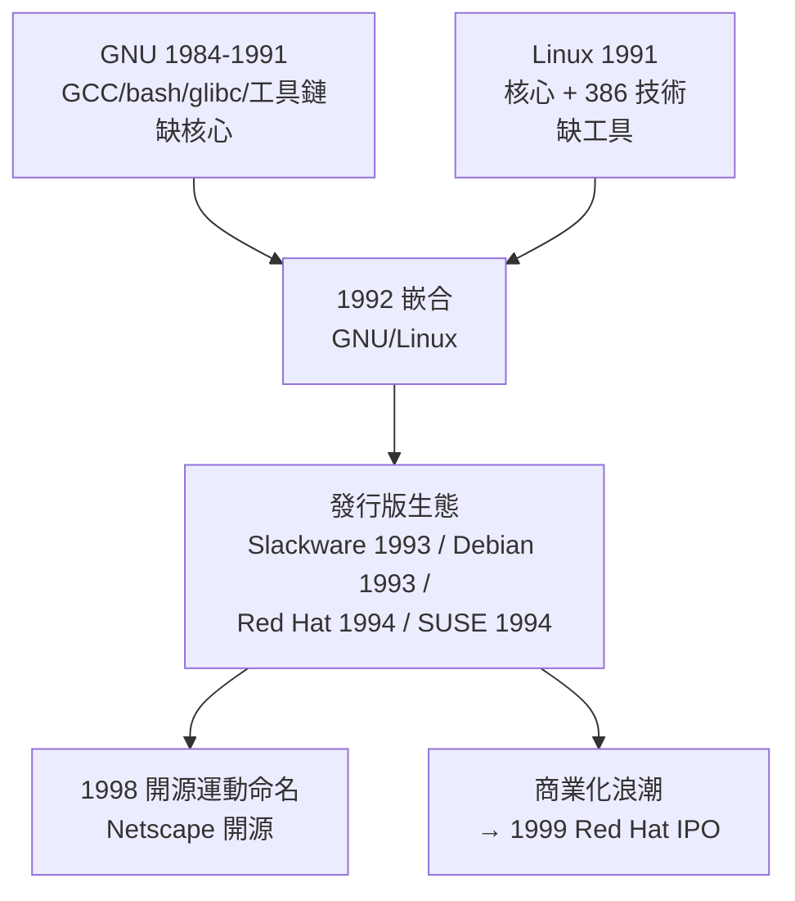

# 網際網路與 GNU/Linux 的世紀結合：理查·斯托曼的自由軟體精神與 Linux 核心的完美嵌合

## Stallman 的起點：MIT AI Lab 文化之死

要理解 GNU，必須先理解 1970 年代 MIT 人工智慧實驗室的文化。那時的 AI Lab 是一個軟體烏托邦：原始碼公開、鄰座有困難你可以直接改他的程式、Xerox 印表機卡紙時工程師會向廠商要驅動程式原始碼來修（廠商也給）。**分享不是盜版，而是行業常識**——這個文化繼承自 1950 年代的 SHARE 社群與駭客倫理（Steven Levy 的《Hackers》1984 年對此有經典記述）。

1980 年代初，這個烏托邦在商業化浪潮下崩解。壓垮駱駝的事件有二：其一，Symbolics 與 LMI 兩家 Lisp 機器公司從實驗室挖走大半工程師，Stallman 為阻止 Symbolics 獨佔改進而與其打了數年「程式碼游擊戰」；其二，實驗室換了新的 Xerox 印表機（Xerox 9700），廠商拒絕提供驅動程式源碼——曾經能修印表機的世界消失了。Stallman 後來在《GNU Manifesto》（1985）中寫道：他目睹的不是一種商業模式，而是**一種互助文明的瓦解**。

## GNU 計畫：重建一個自由的完整系統

1983 年 9 月 27 日，Stallman 在 net.unix-wizards 與 net.usoft 新聞群組發布宣言，宣布 **GNU**（GNU's Not Unix）計畫：目標是做出一個「人人可以自由使用、研究、修改、再散布」的類 UNIX 完整系統。選擇 UNIX 相容性是深思熟慮的策略——**降低遷移成本，讓自由系統能用起來像大家熟悉的樣子**。

工程順序體現了他的判斷力：先做最難且最有槓桿的基礎工具。1984-1991 年間 GNU 陸續產出：

- **GCC**（1987，GNU C Compiler）：自由軟體的兵工廠，任何新系統都需要它；
- **Emacs**（1985）：附 Lisp 直譯器的可擴展編輯器，也是 FSF 早期的經費來源（拷貝費）；
- **bash、glibc、coreutils、gawk、grep、tar**……到 1990 年，一個完整 UNIX 系統的幾乎所有組件就緒；
- **缺的只有核心**。GNU 的核心 Hurd 採用 Mach 微核心，因架構與人手問題長期難產（見 5.3 節）。

1985 年 Stallman 創立**自由軟體基金會（FSF）**，並發明法律武器 **copyleft**：1989 年的 **GPL v1**、1991 年的 **GPL v2** 規定——你可以自由使用與修改，但**任何衍生作品也必須以 GPL 釋出**。自由成為有法律傳染性的義務，這是對版權法的天才式反用。

## 1991 年的完美嵌合

歷史的齒輪在 1991 年咬合。Torvalds 的 Linux 核心誕生時，面對的是一個「只有核心」的尷尬局面：他的系統不能編譯自己、沒有殼、沒有工具——**但它生對了年代**：

1. Torvalds 用 **GCC** 編譯了 Linux（他在第一則宣告貼文中明言系統依賴 gcc 與 bash）；
2. 1992 年 2 月，他把授權改為 GPL v2，Linux 瞬間接入 GNU 的整個工具宇宙；
3. 社群開始發行「GNU/Linux」發行版：1992 年 **Softlanding Linux System（SLS）**、1993 年 **Slackware**（Patrick Volkerding，首個廣泛流傳的發行版）與 **Debian**（Ian Murdock 創立，以社群自治著稱）。

1994 年 Marc Ewing 的 **Red Hat Linux**（Red Hat 公司 1995 年成立）把「發行版+支援服務」做成生意——**軟體免費、服務收費**，這個商業模式證明了自由軟體與資本主義可以共存。1999 年 Red Hat 上市，首日暴漲，自由軟體正式進入華爾街的視野。

## 兩種哲學的張力與合作

Stallman 與 Torvalds 的關係是思想史上的經典張力：

- **Stallman 是道德哲學家**：自由是目的（free as in freedom, not beer——「自由軟體」的自由是言論自由，不是免費啤酒）。封閉軟體是不義，不是次優選擇。
- **Torvalds 是工程實用主義者**：他選 GPL 是因為「它對 Linux 的發展最有利」，而非意識形態。他公開表示自己「沒有道德立場」，並嫌棄政治化討論。

這種張力反而形成了完美分工：**Stallman 提供道德論述與法律框架（GPL、FSF、GNU 工具），Torvalds 提供技術引擎與社群模式（核心、郵件列表開發）**。1990 年代末，Eric Raymond 的《The Cathedral and the Bazaar》（1997）與「開源（open source）」命名運動（1998，與 Bruce Perens 創立 OSI）刻意迴避 Stallman 的道德語言，改用商業友善的效率論述——自由軟體陣營自此分裂為「free software」與「open source」兩個品牌，共享同一批軟體。

## 網際網路：看不見的第三位合作者

這場結合的真正催化劑是網路本身。GNU/Linux 的開發是史上第一個完全靠網路協作完成的大型系統工程：

- **Usenet 與郵件列表**取代實驗室走廊，成為程式碼審查與論戰的場所；
- **FTP 鏡像網絡**讓核心補丁以天為單位傳播全球；
- 1990 年代末，CVS/Subversion 等版本控制系統讓協作規模化；2002 年 Torvalds 因商業版本控制系統（BitKeeper）授權糾紛，親手寫出 **Git**（2005）——分散式版本控制反過來革新了全世界的軟體開發方式，GitHub（2008）的誕生是其直接後裔。

經濟史的視角更能看清這場結合的意義：1990 年代，企業需要廉價的 UNIX 替代品（Sun/HP 工作站昂貴、Windows NT 穩定性存疑），而網際網路基礎設施的爆發（ISP、網站代管、搜索引擎）恰好需要能跑 TCP/IP 的低成本伺服器。**GNU/Linux 在正確的時間、以正確的價格（零）、具備正確的介面（POSIX）出現**——需求、供給與制度三線同時到位。LAMP 堆疊（Linux+Apache+MySQL+PHP）成為 Web 2.0 的標準地基；Google（1998）從第一天就跑在改造過的 Linux 上。

## 尾聲：嵌合體的統治

今日回望，GNU/Linux 的世紀結合創造了軟體史上最成功的嵌合體：**GNU 的哲學+Linux 的工程+網際網路的協作+GPL 的法律+商業發行版的資本**，五種力量各取所需、互相成全。Stallman 在 2000 年代仍堅持要求系統稱為「GNU/Linux」（引發至今的命名之爭），Torvalds 對此不以為然——但爭論本身見證了這個嵌合體的雙重血統。2010 年代，Linux 核心每年接受逾 6 萬次提交、貢獻者逾 4,000 人，而其根基上的 GNU 工具仍運行在每一台伺服器的 shell 裡。**一個 MIT 實驗室的道德憤怒，與一個赫爾辛基宿舍的週末玩具，共同寫下了數位時代最偉大的合作範式**。
