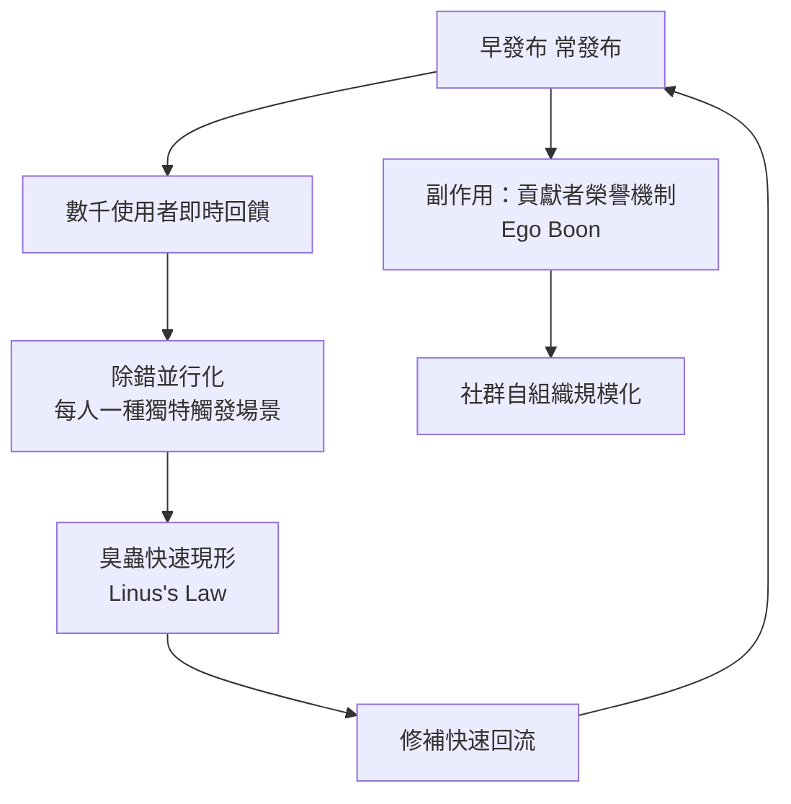
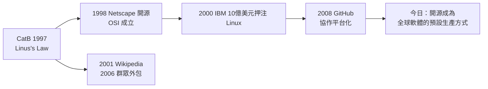

# 開源協作的奇蹟（Linus's Law）：「只要眼睛夠多，所有蟲子都無所遁形」

## 一句格言的誕生

「Given enough eyeballs, all bugs are shallow.」（只要有足夠多的眼睛，所有臭蟲都無所遁形。）這句話在 1997 年由 Eric S. Raymond 在《The Cathedral and the Bazaar》（簡稱 CatB）中正式命名為 **Linus's Law**，以對比「定律墨菲的墨菲定律」（Murphy's Law：凡是可能出錯的必會出錯）。Raymond 自述此格言出自 Linus Torvalds 在 Linux 社群中的口頭禪，Torvalds 本人後來確認自己常掛在嘴邊的版本是：「**everyone has scratchy eyeballs**」——每個人都會抓錯地方，但眼睛夠多總有人抓對。

CatB 的寫作契機極具戲劇性：Raymond 自 1996 年起接手 popmail 專案（fetchmail 的前身），身為 UNIX 老兵，他原以為核心開發需要封閉的精英團隊，卻驚訝地發現 Torvalds 用「早發布、常發布、廣撒網」的方式把 Linux 核心開發得又快又穩。他把觀察寫成系列論文，1997 年在 Linux Kongress 發表演講，1999 年集結成書。書中歸納的「Bazaar 模式」十九條要訣，成為開源方法論的聖經。

## 教堂與市集：兩種開發範式的對照

Raymond 的核心區分是兩種隱喻：

| 面向 | 大教堂（Cathedral） | 市集（Bazaar） |
|---|---|---|
| 代表 | GNU Emacs（早期）、商業軟體 | Linux、fetchmail |
| 開發方式 | 封閉精英、閉門打造、隆重發布 | 早期釋出、公開迭代、人人可貢 |
| 程式碼可見性 | 發布時才揭曉 | 每一步都暴露在陽光下 |
| 假設 | 複雜軟體需要少數天才的縱向協調 | 同儕審查能夠規模化除錯 |

Raymond 的關鍵洞見是**除錯的並行性**：除錯是軟體開發中最貴且最難並行的環節，傳統模式讓少數開發者序列地找蟲；Bazaar 模式把數千名使用者變成潛在的除錯者——**每個使用者都握有一種獨特的硬體、使用路徑與觸發條件**，於是臭蟲的「搜索空間」被天然地並行化。Torvalds 的貼士是「早發布、常發布」：發布頻率越高，回饋迴圈越短，貢獻者的心智投入越大。

## 實證檢驗：Linux 核心的規模化證據

Linus's Law 並非只是格言，Linux 的發展數據提供了規模化的證據：

- **1991-1994**：Linux 從 1 萬行長到 17 萬行，貢獻者從 1 人到數百人——在封閉軟體的經驗裡，這種生長速度不可思議；
- **1997 年前後**：Raymond 引用的數字是全球數萬名使用者在測試開發版核心；
- **2000 年代**：核心每年釋出數個大版本，每次有逾千人提交；2005 年 Git 誕生後協作規模再度躍升；
- **2020 年代**：每年逾 6 萬次提交、逾 4,000 名作者、數百萬行程式碼——**它是人類史上最大的單一協作工程之一**。

當然，實證也揭示法的邊界：核心的**品質瓶頸從未消失**，只是轉移——2010 年代的惡意提交事件（如 2024 年 xz-utils 後門企圖，其防禦恰證明「眼睛」仍有效）顯示，眼睛的「多」不等於審查的「深」。Raymond 本人後來補充：Linus's Law 成立的前提是**使用者有能力與意願讀程式碼**，這在核心開發者社群成立，在一般應用軟體則未必。

## 榮譽經濟：開源的隱形引擎

CatB 第 7 條要訣點出了 Bazaar 模式的社會學基礎：「**當你的頭銜變成『維護者』時，你便獲得了榮譽**。」Raymond 稱之為「Ego Boon」（自我膨脹的恩惠）：開源貢獻者工作的貨幣不是錢，而是**同儕認可、簡歷資本與社群地位**。

這個榮譽經濟有深刻的制度效果：它讓**勞動力全球分佈**——芬蘭學生、印度工程師、巴西駭客都能以同樣標準贏得聲譽，地理與學歷的壁壘在郵件列表上不存在。它也解釋了為什麼開源能吸引最優秀的人才：**在封閉公司裡你是螺絲釘，在開源社群裡你是署名者**。1990 年代末，雇主開始把 GitHub/SourceForge 貢獻當作招聘指標——榮譽經濟最終轉化為勞動市場的真實定價。

## 經濟與產業的連鎖反應

Linus's Law 的產業影響遠超軟體工程本身：

1. **1998 年 Netscape 開源**：Netscape 閱讀 CatB 後決定開源 Mozilla 程式碼，以對抗微軟 IE 的壟斷——這是 Linus's Law 首次直接影響億美元級的商業決策；
2. **IBM 的豪賭（2000）**：IBM 宣布投入 10 億美元於 Linux，CEO Louis Gerstner 的判斷正是「全球眼睛」的品質論——開源模式的可靠性已被證明；
3. **維基百科與 Web 2.0（2001 起）**：「眾人協作勝過少數權威」的模式從軟體外溢到知識生產，Wikipedia 創辦人明言受開源文化啟發；
4. **群眾外包（crowdsourcing, 2006）**：《Wired》記者 Jeff Howe 創造的術語，其思想原型即 Bazaar 模式。

## 批判與平衡：奇蹟的條件

對 Linus's Law 的最有力批判來自經濟學家與安全研究界：**眼睛的數量不保證眼睛的品質**。核心組件（如記憶體管理）的審查者極少；供應鏈攻擊（2010 年的 Stuxnet、2020 年的 SolarWinds、2024 年的 xz 後門）證明攻擊者學會了攻擊「信任鏈」而非程式碼本身。此外，2000 年代的研究（如 Coverity 的掃描）顯示開源專案的缺陷密度與閉源相當——**差異在修復速度與透明度，而非絕對品質**。

Raymond 對此的回應反映了開源思想的成熟：法則的價值不在「自動保證品質」，而在**把品質的可能性條件公開化**——任何人都可以在任何時候檢查、修正、貢獻。這個可能性條件，是封閉模式永遠無法提供的。2016 年，Torvalds 獲頒千禧科技獎（Millennium Technology Prize）時，評審委員特別表彰「Linux 所示範的開放協作新範式」。從 1991 年一則新聞群組貼文，到今日全球軟體的預設生產方式，**Linus's Law 見證了一個簡單的觀察如何長成文明級的生產制度**：當協作的成本趨近於零，眼睛的數量就是工程的力量。
