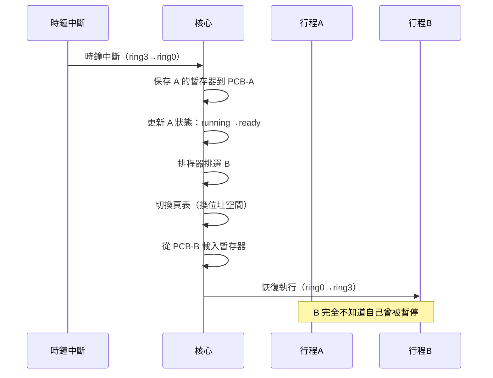
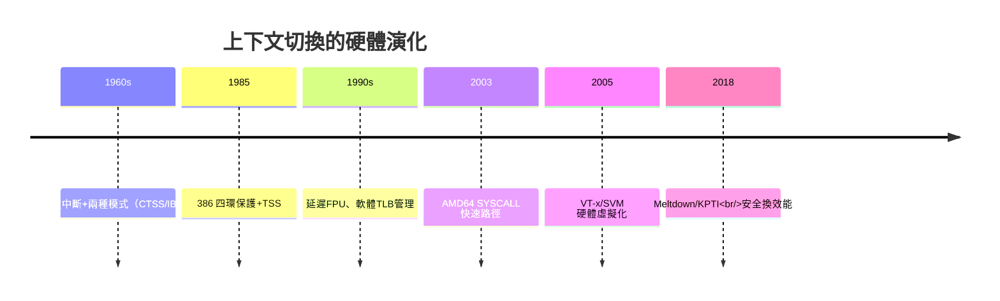

# 行程控制塊（PCB）、上下文切換（Context Switch）與 CPU 狀態保存

## 從「工作」到「行程」：概念的昇華

多道程式設計（見 1.3 節）帶來一個深遠的概念需求：當機器裡同時存在多個「在進行中的程式」，系統必須有一個物件來**代表與追蹤每一個**。批次時代它被稱為 job；分時時代，MIT 的研究者與之後的理論家把它正式化為 **process（行程）**——一個正在執行的程式與其全部資源的總和。這個抽象自 1960 年代定型後，六十多年來始終是作業系統的中心概念。

行程的「檔案」就是**行程控制塊（Process Control Block, PCB）**——作業系統為每個行程維護的資料結構，記錄著這個行程的一切：

- **CPU 暫存器快照**：程式計數器（PC）、堆疊指標、通用暫存器、旗標暫存器；
- **行程狀態**：就緒（ready）、執行（running）、阻塞（blocked/zombie 等）；
- **記憶體資訊**：頁表指標、界限、行程位址空間描述；
- **會計與身分**：PID、使用者 ID、優先級、CPU 使用統計（CTSS 按量計費的遺產）；
- **資源清單**：開啟的檔案描述表、訊號處理器、子行程清單。

PCB 的深意可以用憲法比喻講清楚：**它是國家對每個公民建立的戶籍與財產登記冊**——系統之所以能暫停、恢復、審計、終止任何行程，正因為每個行程的「存在狀態」都被完整地外化在這份登記冊裡。UNIX 把它具象為 `struct task_struct`（Linux）或 proc 結構；Plan 9 與 Linux 更把部分 PCB 內容暴露為 `/proc` 檔案——**行政檔案變成了可讀的介面**（見 3.3 節）。

## 上下文切換：一場以微秒計的權力交接

當排程器決定讓行程 A 讓位給行程 B，核心執行**上下文切換（context switch）**，步驟精確如儀式：

每一步都有不可見的工程含量：

1. **狀態保存**：現代 x86 上，核心不用笨重地保存全部暫存器——x86-64 的函式呼叫慣例（callee-saved registers）讓核心只需保存少數幾個暫存器加 PC 與旗標；FPU/向量暫存器（x87、SSE、AVX）則用硬體指令（如 x86 的 `FXSAVE`/`XSAVE`）批次保存，且採**延遲 FPU 切換**（lazy FPU switching）：用到才切，省下大量無謂保存。
2. **位址空間切換**：載入新頁表基底（x86 的 `CR3`）。這一步的代價近年急劇上升——2018 年的 **Meltdown 漏洞**迫使核心引入 **KPTI**（Kernel Page Table Isolation，核心頁表隔離），每次進出核心都要切頁表，直接造成 5-30% 的效能損失——**安全與效能的歷史性交換**在上下文切換的微觀處具體上演（見 8.2 節）。
3. **TLB 與快取汙染**：切換行程會打亂 CPU 快取與 TLB（位址轉譯快取）的熱資料，這部分「看不見的成本」常超過暫存器保存本身。ASID（位址空間識別碼）等硬體機制就是為了緩解它而生。

一次典型的上下文切換耗時 1-10 微秒。聽起來極快，但換算成「每秒若切換十萬次，就有一秒純粹花在官僚作業上」——**排程頻率是效率與回應速度的槓桿支點**，這正是排程器設計（7.3 節）的核心權衡。

## 行程的誕生與死亡：fork/exec 的 UNIX 智慧

UNIX 為行程生命週期發明的兩個系統呼叫，是概念美學的高峰：

**fork()**：把當前行程連 PCB、頁表、檔案描述表**整個複製**一份，父子行程從同一行代碼分岔。配合**寫時複製（Copy-on-Write，見 8.3 節）**，fork 幾乎免費——頁面共享，寫入才複製。
**exec()**：把當前行程的位址空間**整個替換**為新程式，PID 與資源清單保留。

`fork + exec` 的組合看似繞路（為何不直接「啟動新程式」？），卻解鎖了驚人的能力：**在 exec 之前，子行程可以做任何事**——重定向輸入輸出（管道的實現基礎，見 3.3 節）、修改環境變數、設定資源限制。Windows 選了 `CreateProcess` 一步到位，UNIX 陣營始終認為分步更強大。這場「fork 派 vs spawn 派」的辯論持續至今（POSIX 也補上了 `posix_spawn`），但 shell、伺服器與所有 UNIX 工具的基石仍是這對黃金搭檔。

死亡同樣有制度：**zombie（殭屍）與 wait()**。子行程死亡後，其退出狀態必須留給父行程認領——這是「死亡證明與遺產清算」的制度化。孤兒行程由 init（PID 1）收養——**連死亡管理都有戶政系統**。

## 硬體的共謀：中斷、模式切換與現代強化

上下文切換的舞台由硬體搭建。時鐘中斷（CTSS 時代已具備）強制交還控制權；系統呼叫觸發 trap，完成使用者態與核心態的轉換。1960 年代的硬體為 OS 提供了第一組「特權指令」，而現代硬體持續深化合作：

- **快速系統呼叫**：x86 的 `SYSENTER`/`SYSCALL`（AMD 2000 年代普及）取代昂貴的中斷門，系統呼叫從數百週期壓到數十週期；
- **vDSO**：把部分系統呼叫（如 `gettimeofday`）映射為使用者態函式庫，**連 trap 都省了**；
- **虛擬化的挑戰**：hypervisor 之下，客戶機核心的「ring 0」是假的——硬體輔助虛擬化（Intel VT-x，2005）新增 root/non-root 模式，形成「環外的環」，上下文切換的成本結構再度重組。

## 結語：微觀制度決定宏觀文明

上下文切換最深刻的啟示在於：**現代計算的「多工幻覺」，建立在無數次極其精確的微觀權力交接之上**。每一次你同時聽著音樂、跑著編譯器、開著瀏覽器，都是排程器在毫秒之間完成數百次 PCB 保存與恢復。這個機制的成本決定了系統的回應能力，其正確性決定了系統的可靠，其安全性決定了整個信任模型——2018 年 Meltdown 之後，全世界才驚覺：**一個快取微架構的設計瑕疵，能穿透一切軟體隔離**。行程抽象與其硬體契約，既是數位國家的戶政系統，也是數位國家的國防邊界。
