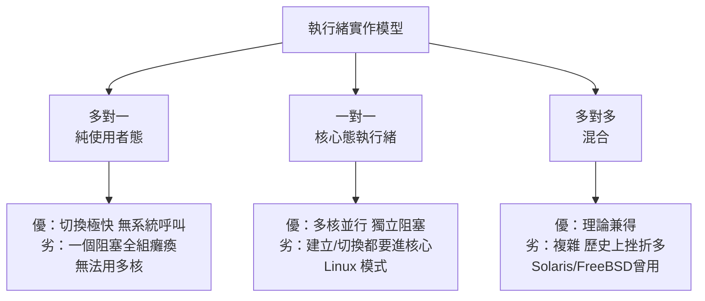

# 從單執行緒到輕量級執行緒（Threads）：並行運算與使用者態/核心態執行緒的對決

## 為什麼有了行程還要執行緒

行程抽象（7.1 節）完美解決了「多個程式共存」的問題，但 1980 年代出現了新痛點：**同一個程式內部需要並行**。伺服器要同時服務多個連線、視窗程式要一邊響應點擊一邊重繪、科學計算要拆分矩陣運算。用 fork 實現？代價高昂——fork 複製整個位址空間（資料不共享），行程間通訊（IPC）要穿越核心。

工程師渴望的是更輕的並行單位：**共享同一個位址空間、共享檔案與訊號，但擁有獨立的執行流與堆疊**——這就是**執行緒（thread）**。它常被稱為「輕量級行程」（Light Weight Process, LWP）：行程是資源的容器，執行緒才是排程的單位。這個「資源 vs 執行」的分離，是繼「程式 vs 行程」之後第二次概念切割。

## 歷史源流：從 Burroughs 到 POSIX

執行緒的思想早於其普及。1960 年代的 Burroughs B5000 系統已支援多個指令流共享記憶體；1967 年的「fork/join」模型在 Conway 的論文中成形；但真正讓執行緒成為產業標準的，是 1980 年代末的三股力量：

1. **SMP 硬體的到來**：多處理器伺服器（Sun、Sequent、SGI）需要把計算真正分到多顆 CPU——多個行程做不到共享資料池，執行緒是唯一解；
2. **Dijkstra 之後的理論成熟**：互斥鎖（mutex）、條件變數、信號量的語義已充分理論化；
3. **各廠私房執行緒庫的混亂**：Sun 的 UI threads、HP 的 DCE threads、微軟 Win32 執行緒……介面互不兼容，重演了 UNIX 割據的痛。

1995 年，**IEEE POSIX 1003.1c（pthread）** 終結混亂：`pthread_create`、`pthread_mutex_lock` 等介面成為全球標準（承續 4.3 節 POSIX 的制度邏輯）。同年 Java（1995）把執行緒內建進語言與虛擬機——**多執行緒從系統程式設計師的專業技能，變成所有程式設計師的日常義務**。

## 核心戰場：使用者態執行緒 vs 核心態執行緒

執行緒的實作位置引發了一場架構對決，三種模型的取捨至今仍是教科書核心：

**使用者態執行緒（N:1）** 在 1990 年代風行一時：切換只是函式呼叫等級的操作，快到極致。但兩個致命傷——阻塞系統呼叫會凍結整組執行緒（核心看不見它們）、無法利用多核——讓它退居配角。

**核心態執行緒（1:1）** 最終成為主流，但 Linux 走出了獨特的簡化之路：**Linux 根本不區分行程與執行緒**。`fork` 只是 `clone` 的一個特例；`pthread_create` 底層是帶 `CLONE_VM|CLONE_FILES|CLONE_SIGHAND` 旗標的 `clone`——**「執行緒」只是選擇性共享資源的行程**。這個統一視角（一切皆 task）讓 Linux 的排程器只需處理一種物件，工程上極其優雅，也是 Torvalds 實用主義的範例。NPTL（Native POSIX Thread Library，2003，Ingo Molnar 等人）取代舊的 LinuxThreads 後，Linux 的 1:1 模型達到工業強度——當年 IBM 用 NPTL 跑出「一秒建立十萬執行緒」的示範，震動產業。

## 「核心態執行緒的對決」的現代續章：協程的復仇

有趣的是，2010 年代，被淘汰的「使用者態執行緒」以**協程（coroutine/goroutine）**之名華麗返場。場景的變化給了它新生命：

- 網路服務面對**數十萬並發連線**（C10K 問題，Dan Kegel 1999 年提出），每連線一個核心執行緒的記憶體與切換成本不可承受；
- 核心執行緒的切換（微秒級+快取汙染）在高並發下成為瓶頸；
- 於是語言層的綠色執行緒崛起：Erlang 的輕量行程（1986 已有，2010 年代因 WhatsApp 聞名）、Go 的 goroutine（2009，切換約百奈秒級）、Java 的虛擬執行緒（Loom 專案，2023 定稿）、Rust 的 async/await 生態。

**M:N 調度**回到中心：數百萬使用者態協程，由少量核心執行緒承載，配合 **epoll/kqueue/IOCP** 等非同步 I/O 介面（Linux 2003 年的 epoll 是關鍵基建）解決「阻塞拖垮全組」的舊病。歷史完成了一個輪迴：**1:1 核心執行緒贏得了多核時代，M:N 使用者態協程贏得了高並發時代**——兩者如今共存於每台現代伺服器。

## 並行的代價：競態、鎖與記憶體模型

執行緒的普及也把一類深淵帶給了所有程式設計師：**競態條件（race condition）與共享可變狀態**。經典災難層出不窮——2003 年北美大停電的調查報告指出，其中一環與分散式系統的競態有關；更普遍的是數據競爭引發的 heisenbug（幽靈臭蟲）。理論回應包括：

- **記憶體模型（memory model）**：2013 年 C++11 定稿記憶體模型，定義 happens-before 與原子操作的語義——硬體的亂序執行與快取一致性（x86 的 TSO、ARM 的弱模型）迫使語言標準正面迎戰硬體現實；
- **無鎖資料結構與 RCU**：Linux 核心的 Read-Copy-Update（1990 年代末由 Paul McKenney 等人推廣）讓讀者完全無鎖，成為核心可擴展性的秘密武器；
- **模型檢查與 Sanitizer**：ThreadSanitizer 等工具（2000 年代末起）把競態偵測自動化。

## 結語：切割概念的槓桿

行程與執行緒的歷史揭示了一條系統設計的元律：**每當「資源」與「執行」被切開，系統的能力就躍升一個量級**。1970 年代把「程式」與「執行中實體」切開，誕生行程；1980 年代把「資源」與「執行流」切開，誕生執行緒；2020 年代把「執行流」與「排程單位」再切開（協程與工作竊取調度器），誕生了高並發架構。每一次切割都伴隨新的分享問題與新的同步工具——而這條切割之路的下一站，將在虛擬機器與容器那裡，把「機器」本身也變成可被切割的資源（第 10 章）。
