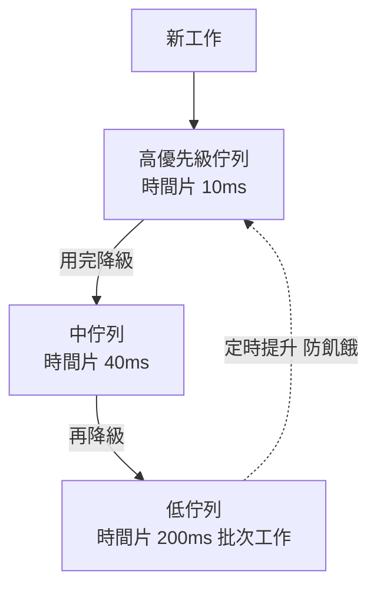
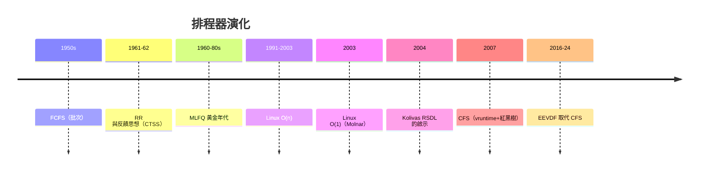

# 經典排程演算法演進：從簡單的先來先服務（FCFS）、多級反饋佇列（MLFQ）到 Linux 的完全公平排程器（CFS）

## 排程的三元困境

排程器面對一組永遠互相衝突的目標：**吞吐量**（單位時間完成的工作量）、**回應時間**（互動使用者的等待）、**公平性**（資源分配的公正）。任何一項的極大化都會犧牲其他——這個三元困境是六十多年排程演算法史的引擎。本節沿著理論與工程兩條線，走完從 FCFS 到 CFS 的演化。

## 第一代：FCFS 與 SJF 的理論起點

**先來先服務（FCFS）** 是批次時代的自然選擇：排隊、按序執行。它公平（先到先做）、簡單，卻有致命的**護航效應（convoy effect）**：一個 24 小時的批次工作排在前面，後面一秒鐘的互動工作全部陪葬。

理論家的回答是 **SJF（Shortest Job First，最短工作優先）**：數學上可證明 SJF 最小化平均等待時間。但 SJF 需要預知工作長度——除了少數嵌入式場景，這是無法兌現的預言。工程上的妥協是 **Round-Robin（RR，時間片輪轉）**：每人跑一個時間片就換人。RR 誕生於 CTSS（見 2.3 節），是分時系統的排程基石；時間片的取捨直接體現三元困境：片太短→切換開銷吞噬算力；片太長→回應變慢。

## 第二代：多級反饋佇列（MLFQ）的黃金年代

1962 年，Corbató 的 CTSS 論文已展示「按行為調整優先級」的反饋思想（2.3 節）；1960-70 年代，此思想被系統化為**多級反饋佇列（MLFQ）**，成為數十年間最成功的通用排程器：

規則看似簡單卻暗藏智慧：**新工作進最高佇列**（假設是互動）；**用完整時間片者降級**（被判為 CPU 密集）；**提前讓出者留在高層**（被判為 I/O 密集）；**定期提升所有工作**（防止飢餓，也讓長批次工作最終能跑）。MLFQ 用「過去行為預測未來」巧妙繞開了 SJF 的預知難題——它是**排程版的機器學習**。

但 MLFQ 也留下兩個經典難題，成為其掘墓人的出發點：其一，使用者可以** gaming 排程器**（每 99% 時間片主動讓出，永久霸佔高優先級）；其二，「優先級」這個整數本身語義模糊——**優先級 10 憑什麼比優先級 5 多用一倍 CPU？** 沒有清晰的公平定義，調參淪為黑魔法。UNIX 各流派（SVR4 的分時類別、BSD 的動態優先級）在 MLFQ 路線上迭代了三十年，Windows 至今仍是 MLFQ 家族。

## 第三代：Linux 的 O(n) 時代與 O(1) 排程器

Linux 的排程器演化本身就是一部微縮史：

- **v0.x-2.4：O(n) 排程器**——每次調度掃描全部可執行行程找最高優先級。數百行程時尚可，伺服器上萬行程時成為瓶頸；
- **2.6（2003）：O(1) 排程器**（Ingo Molnar）——用位元圖與優先級陣列實現恆定時間挑選，配合互動性啟發式（interactivity heuristics）獎勵睡眠中的行程。它效能驚人，但啟發式日趨複雜，**「什麼是互動性」的判定公式改了又改，互動體驗仍時常糟糕**。2000 年代中期，桌面使用者的抱怨（音樂跳針、滑鼠卡頓）成為改變的動力；
- **2004 年的醞釀**：匈牙利工程師 **Con Kolivas** 的 RSDL（Rotating Staircase Deadline Scheduler）以「階梯輪轉」實現無黑魔法的公平，廣受桌面使用者好評但未進主線。Kolivas 的業餘堅持（他本人是醫師！）與其被拒的經歷，成為開源社群史的著名插曲——**它證明了公平排程的渴望是真實的市場需求**。

## 第四代：CFS 與「公平」的嚴格化

2007 年，Ingo Molnar 親手替換自己寫的 O(1) 排程器，推出**完全公平排程器（Completely Fair Scheduler, CFS）**，進入 Linux 2.6.23（2007 年 10 月）。CFS 的哲學轉向堪稱教科書案例：

**1. 廢棄「時間片」，改用「虛擬運行時間（vruntime）」。** 每個行程記帳一個 vruntime（實際運行時間按其權重折算），排程器永遠挑 **vruntime 最小者**執行。理念直白如烏托邦：**系統力圖讓每個行程的 vruntime 相等——這就是「完全公平」的數學定義**。優先級不再是神秘的整數，而是明確映射為「你每單位實際時間獲得多少 vruntime 折扣」（nice 值經權重表轉換，nice +1 約少分 10% CPU，可預測）。

**2. 用紅黑樹實現 O(log n)。** 可執行行程按 vruntime 排序放在紅黑樹中，最小者即最左節點，挑選 O(log n)（且實務上有快取）。

**3. 組群排程（group scheduling, 2008 起）。** 公平不只對行程，還對「使用者/容器」——同一使用者的十個行程不得搶走單行程使用者的資源份額。**公平的單位從行程升級為利益主體**，這正是雲時代排程的前奏。

**4. 後記：CFS 也被取代了。** 2023 年，Linux 6.6 以 **EEVDF**（Earliest Eligible Virtual Deadline First，1995 年由 Ion Stoica 與 Hussein Abdel-Wahab 等人發表的學術演算法，由 Molnar 排程器團隊的 Peter Zijlstra 引入主線）替換 CFS：CFS 的公平在高延遲敏感場景（桌面音訊、遊戲）表現不理想，EEVDF 在公平之外加入**虛擬期限**，兼顧延遲。CFS 統治 16 年後功成身退——**排程器沒有永遠的王者，只有當下約束下的最優**。

## 尾聲：排程即政治的現代版

從 CTSS 的終端活動訊號，到 MLFQ 的行為推斷，到 CFS 的記帳公平，再到 EEVDF 的延遲期限，排程演算法的每一步都對應著計算社會形態的變遷：分時是「公民平權」，伺服器時代是「吞吐優先」，桌面時代是「互動敏感」，雲端時代是「組群配額與多租戶隔離」（Kubernetes 的資源請求/限制，10.2 節，正是 CFS 組群思想的延伸），AI 時代則要為 GPU 上的推理批次排程。**排程器是作業系統裡最接近「分配正義」的機構**——它對公平的定義變了幾次，人類對運算資源的理解就變了幾次。
