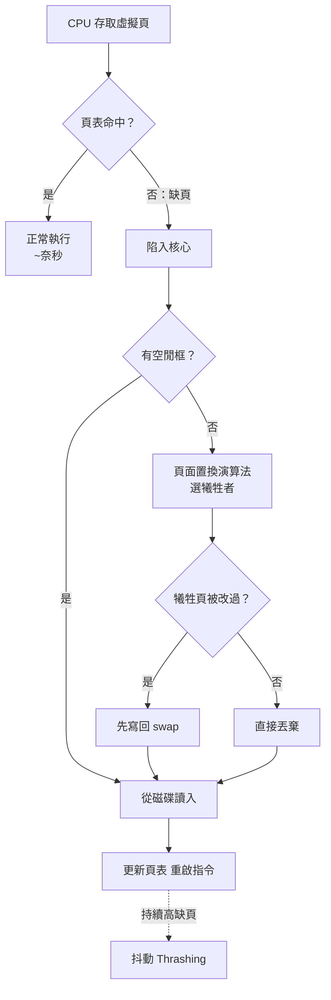
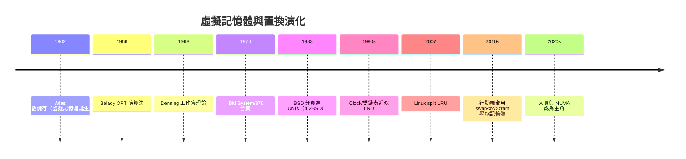

# 實體記憶體不足的解方：對換空間（Swap Space）與頁面置換演算法（LRU, FIFO）

## 從 Atlas 開始：虛擬記憶體的革命

1962 年，曼徹斯特大學與 Ferranti 合作的 **Atlas 電腦**交付了一項載入史冊的發明：**單級儲存（one-level store）**，即今日所稱的**虛擬記憶體**。Atlas 的工程師（Tom Kilburn 團隊）讓程式以為自己擁有龐大的連續記憶體，實際上硬體的分頁機制配合監督程式，把常用的「頁」留在磁鼓與核心記憶體、把不常用的移出去。程式設計師從此**不必再手工覆蓋（overlay）**——在那之前，程式大於記憶體意味著工程師要親手把程式切成段落、輪流載入，這是 1960 年代程式設計師的噩夢。

虛擬記憶體迅速成為標配：IBM System/370（1970）、VAX（1977）、以及 BSD 將分頁帶進 UNIX（4.2BSD，見 4.1 節）。今日所有現代作業系統的本質都是 Atlas 的孫輩：**以磁碟為後備，把稀缺的 RAM 放大成近乎無限的位址空間**。

## 對換空間：磁碟作為記憶體的保險庫

當實體記憶體耗盡，作業系統有兩條路：把**整個行程**換出（swapping，CTSS 時代的手法，粗獷但昂貴），或把**個別頁面**換出（paging，Atlas 之後的主流）。後者需要的磁碟區域就是**對換空間（swap space）**——Linux 的 swap 分區/檔案、Windows 的 pagefile.sys。

頁面在 RAM 與 swap 之間的往返由**缺頁中斷（page fault）**驅動：CPU 存取的虛擬頁不在記憶體 → 硬體陷阱進核心 → 核心從 swap 讀回頁面（可能先驅逐別頁）→ 重啟指令。整個過程對程式完全透明，但代價驚人：**一次硬缺頁的時間約為記憶體存取的十萬倍**（奈秒級 vs 毫秒級）。這個比例決定了記憶體管理的一切設計哲學：**缺頁率是最珍貴的指標**。當系統持續高頻換入換出，CPU 時間大部分花在搬頁而非計算——這種病態狀態稱為**抖動（thrashing）**，1960 年代的 IBM 系統就已被診斷出來，解方是工作集（working set）理論：**記憶體必須同時容納每個行程的「當前常用頁集合」，否則乾脆減少行程數**（Denning，1968）。

## 頁面置換演算法：從理論極限到工程現實

「驅逐哪一頁」是記憶體管理的核心決策，演算法譜系清晰：

**1. OPT（Belady 演算法，理論極限）。** 1966 年 Laszlo Belady 證明「驅逐未來最久不會用到的頁」是最佳策略——但未來無法預知，OPT 只能用作其他演算法的評分基準。

**2. FIFO 與 Belady 反常。** 最簡單的驅逐最早進入的頁。FIFO 的反例是著名的 **Belady 反常**（1969）：某些存取序列下，**給更多頁框反而缺頁更多**——這個反直覺結果證明 FIFO 缺乏堆疊性質，學術界由此理解「為什麼置換演算法需要精緻化」。

**3. LRU（最近最少使用）。** 用「過去」近似「未來」：驅逐最久未使用的頁。理論上優雅，實作上昂貴——精確 LRU 需要在每次記憶體存取時更新鏈結串列，硬體做不到。工程妥協是**近似 LRU**：x86 等硬體在頁表項提供**參考位元（accessed bit）**，被存取時硬體置位；核心定期掃描清位，以位元組合近似使用頻率。

**4. 時鐘演算法（Clock / Second Chance）。** 把頁框排成環形，指針掃過時：參考位元為 1 → 清零並放行（給第二次機會）；為 0 → 驅逐。**這是 Berkeley 的 BSD 在 4.3BSD 中使用的方案**（BSD 早期的 pagewire 實現亦採用類似思路），以極低成本逼近 LRU，至今仍是教科書最愛。

**5. 工程的再進化：Linux 的雙鏈表與掃描抵抗。** Linux 用 **active/inactive 雙 LRU 鏈表**加第二次機會機制，讓活躍頁免於反覆掃描；CFS 排程器作者之外的記憶體子系統維護者（如 Andrea Arcangeli 的 split LRU，2007-2008）進一步區分檔案頁與匿名頁——**檔案頁（如程式碼）可直接丟棄、從磁碟重讀；匿名頁（堆疊資料）必須寫 swap**，兩者成本不同，應區別對待。現代核心甚至支援 zswap/zram：**用壓縮演算法把頁壓進 RAM 內的壓縮池**，用 CPU 換 I/O——行動裝置（無實體 swap）依賴此路線。

## 經濟視角：Swap 的興衰史

對換空間的命運隨硬體經濟學數次起落，極具啟發：

- **1960-90 年代**：RAM 以 MB 計價，swap 是標配救命稻草。「機器夠不夠快，先看 swap 用了多少」是系統管理員的口頭禪；
- **2000 年代**：RAM 便宜化，桌面 Linux 社群流行「swap 設成 RAM 的兩倍」的舊規則被質疑；伺服器甚至出現 swap=0 的極端配置（寧可 OOM 殺行程，不要抖動）；
- **2010 年代**：行動革命翻轉一切——**Android 與 iOS 皆不使用傳統磁碟 swap**（快閃記憶體的寫入壽命與延遲都不合適），改用「殺行程」（OOM killer / 應用凍結）管理記憶體（見 9.1、9.3 節）；
- **同時代的伺服器**：雲端虛擬機的內存過度承諾（overcommit）又讓 swap 以新形式回歸，且 **Kubernetes 節點**的 swap 支援（2023 年 1.28 版起 beta）成為熱門議題。

## 理論的深水區：頁面大小與 NUMA

工程細節裡藏著兩個深遠的歷史決定。其一是**頁面大小**：4KB 是 1970 年代的合理值（Atlas 頁 512 words、VAX 頁 512 bytes 的折衷演化），但 2020 年代的 128GB RAM 伺服器上，4KB 頁讓 TLB 成為瓶頸，催生**大頁（huge pages，2MB/1GB）與透明大頁（THP）**——半世紀前的尺寸決定，今日仍在償還技術債。其二是 **NUMA**（非一致記憶體存取）：多插槽伺服器上，跨插槽存取記憶體延遲倍增，核心必須「記憶體就近分配」——2000 年代 Linux 的 NUMA 支援（從 SGI 的超大機器需求而來）如今連筆電 CPU 都有 NUMA 拓撲。

## 結語：放大是幻覺，排隊是現實

虛擬記憶體與頁面置換的歷史，本質上是**用排隊理論對抗稀缺性**的工程史：把貴而小的 RAM 當作快取、把便宜而慢的磁碟當作後備、用「歷史行為預測未來使用」決定誰留下誰離開。這套邏輯與 1.3 節的 Spooling、7.3 節的排程一脈相承——**作業系統的半部歷史，就是把資源短缺轉化為排隊問題、再把排隊問題轉化為預測問題**。當 AI 時代的顯存（HBM）再次成為天價稀缺品，GPU 的記憶體管理正在重演同樣的劇本（見 10.3 節）——Atlas 的幽靈，五十年後仍在每一層新的儲存金字塔上巡邏。
