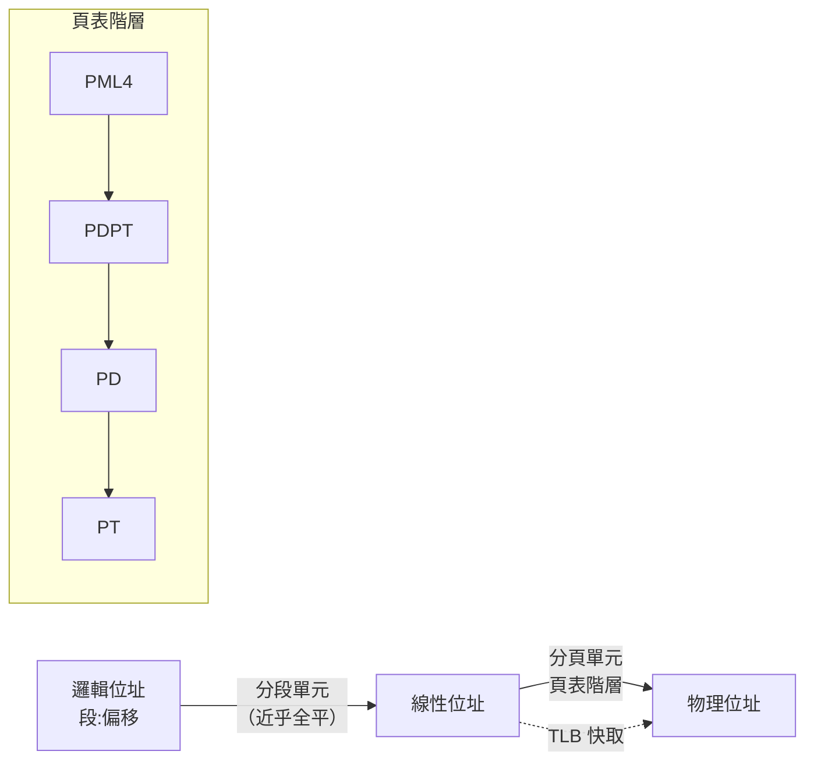
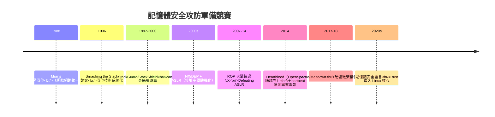

# 保護模式、段頁式記憶體管理與零日漏洞防範

## 兩層憲法的分工：分段與分頁

現代記憶體保護的硬體契約由兩層機制構成，理解其分工就理解了半部系統安全史。

**分段（segmentation）** 是 1960-80 年代的第一代方案：程式按邏輯單位（程式碼、資料、堆疊）劃分為段，每段有基址與界限，越界即觸發保護例外。Intel 80286（1982）以分段為核心賣點——16 位元暫存器配上 24 位元的段基址，號稱定址 16MB 且具硬體保護，這是「保護模式」一詞的由來（相對於 8086 的「真實模式」）。

**分頁（paging）** 則是 Atlas 傳下來的方案（8.1 節）：把位址空間切成固定大小的頁，透過頁表對映到物理記憶體，天然支援虛擬記憶體。

80386（1985）的歷史決定是**兩者並存**：邏輯位址 → 段轉換 → 線性位址 → 頁轉換 → 物理位址。但這個「段頁式」的完整威力很快被簡化：1980 年代末的作業系統（包括 Linux）採取**平坦模型**——把所有段的基址設為 0、界限設為最大，**讓分段名存實亡，只用分頁**。原因很工程：分頁支援按需載入與對換，分段則笨重且可移植性差。x86-64（AMD，2003）乾脆把長模式的段機制閹割到只剩形式——**分段從主角淪為遺跡**，只在大歷史（如 32 位元時代的 segments in Linux 的 TLS 支援）與少數特殊用途（GDTR 中的系統段、用於核心切換與使用者/核心區分）中存續。

## 保護環與特權架構：硬體版的權力分立

保護模式的靈魂是**特權等級（privilege rings）**：x86 提供四環，0 為最高特權。實務上所有現代 OS 只用兩環：**ring 0 給核心，ring 3 給使用者**（1、2 棄用——Unix 微核心陣營曾想用中間環跑驅動，從未主流，呼應 5.3 節）。環之間的跨界必須經過受控通道：系統呼叫（trap）與中斷。這個設計與 1950 年代末的兩模式機制（1.2 節）一脈相承，是**數位憲法中最根本的權力分立條款**：使用者態行程不能執行特權指令（如載入頁表、關中斷、存 I/O 埠），越權立即觸發硬體陷阱。

分頁單元補上第二道防線：每個頁表項帶有**保護位元**——存在位、讀寫位、使用者/管理者位、NX（不可執行）位。作業系統用這些位元實現各種魔法：寫時複製（8.3 節）、零頁共享、堆疊不可執行（對抗緩衝區溢位攻擊的 **NX/DEP**，2000 年代初普及）。

## 虛擬化：在憲法之上再立憲法

保護模式的下一步邏輯推演是虛擬化：**讓多個作業系統同時跑在一台機器上，彼此隔離**。1974 年，IBM 的 Popek 與 Goldberg 發表經典定理，定義了虛擬機器的形式條件（敏感指令必須是特權指令的子集）。IBM 大型主機在 1960-70 年代已實現（CP/CMS，Virtual Machine Facility）——**虛擬化其實比微核心更早**，只是 1980 年代因單一 OS 足夠強大而沉寂。

x86 的挑戰在於其指令集有 17 條「敏感但非特權」的指令，破壞了 Popek-Goldberg 條件。1998 年，史丹佛的 **VMware** 用二進位翻譯繞過此限制（商品化），學界則有 Xen（2003，劍橋，半虛擬化——要求客體 OS 修改）與硬體廠商的終極回應：**Intel VT-x 與 AMD SVM（2005-2006）** 新增 root/non-root 兩層模式，硬體直接支援虛擬化——**保護環之外又加了一環**。Linux 的 KVM（2007 併入主線）把核心變成 hypervisor；今日的雲端（AWS EC2 等）整體架構立在這個「雙層憲法」之上（10.1 節將講容器如何在其上再疊一層）。

## 零日漏洞：憲法的漏洞被發現之日

再完美的硬體保護也有被攻破的一天。**零日漏洞（zero-day）** 指廠商尚不知情、無補丁可用的漏洞——攻擊者的黃金窗口。記憶體安全漏洞是零日攻擊的主力，其歷史本身就是一部攻防軍備競賽：

這場競賽的三個歷史階段值得細看：

**第一階段（1988-2005）：軟體邊界之戰。** 1988 年 Robert Morris 的蠕蟲利用 fingerd 的緩衝區溢位癱瘓了網際網路的一成，這是**安全意識的啟蒙事件**（Morris 也因此成為依《電腦詐欺與濫用法》被起訴的第一人，其父親恰是當時 NSA 的首席科學家——歷史的黑色幽默）。防禦隨之演進：棧保護（canary）、不可執行堆疊（NX）、位址隨機化（ASLR，2001 年 PaX 計畫首創，2007 年 Windows Vista/Linux 主流化）。

**第二階段（2007-2018）：硬體信任的崩塌。** 攻擊者發現不必攻破邏輯——**CPU 微架構本身就是側信道**。2018 年 1 月的 **Spectre 與 Meltdown** 震撼世界：投機執行（speculative execution）與快取的微觀狀態，能洩漏核心記憶體甚至跨虛擬機的資料。**這是保護模式的哲學性失守**：頁表權限檢查得再嚴格，硬體投機執行的副作用仍留下了指紋。防禦（KPTI、retpoline、微碼更新）造成全球 5-30% 的效能損失——**1985 年以來保護模式的效率紅利，被三十多年後的微架構漏洞一次性部分收回**。

**第三階段（2019-至今）：換語言與換硬體。** 業界逐漸承認：**70% 的嚴重 CVE 源於記憶體安全問題**（微軟與 Google 的統計），而補丁文化永遠慢於攻擊者。解方有二：其一，**記憶體安全語言**——Rust 憑所有權系統在編譯期杜絕資料競爭與懸垂指標，2022 年起正式進入 Linux 核心（Torvalds 親自批准），Android 的統計顯示 Rust 化元件的記憶體漏洞占比驟降；其二，**硬體記憶體標籤**——ARM MTE（Memory Tagging Extension，2019）在硬體層為每個指針貼標籤，越界立即現形。

## 結語：保護的辯證法

從 286 分段的優雅設計，到平坦分頁的務實簡化，到 VT-x 的憲法重修，再到 Spectre 的哲學失守與 Rust 的語言補憲——記憶體保護的歷史反覆印證一個辯證法：**每一層保護的建立，都同時創造了新的攻擊面；每一次攻擊面被利用，都催生更高層次的抽象防禦**。零日漏洞不可消滅，能被縮短的只有「發現到修復」的窗口——而這正是作業系統作為「數位憲法」的永恆工作：**憲法寫得再好，都需要常設的修憲機制**。今日的 OS 安全更新、子系統沙盒（9.3 節）與供應鏈簽章，都是這部活憲法的修訂條款。
