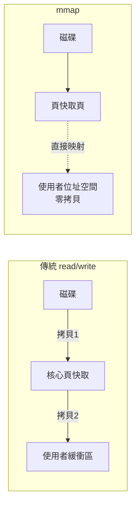
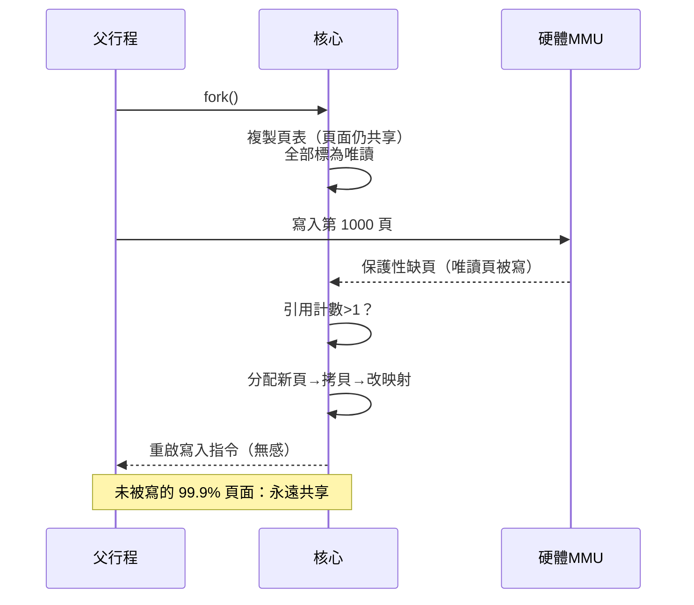

# 記憶體對映檔（Memory-mapped Files）與寫時複製（Copy-on-Write, CoW）的高效魔法

## mmap：把檔案變成記憶體的魔法

1979 年，SunOS 的工程師（Robert Gingell 等人）為解決 UNIX 的一個老問題引入了 **mmap**：把檔案（或匿名記憶體）**直接映射進行程的位址空間**，此後讀寫檔案就像讀寫陣列。這個介面後經 4.2BSD/4.3BSD 的虛擬記憶體改造（4.1 節）與 POSIX 標準化（4.3 節），成為現代系統的基礎設施。

傳統 `read/write` 的成本帳單：資料從磁碟 → 頁面快取（核心空間）→ 使用者緩衝區，**兩次拷貝、兩次模式切換**。mmap 則省去中間人：頁面快取的頁**直接映射**進使用者位址空間，一次拷貝都不需要——資料從磁碟到使用者手中，只經過一次硬體的頁表翻譯。對大型檔案的隨機存取（資料庫、編輯器、搜索引擎索引），差距是數量級的。

mmap 的深層意義是**統一了兩個世界**：檔案系統與虛擬記憶體——**磁碟上的頁與記憶體中的頁是同一物件的兩種形態**。這個統一（呼應 3.3 節「一切皆檔案」的兄弟理念：「檔案也是記憶體」）的工程落點是**統一的頁面快取（unified page cache）**：4.4BSD 的 VM 系統（由 CMU 的 Mach VM 程式碼移植改造）率先把 buffer cache 與 VM 合一，Linux 的 page cache 同理。資料庫（如早期的 SQLite 與一些 LSM 引擎）、共享函式庫（.so 的程式碼頁天然被多行程共享，只佔一份實體記憶體）、以及**核心鏡像自身**的載入，全部站在 mmap 的肩膀上。

## 寫時複製：fork 得以存在的魔法

**寫時複製（Copy-on-Write, CoW）** 是作業系統史上性價比最高的技巧之一，其思想可追溯到 1960 年代（Tenex 系統的實踐），成熟於 4.3BSD 與 Mach VM。

原理：**複製資源時先不複製，共享同一份；直到有人要「寫」，才真正複製被寫的那一頁**。實現靠分頁硬體：把共享頁的頁表項標為唯讀；寫入觸發保護性缺頁；核心檢查引用計數——若 >1 就分配新頁、拷貝內容、改寫頁表，然後重啟指令。使用者完全無感。

CoW 的第一個受益者是 **fork()**（7.1 節）：複製整個位址空間只需複製頁表（微秒級），頁面本身共享。沒有 CoW，UNIX 的行程模型（fork 大量用於建立子行程執行命令）會昂貴到不可用——**shell 的每一次命令啟動、Apache 的每一個請求行程、Redis 的 RDB 快照**，都依賴 CoW。Redis 的案例特別典型：BGSAVE 用 fork 建立快照，記憶體中幾十 GB 的資料瞬間「複製」，實際只拷貝頁表——代價只是寫入期間逐漸增長的 CoW 頁。

## CoW 的推廣：從記憶體到整個系統

CoW 的思想外溢到系統的每個層次，成為「惰性求值」在系統軟體的化身：

- **虛擬記憶體零頁**：映射未初始化記憶體時直接指向系統共用的全零頁，寫入才分配真實物理頁——**上 GB 的空堆棧區間，實際佔用幾乎為零**；
- **檔案系統的快照**：Sun 的 ZFS（2005）、Linux 的 Btrfs（2009）、Google 的專有系統與現代雲端快照，全部以 CoW 為底層——「快照」之所以瞬間完成，因為只是共享舊資料塊、新寫入另闢新塊；
- **虛擬機與容器鏡像**：VM 快照（VMware 的 linked clone）、Docker 容器層（overlayfs，10.1 節）——鏡像只存一份，容器各自的寫入進入 CoW 層。**KSM（Kernel Same-page Merging，2009）** 更進一步：掃描記憶體找出內容相同的頁合併（反向 CoW），一個虛擬機跑百台相同 Windows 時記憶體銳減——1950 年代的「共享程式庫」思想在資料層的轉世；
- **GPU 與 AI 推理**：統一記憶體架構（CUDA UVM）用 CoW 式按需遷移頁面，讓超大模型「假裝」住進不足的顯存（10.3 節的前哨）。

## 效能與代價：魔法的賬單

這些魔法並非免費，它們的代價構成了系統調優的日常課題：

1. **缺頁風暴**：mmap 的首次存取逐頁觸發軟/硬缺頁；fork 後的 CoW 頁在寫入密集場景（如 Redis 大快照期間）造成可觀的記憶體膨脹與延遲尖峰；
2. **TLB 與頁表壓力**：共享與惰性依賴大量頁表項與引用計數，記憶體管理的常數開銷上升；
3. **透明大頁的爭議**：THP（透明大頁）想用 2MB 大頁降低 TLB 壓力，卻因 CoW 粒度變粗（寫一個字節要複製 2MB）在資料庫與 Redis 上引發延遲災難——**Redis 作者 antirez 公開建議關閉 THP**，成為雲原生運維的經典條目。魔法粒度的取捨，從來是零和遊戲；
4. **安全反噬**：共享頁與推測執行結合成新的側信道（Forkserver attack、Cross-VM 攻擊），CoW 的「暫時共享」正是 Spectre 類攻擊的溫床之一（8.2 節）。

## 歷史的統一敘事：惰性是效率之母

回望本節，mmap 與 CoW 展示了作業系統設計的第三條元律（前兩條見 1.3 與 8.1 節）：**當資源昂貴時，最好的策略不是省著用，而是「用時才付費」**。從 CTSS 的換出（被迫的粗粒度惰性），到 demand paging（頁級惰性），到 CoW（物件級惰性），到零頁與去重（內容級惰性），**惰性（laziness）被不斷精煉為越來越細粒度的技術**。這條線索在雲端時代到達新的高度：虛擬機的記憶體氣球（memory ballooning）、無伺服器函式的冷啟動快照（AWS Firecracker 的快照恢復，毫秒級喚醒整個行程樹）、乃至 AI 模型權重的按需載入——**都是「先共享、用時再付費」這個 1960 年代思想的當代續章**。作業系統的真正魔法，不是把事情做得更快，而是把「不做」偽裝得足以亂真。
