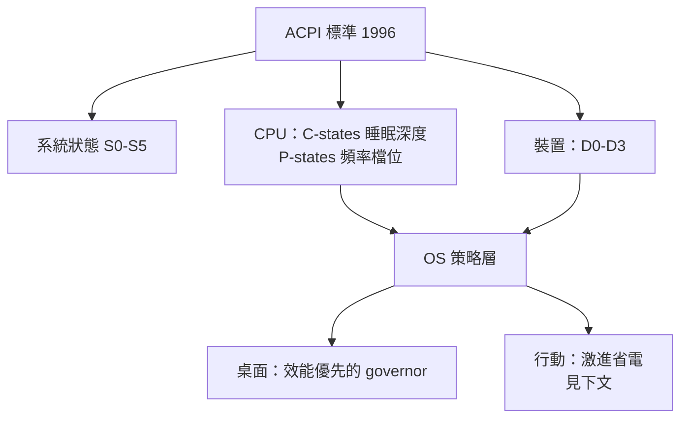
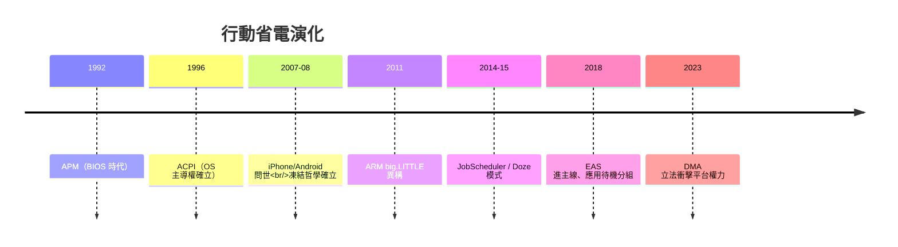

# 功耗、續航與行動裝置的殘酷限制：作業系統如何重新定義電池管理與休眠機制？

## 行動革命翻轉了 OS 的價值序列

2010 年代的行動革命，迫使作業系統重寫它的價值函數。桌面時代的排序是：效能 > 回應 > 功耗；行動裝置上這條序列**整個顛倒**——電池容量（iPhone 4 約 1,400 mAh、初代 Android 機器相近）限制了總能量預算，而使用者期待「一整天」。**OS 的首要任務從「把 CPU 用滿」變成「讓 CPU 儘量不動」**——這是 1960 年代以來（見 1.3 節的效率危機）作業系統目標函數的第一次根本性翻轉。

殘酷的物理現實決定了一切：

- **漏電流隨頻率與電壓上升**：CMOS 的動態功耗 ∝ CV²f，跑得越快燒得越多；
- **射頻是最貪婪的**：3G/LTE 基頻晶片的耗電可達 CPU 的數倍，且從待機喚醒到滿速有數秒的「尾部能量」（tail energy）——傳一次 1KB 的資料，喚醒基頻的成本可能超過傳輸本身；
- **螢幕與 GPU 同樣昂貴**，但至少可調光調幀。

**任何一次不必要的喚醒都在燃燒電池**——這條鐵律催生了一整套新的 OS 技術棧。

## 從 APM 到 ACPI：休眠的硬體契約

桌面時代的先聲是 1990 年代的省電標準：Intel 與微軟的 **APM**（Advanced Power Management，1992）讓 BIOS 介面級地管理電源，但職責不清；1996 年的 **ACPI**（Advanced Configuration and Power Interface，Intel/Microsoft/Toshiba 共同制定）徹底制度化——OSPF 不再是被動角色，而是**電源管理的主人**：定義了系統睡眠狀態 S0-S5、裝置電源狀態 D0-D3、處理器狀態 C0-Cn 與效能狀態 P0-Pn。ACPI 讓 OS 可以說出「把這個裝置降到 D3、把 CPU 放進 C2」這種精細指令——**硬體的能源介面第一次被標準化**（POSIX 式的標準化邏輯，見 4.3 節，延伸到了電池世界）。

處理器的微觀狀態機是省電的核心：**C-states**（C0 執行中，C1 停時鐘，C3 停快取，C6 掉電保存狀態……）與 **P-states**（頻率/電壓檔位）。OS 的 idle 迴圈與 **governor**（如 Linux 的 `ondemand`、`schedutil`）不斷在「反應快」與「睡得深」之間算帳：睡得越深，喚醒延遲越大。**省電調度本質上是在能量與延遲之間做即時最佳化**。

## 行動 OS 的省電兵法：三大發明

行動世代在 ACPI 之上發明了三件套：

**1. 激進的任務凍結（app freezing / suspended execution）。** Android 的早期哲學：使用者按 Home 後，應用行程保留記憶體但**完全凍結**（不排程）；iOS 更早走極端：**前台應用是唯一公民**，退到背景者多數被直接凍結或終止（iOS 的行程模型天生是 9.3 節「生命週期管理」的一部分）。後續演化：Android 6.0 的 **Doze 模式（2015）**——裝置靜止且無互動時，系統進入深度休眠，把應用的喚醒、網路、Job Scheduler 全部延後、批量合併成「維護窗口」；Android 9 的**應用待機分組（2018）**按使用頻率給應用分桶（活躍/工作集/常用/罕用），罕用者受嚴厲配額。**OS 從公平的資源分配者，變成了行為分級的紀律管理者**。

**2. 喚醒鎖與喚醒治理。** Android 引入 **wakelock**（應用可申請「別讓 CPU 睡」），但這個權力很快被濫用——背景應用頻繁喚醒裝置（「wake alarm 風暴」）成為耗電元兇，Android 的版本更新持續收緊（JobScheduler 2014、WorkManager 2018、背景執行限制 Android 8.0 2017）。**「背景」在行動語境下被重新定義為特權**——桌面時代天經地義的背景常駐，成為需要申請配額的稀有資源。

**3. 晶片級的異構省電：big.LITTLE。** ARM 的 **big.LITTLE 異構架構（2011，ARM 宣布）**：效能核（大核，跑得快耗電多）+ 效率核（小核，慢但省電），OS 必須把前景互動放進大核、背景與低優先級工作放進小核。這讓排程器（7.3 節的 CFS）長出 **EAS（Energy Aware Scheduling，2018 前後進入 Linux/Android 主線）**——**排程的目標函數加入了每瓦效能（perf/watt）模型**。這是運算史上第一次，排程器的決策直接以「焦耳」為單位計價。

## 歷史的深意：供應鏈與生態的權力重組

電池管理的歷史也重組了產業權力。**晶片商（ARM、Qualcomm）開始深入 OS 領域**（提供 big.LITTLE 調度建議、DSP 協處理器、以及後來的異構 AI 單元）；**OS 廠商掌握了應用生殺大權**（Google 可用背景限制與 Play 商店政策直接裁決應用的存亡）；而**開發者的自由被系統性讓渡**——桌面時代「我的行程我做主」的 UNIX 倫理（3.3 節），在行動平台上變成「平台准許什麼你才能做什麼」。這場權力轉移在 2020 年代引發了真實的立法戰場：歐盟《數位市場法》（DMA, 2023）要求蘋果與 Google 開放側載與替代應用商店——**電池管理政策與市場壟斷指控在法律文書上首次同框**（例如 App Store 對背景下載的限制被論證為自我偏好）。

## 結語：從「算力管理」到「能量經濟學」

行動時代教給作業系統的新課題，是**能量成為一級公民資源**：它有存量（電池）、有漏損（尾部能量）、有異構供應（大小核、DSP、NPU 各有能效曲線）。OS 的角色從算力分配者演進為**能量經濟學家**——每一個喚醒、每一次射頻發射、每一幀渲染都要入帳。這套能量經濟學即將迎來最大的考驗：**AI 推理**。當 NPU 與 GPU 的功耗曲線更陡峭、當每個應用都想喚起神經網路推理時，今日的 Doze 模式與待機分組是否夠用？下一節，我們先看行動 OS 雙雄如何在這片新大陸上劃分勢力範圍。
