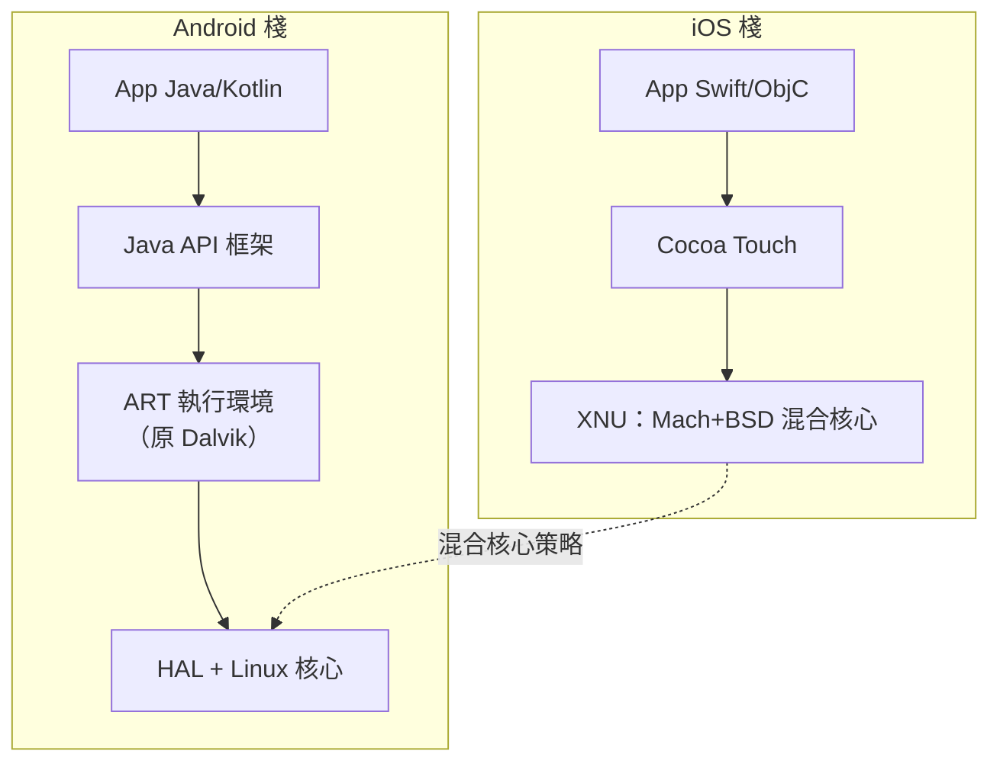
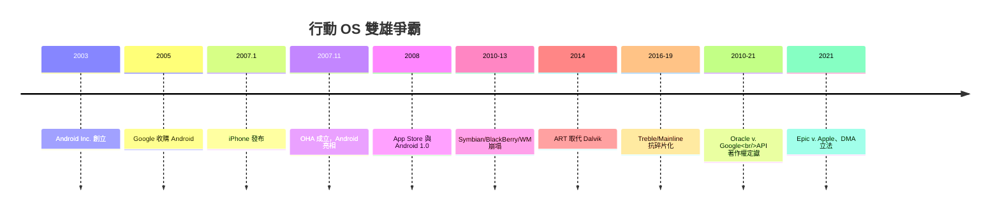

# Google Android（Linux 核心 + Dalvik/ART 虛擬機）與蘋果 iOS（XNU 核心 + Cocoa 框架）的雙雄爭霸

## 兩種出身：開源混血 vs 一體化帝國

2007 年是行動 OS 歷史的分水嶺：1 月，賈伯斯發布 iPhone（OS X 手機版，次年更名 iPhone OS、2010 年定名 iOS）；11 月，**開放手機聯盟（OHA）** 由 Google 領銜成立（34 家廠商：HTC、三星、摩托羅拉、高通……），Android 正式亮相。兩者的血統截然不同，這種血統差異決定了此後十五年的產業格局。

**Android 的血統是「Linux + 市場收購 + 生態結盟」。** Android Inc. 由 Andy Rubin 等人於 2003 年創立（原目標是相機軟體），2005 年被 Google 收購。Google 選擇 **Linux 核心作為硬體抽象層**——享受其成熟的驅動生態與開源授權（GPL 對核心強制開放，但上層的 Apache 授權允許廠商客製封閉）。核心之上，Android 並非傳統 Linux 發行版：**沒有 X11、沒有 glibc（用自製的 Bionic libc，規避 LGPL 传染）、沒有 bash**——Java 應用跑在 **Dalvik** 虛擬機（Dan Bornstein 主導設計，針對行動裝置的暫存器式 VM，不同於棧式 JVM）之上。2005 年 Sun 的 Java 授權談判破裂後，Google 依 Apache Harmony 的類庫自建體系——此舉日後引發 Oracle 訴 Google 的世紀訴訟（2010 年起，關於 Java API 著作權，2021 年美國最高法院以公平使用終結，**API 的著作權地位自此定讞**——這是 4.3 節 POSIX「介面 vs 實作」法律哲學的現代判例）。

**iOS 的血統是「NeXTSTEP + 桌面 OS 的縮小化」。** iPhone OS 的核心 **XNU** 是 1989 年 NeXT 購自 CMU 的 Mach 微核心（5.3 節）與 4.3BSD 的混合物——喬布斯 1997 年重返蘋果帶回的 NeXTSTEP 遺產。其上的框架層（Cocoa Touch，Objective-C，後加 Swift）與 Xcode 工具鏈構成垂直整合的整體。**賈伯斯的哲學：硬體、OS、應用商店一體控制**——與 Google 的「開放生態收割使用者」形成哲學對決。

## Dalvik 到 ART：行動執行環境的技術軍備

虛擬機層的演化最能體現行動約束下的工程演化：

- **Dalvik（2008-2014）**：JIT（即時編譯）為主，省記憶體、省儲存，但每次執行都有編譯開銷；
- **ART（Android 5.0，2014）**：**安裝時預編譯（AOT）**——應用安裝時直接編成機器碼，執行零編譯開銷，代價是安裝慢與儲存翻倍；Android 7.0（2016）進化為 **JIT+AOT 混合**，用設定檔引導（profile-guided）只編譯熱路徑——**這與桌面 JIT 的技術譜系（Java HotSpot、.NET）同一血統，卻因行動的電池與儲存約束走出了獨特形態**（見 9.1 節的能量經濟學）。

## 雙雄的分岔路：四大戰場

**戰場一：開放 vs 控制。** Android 以 **Apache 授權**開放 AOSP，任何廠商可免費拿走——這是對抗 iOS 的絕佳武器：2010 年前後，諾基亞 Symbian、RIM BlackBerry、微軟 Windows Mobile 在智能手機市場的份額崩塌，正是因為**免費且夠好的 Android 把作業系統的商品化了**（承 4.3 節的邏輯：當介面被標準化、實作被免費化，廠商鎖定即瓦解）。Google 的商業模式不在 OS 授權費，而在**搜尋、Play 商店與 GMS（Google Mobile Services）的生態收租**。iOS 則以封閉換取體驗與利潤：App Store（2008 上線）30% 抽成成為蘋果服務營收的支柱，也成為 Epic Games 訴訟（2020-2021）與全球反壟斷調查的靶心。

**戰場二：碎片化 vs 一致性。** Android 的開放導致**碎片化**：數千種機型、數十個 Android 版本並存、安全補丁延遲數月。Google 的應對是持續的架構下移：**Treble 專案（Android 8.0，2017）** 把廠商 HAL 與系統框架用 HIDL 介面凍結分離，讓系統更新不依賴驅動重建；**Mainline 模組（Android 10，2019）** 把部分系統組件變成可透過 Play 更新的模組；Project Mainline 之後，**安全補丁的下放**逐步改善。iOS 的垂直整合沒有此問題（補丁覆蓋率長期遠高於 Android），但犧牲了裝置多樣性。

**戰場三：核心的趨同。** 有趣的歷史軌跡是：兩大陣營在底層越走越近。iOS 的 XNU 始終是 Mach+BSD 混合（4.1 節 BSD 遺產的直接後裔）；Android 的 Linux 核心則吞併了大量原本在上層的職能（Binder IPC、ion 記憶體分配、低記憶體殺手 LMK 後被核心態的 PSI 資訊與 lmkd 取代）。兩者都要回答同樣的行動難題：**如何在異構硬體（大小核、GPU、NPU）上做能效排程**（9.1 節 EAS）——雙方殊途同歸。

**戰場四：應用開發範式的內卷。** iOS 的 Objective-C/Swift 與 Android 的 Java/Kotlin 各有體系；跨平台的誘惑催生了 HTML5（2010-2012 的失敗浪潮）、Xamarin、React Native（2015）、Flutter（Google，2017，Dart 語言+自繪引擎，**繞過原生 UI 棧**）——**應用層的「虛擬機化」不斷重演**（呼應 7.2 節的執行緒演化與 5.3 節的抽象層疊加）。2020 年代，兩平台各自擁抱宣告式 UI：SwiftUI（2019）與 Jetpack Compose（2021）——**React 的函數式 UI 哲學被原生世界正式收編**。

## 歷史帳本：為什麼是雙雄而不是三雄或一雄

到 2020 年代，行動 OS 市場形成穩定的雙寡頭（Android 裝置量約七成、iOS 約二成多，營收上 iOS 佔大頭）。歷史淘汰名單觸目驚心：**Windows Phone（2010-2017）** 擁有世界最強的桌面軟體公司與充足的資本，仍宣告失敗——原因並非技術（其核心 NT 系譜堅實），而是**生態網絡效應的雞生蛋困境**：應用開發者不投資沒用戶的平台，用戶不買沒應用的平台。微軟以 72 億美元收購諾基亞（2013）後全數減記，微軟 CEO 納德拉後來稱放棄手機是「最艱難的決定」之一。**行動 OS 之戰的本質不是技術戰，而是兩個正回饋生態的搶灘戰**——Android 靠免費開源搶下所有硬體廠商，iOS 靠品牌與利潤守住高端，兩者恰好把整個光譜夾死，第三者無縫可入。

## 結語：行動 OS 是憲政形態的實驗場

Android 與 iOS 的雙雄爭霸，本質上是兩種**數位憲政形態**的大規模社會實驗：一個以開源核心+封閉服務的「聯邦制」（廠商自治但受 GMS 契約約束），一個以垂直整合的「帝國制」（一切由蘋果裁決）。兩者都繼承了作業系統的完整歷史遺產——Linux 的宏核心與 Mach 的微核心血統、POSIX 的介面哲學、沙盒的安全制度（9.3 節）——卻在最終的權力分配上走向光譜兩端。**它們的成敗證明：在平台經濟時代，作業系統的競爭力一半寫在核心代碼裡，另一半寫在商業契約、法律與生態政治裡**。而無論哪種憲政，都必須先回答沙盒與權限的問題——那是下一節的主題。
