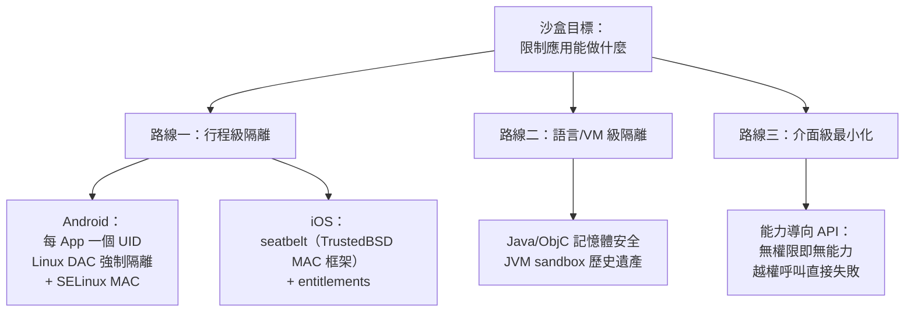
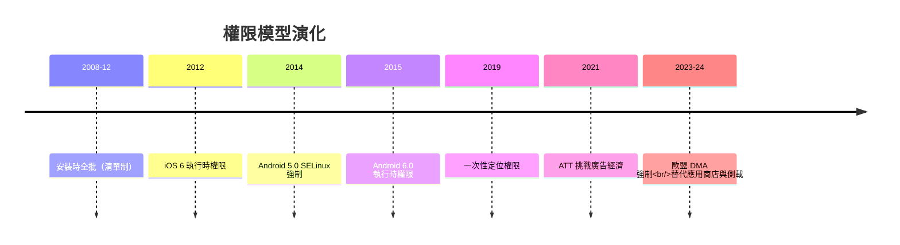

# 沙盒機制（Sandbox）、權限管理與應用程式生命週期管理的神經中樞

## 從 UNIX 的信任模型到行動的零信任

UNIX 的安全模型誕生於 1970 年代的學術烏托邦：**使用者是信任的邊界**——同一個使用者的所有行程可以互相讀寫（同 UID 即同權限）。這個模型在多使用者主機上合理，在行動裝置上卻是災難：你的手機裡，一個手電筒 App 與你的簡訊、相簿、聯絡人以**同一使用者身份**共存，按 UNIX 傳統它本可讀取一切。

行動平台因此進行了一場憲政革命：**信任的邊界從「使用者」下移到「應用」**。每個 App 就是一個自治領地，預設對其他領地零權限——**零信任架構在 2008 年就有了作業系統級的實現**（比企業 IT 圈流行零信任概念早了十年）。支撐這場革命的是沙盒技術。

## 沙盒的三條技術路線

**Android 的做法**最直接：每個應用安裝時分配**獨立的 Linux UID**（如 `u0_a42`），核心的傳統 Unix 檔案權限（DAC）立刻把 App 彼此隔離；Android 4.3 起引入 **SELinux**（美國 NSA 主導的強制存取控制，MAC）——2014 年 Android 5.0 強制全域啟用「enforcing」模式，用策略語言規定「哪個網域（App）能碰哪種標籤（檔案/服務）」——**NSA 的安全工程成為全球最大消費平台的底層**，這是軍民技術轉移的當代經典案例。

**iOS 的做法**更精緻：**Seatbelt** 沙盒源自 MAC 計畫（2005 年，NSA 與賓州大學合作的 TrustedBSD 研發），每個 App 的檔案系統視野、IPC 能力、網路存取都被 profile 白名單約束；**entitlements**（權利清單，簽名嵌入二進位）決定能否使用 iCloud 推送等系統服務——**蘋果連 App 能呼叫哪些 API 都要簽章批准**，這是「能力導向安全」（capability-based security）思想的商業化巔峰。

**生命週期管理**則是沙盒的時間維度：行動 App 不是「啟動後常駐」，而是**被系統隨時暫停、凍結、驅逐的租客**。iOS 的 `AppDelegate` 生命週期（willResignActive → didEnterBackground → didReceiveMemoryWarning…）與 Android 的 Activity 生命週期（onPause → onStop → onDestroy…）把「系統有權隨時收回你的執行權與記憶體」制度化了——這是 9.1 節省電哲學的 API 化。**低記憶體殺手（LMK/OOM killer）** 按優先級（前台 > 可見 > 服務 > 快取）清理行程，配合 8.1 節「行動端無 swap」的記憶體策略，構成行動記憶體管理的完整生態。

## 權限模型的三次革命

權限管理在十五年間經歷了三次範式轉移，每次都是**信任結構的重組**：

**第一次：安裝時全批（Android 1.0-5.0 / iOS 早期）。** 安裝時彈出清單「此 App 需要：讀取簡訊、定位、聯絡人……」，同意即全給。問題顯而易見：使用者要麼不看、要麼全點——**烏合之眾的同意不是同意**。2012 年美國 FTC 對 Flashlight App 濫用定位的調查、以及學界「為什麼人們點同意」的經典研究（Acquisti 等人），推動了轉型。

**第二次：執行時逐項授予（iOS 6/2012、Android 6.0/2015）。** App 在**需要時**才彈出單一權限對話框，使用者可拒絕且 App 不得崩潰。這個制度變革的深意：**權限從一次性契約變成持續談判**——作業系統成為 App 與使用者之間的常設法庭。

**第三次：一次性與自動裁決（2019-至今）。** iOS 13（2019）的「只許這一次」定位、Android 10-14 的「僅使用中允許」「精確/模糊定位」「照片部分授權」、iOS 14.5 的 **App Tracking Transparency（2021）**——每一次細化都在削弱應用對使用者的監控能力，而這些修改**本質上是 OS 對整個廣告經濟的行政干預**（Facebook 曾登報抗議 ATT，2021 年；Meta 估算 ATT 使其年度營收損失約 100 億美元量級）。**權限對話框成為萬億美元產業的調節閥**——這是作業系統權力史上最戲劇性的時刻之一。

## 沙盒的滲漏與攻防

沙盒從未完美，它的歷史就是一部滲漏史與補漏史：

- **側信道**：2017-18 年的 Spectre/Meltdown（8.2 節）證明 CPU 微架構可穿透一切沙盒；行動平台上 JS 計時攻擊（如 2015 年的 Rowhammer.js 研究）展示瀏覽器沙盒同樣脆弱；
- **間接洩漏**：應用讀不到聯絡人，但可讀「剪貼簿」（iOS 14 才加提示）、可讀已安裝 App 清單（Android 11 收緊）、可透過感測器指紋識別裝置（加速度計校準差異）——**沙盒關上一扇門，側門就成為主門**；
- **沙盒逃逸與提權**：iOS 的越獄（jailbreak）與 Android 的 root 漏洞攻防持續十五年，催生了賞金計畫（Apple Security Bounty，2019 起，單一漏洞最高百萬美元）與漏洞經紀市場（Zerodium 等）——**0day 的市場定價**成為新的灰色經濟（NSO 的 Pegasus 間諜軟體利用 iOS 零點擊漏洞監控記者與政要，2021 年被 Project Zero/Amnesty 揭露，引發國際政治風波）。

這些攻防推動了架構的深化：iOS 引入 **PAC（Pointer Authentication Codes，A12 晶片起硬體指針簽章）**、MTE（8.2 節 ARM 記憶體標籤）；Android 引入 **Scoped Storage（2019-2021，App 不再能自由讀整個共享儲存）** 與 **Hardened malloc**——**隔離的粒度從行程下探到指針與記憶體塊**。

## 結語：神經中樞的意義

回望本章，沙盒、權限與生命週期構成了行動 OS 的**神經中樞**：它決定誰能感知什麼（權限）、誰能執行什麼（沙盒）、誰何時存在（生命週期）。這套制度的三個深遠遺產值得記錄：其一，**零信任從學術理想變成數十億人的日常現實**——每個使用者在彈出對話框時，都在行使一次微型憲政投票；其二，**作業系統獲得了前所未有的社會權力**——它能裁決 App 的存亡（下架）、監控的合法邊界（ATT）、甚至產業的財富流向（商店抽成），這種權力已進入反壟斷與立法視野（DMA、Epic 案）；其三，**沙盒思想開始外溢回桌面與伺服器**：macOS 的 App Sandbox、Windows 的 AppContainer 與 UWP、瀏覽器的 site isolation、乃至容器的隔離（10.1 節）——**行動平台發明的憲法，正在成為整個數位世界的通用法**。
