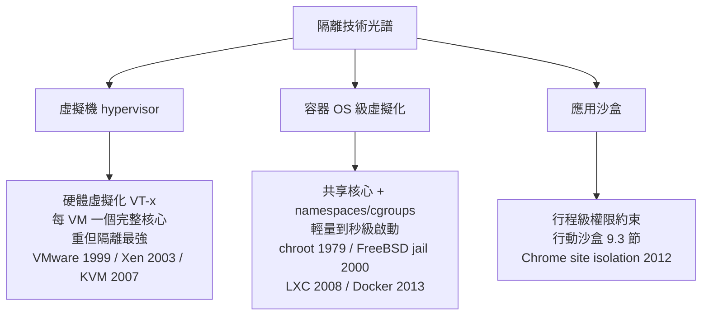
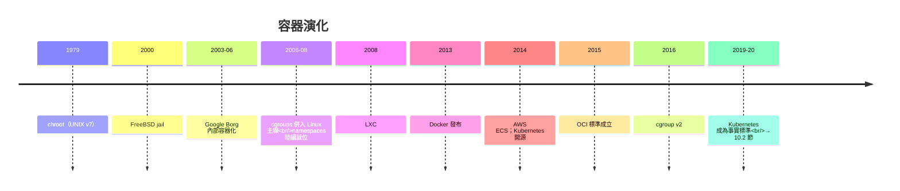

# 從機器虛擬機到容器核心：Linux cgroups 與 Namespaces 如何重新定義作業系統邊界？

## 三種隔離的系譜：VM、容器與沙盒的憲法分野

要理解容器，先看清隔離技術的光譜。2010 年代的「雲原生革命」實質上是**三條隔離路線的競爭與合流**：

容器不是新發明——**chroot**（1979，Bill Joy 的 UNIX 第七版）已能改變行程的根目錄；**FreeBSD jail**（2000）與 Solaris Zones（2004）完善了 OS 級虛擬化；**Google 從 2003-2006 年開始在內部把一切工作負載跑進容器**（Borg 系統，2015 年論文公開，其基因直接孕育 Kubernetes）。真正的歷史轉折是 **2013 年 3 月，Solomon Hykes 在 PyCon 的五分鐘演示**：Docker 把 Linux 核心的 namespaces/cgroups 打包成「`docker run` 一行命令」——**技術早已存在，Docker 發明的是開發者體驗與鏡像分發（Registry、Dockerfile、不可變鏡像層）**。六個月內 Docker 成為 GitHub 最熱門專案，2014 年 AWS 推出 ECS，雲原生革命正式啟動。

## Namespaces：偽造一整個作業系統的視野

**Namespace** 的本質是**對系統全域資源做「按行程分組的視圖隔離」**——每個 namespace 內的行程以為自己獨享整台機器。Linux 陸續提供的六（後加至八）種 namespace 構成容器的憲法條款：

| Namespace | 隔離內容 | 歷史 |
|---|---|---|
| mount | 檔案系統掛載點 | 2002（Linux 2.4.19） |
| UTS | 主機名與網域 | 2006 |
| IPC | System V IPC 物件 | 2006 |
| PID | 行程編號空間（容器內 PID 1） | 2008（2.6.24） |
| network | 網卡、路由、防火牆規則 | 2008 |
| user | UID/GID 映射（root 降權） | 2012-2013 |
| cgroup（ns） | cgroup 視圖 | 2016 |
| time | 時鐘偏移 | 2020 |

這份表格藏著一段漫長的制度演化：Linux 的 namespace 支援是**自 2002 年起、由虛擬化需求（OpenVZ/VServer 等前輩專案的實踐）與安全需求（user namespace 讓容器內 root 並非真 root）逐條推動的**——它不是一次性的設計，而是十五年「以核心補丁促主線接納」的漸進立法。容器內的 PID 1 之謎（init 行程的角色與訊號處理）、mount namespace 與 **overlayfs**（多層鏡像：唯讀基層+CoW 寫層，8.3 節的檔案系統轉世）等細節，共同把「一個行程」包裝成「一台機器」的幻覺。

## cgroups：資源的配額憲法

Namespace 解決「看得見什麼」，**cgroups**（control groups）解決「用得了多少」。2006 年 Google 工程師 Paul Menage 與 Rohit Seth 提交了「process containers」補丁，2007 年併入主線時更名 cgroups；2016 年的 cgroup v2 統一了層級語義。它為每組行程提供四類配額：

- **CPU**：shares/配額（底層就是 CFS 的組群排程，7.3 節！cgroup 是 CFS group scheduling 的直接用戶）；
- **記憶體**：上限+OOM 行為（8.1 節的記憶體管理擴展）；
- **block I/O**：磁碟頻寬；
- **裝置存取**：device whitelist。

**cgroups 與 namespaces 的組合，在宏核心內部實現了微核心夢寐以求的隔離**（5.3 節的判決在此獲得歷史平反）——只是隔離的單位不是「伺服器行程」而是「資源視圖+配額」。Docker 容器的本質，用一行話說：**一組被 namespaces 重新框定視野、被 cgroups 限定預算、以 overlayfs 疊層提供檔案系統的普通 Linux 行程**。沒有第二個核心、沒有硬體虛擬化——輕如鴻毛（毫秒級啟動、個位數 MB 開銷），重如鐵幕（生產環境的隔離等級卻低於 VM，2019 年 runC 漏洞 CVE-2019-5736、2022 年容器逃逸案例提醒世人：共享核心即共享命運，安全關鍵場景仍需 gVisor/Kata 這類「沙盒容器」補強）。

## 重新定義作業系統邊界：三個哲學後果

容器革命的深遠之處，在於它改寫了三個作業系統的憲政前提：

**1. 「一台機器一個 OS」的崩塌。** 傳統憲法下，OS 是機器的唯一主權者；VM 讓多個 OS 共存，容器則更進一步——**多個「準系統」在同一核心內共存**。OS 的定義從「管理硬體的軟體」變成「管理資源視圖的軟體」：**邊界不再由硬體劃定，而由核心的會計帳本劃定**。

**2. 應用與環境的綁定（immutability）。** 「在我的機器上能跑」是軟體工程永恆的痛（依賴地獄，呼應 3.2 節的組合困境）；Docker 鏡像把**應用+運行時+函式庫+設定**凍結為不可變成品——**部署單位從「程式」變成「檔案系統快照」**。這是函數式程式設計的不可變性思想在部署層的勝利，也是 DevOps 運動（2009 年起）「基礎設施即代碼」的技術基石。

**3. 排程與計費的對象上移。** 雲端廠商按容器/VM 小時計費（AWS Lambda 更以函式毫秒計費，2014），cgroup 的會計資料成為商業計費的原始憑證——**CTSS 的按量計費（2.2 節）在六十年後以 `docker stats` 的形式回歸**，只是計量的對象從 CPU 秒擴展到 CPU、記憶體、網路、GPU 的全維度。

## 結語：容器的父親是誰

容器革命的因果鏈橫跨四十年：chroot 給了根目錄、jail/Zones 給了實踐、Google Borg 給了規模驗證、cgroups/namespaces 給了核心機制、Docker 給了開發者體驗、Kubernetes 給了編排與治理（下一節）。**每一代人都以為自己在發明新東西，實際上都在為同一個古老想法——「安全地共享一台機器」——添磚加瓦**。而當容器成為部署的原子單位，下一個問題自然浮現：成千上萬的容器散布在成千上萬的機器上，誰來當它們的政府？——分散式作業系統的時代來臨了。
