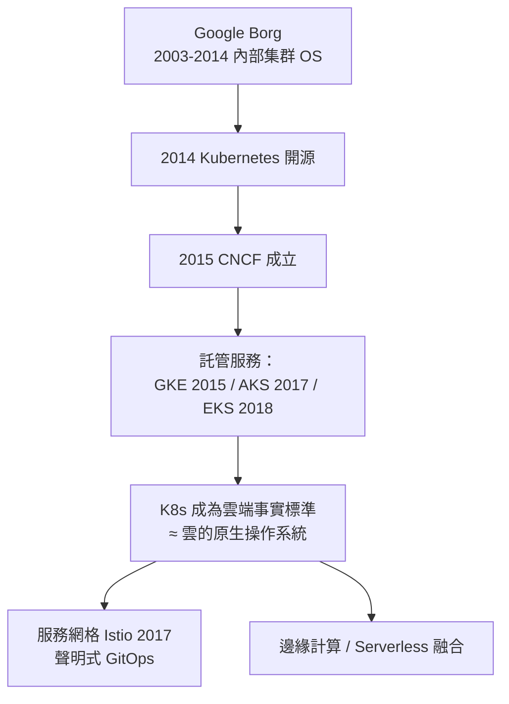
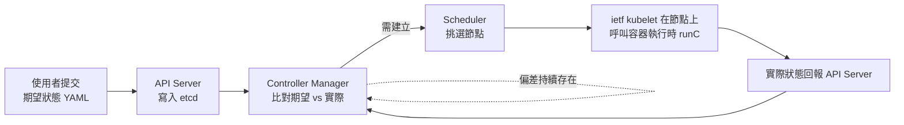

# 分散式作業系統（如 Kubernetes）：把整個資料中心的成千上萬台機器視為一台巨大的「虛擬作業系統」

## 從單機憲法到行星尺度憲法

當容器（10.1 節）成為部署原子，一個老問題以新規模復活：**誰來排程、誰來管記憶體、誰來確保公平與存活？**答案是**分散式作業系統**——把數千甚至上百萬台機器抽象為一台巨大的虛擬電腦。這個夢想有清晰的歷史家譜：

- **1990 年代**：MIT 的 JMachine 與 Berkeley 的 NOW（Network of Workstations）計畫嘗試把工作站集群當單機；
- **2000 年代**：Google 的 **MapReduce 論文（2004，Jeff Dean 與 Sanjay Ghemawat）**與 **GFS（2003）** 展示了「處理器 Cluster 即電腦」的工程現實；Amazon 的 **EC2（2006）** 把這種能力商品化出租——**McCarthy 的「電腦公用事業」夢（2.1 節）在此兌現**；
- **2015 年，Google 公開 Borg 論文**，證實其內部自 2003 年起就用一套集群作業系統管理一切工作負載——**這是分散式 OS 的第一份正式「憲法草案」**。

## Kubernetes 的誕生：Borg 的開源轉世

2014 年 6 月，Google 開源 **Kubernetes**（希臘語「舵手」）。工程背景耐人尋味：主導者 **Brendan Burns、Joe Beda、Craig McLuckie** 都有 Borg 經驗，他們決定以證實過的叢集管理**概念模型**（Pods、標籤、副本控制器、排程器）為骨幹，用 **Go 語言**重寫為開源系統——名字本文獻感的巧合：**Docker 提供了容器，Kubernetes 提供了「艦隊指揮權」**。

其演化的推力來自**經濟結構**：2014-2015 年，雲端遷移已成大勢，但**廠商鎖定**（vendor lock-in）是企業的最大恐懼——如果把工作負載綁死在 AWS 專有介面上，議價權歸零。Kubernetes 以**開源中立的抽象層**扭轉戰局：同一套 YAML 可以跑在 AWS、GCP、Azure 或自建機房。微軟（2017 年將 AKS 建立在 AKS 引擎上）、Google、AWS、阿里雲相繼提供託管版——**標準化邏輯（4.3 節 POSIX）在雲端時代重演：誰的介面成為通用法，誰就贏得平台戰**。2015-2018 年，CNCF（Cloud Native Computing Foundation，作為 Linux 基金會的託管組織成立）接管 Kubernetes，捐贈者包括 Google 競爭對手；到 2020 年代，Kubernetes 成為**「雲端的 Linux 核心」等級的事實標準**，CNCF 生態中的專案數量超過 150 個。

## 巨型虛擬 OS 的解剖：Kubernetes 移植了哪些單機概念

Kubernetes 的深刻之處，在於它**把單機作業系統的核心概念逐一放大**——這是本書「作業系統=數位憲法」主題的最佳當代例證：

| 單機 OS 概念 | Kubernetes 對應物 | 治理邏輯 |
|---|---|---|
| 行程 (process) | **Pod**（一組共享網路/儲存的容器） | 排程的最小單位 |
| init / systemd | **API Server + etcd** | 全叢集狀態的唯一真相源（分散式 KV，Raft 共識） |
| 排程器 CFS（7.3） | **kube-scheduler**（bin-packing + 親和性 + 資源請求/限制） | 把 Pod 放到合適節點 |
| 檔案系統 mount（8.3） | **Volume / PersistentVolume** | 儲存抽象為可宣告的資源 |
| IPC（3.3 管道） | **Service / DNS / 網路策略** | 行程間通訊的叢集級管道 |
| rlimits / ulimit | **ResourceQuota / LimitRange** | 租戶配額 |
| watch / inotify | **watch API + operator 模式** | 事件驅動的狀態同步 |
| 系統服務（cron） | **CronJob / DaemonSet** | 常駐與定時服務 |

Kubernetes 的**聲明式哲學**值得細看：你不說「啟動三個副本」（命令式），而說「**期望狀態：三個副本在跑**」（聲明式）。控制迴圈（controller）持續比對「期望 vs 實際」，差異即偏差，自動修復。**「觀察-判斷-行動」的回授迴路取代了單機 OS 的指令流**——這借鑒了 1960 年代就已有的自癒系統思想（ATLAS 的 supervisor、IBM 的 OS/360 重啟機制），但把它推到叢集尺度。**整個資料中心被治理成一台「輸入期望、輸出現實」的巨型機器**。

## 新的自由與新的枷鎖：分散式 OS 的代價

Kubernetes 統治叢集的同時，也帶來了單機 OS 從未有的難題——它們大多源自**CAP 定理**（Eric Brewer 提出，2000，Gilbert 與 Lynch 2012 證明）：一致性（Consistency）、可用性（Availability）、分區容忍（Partition tolerance）三者不可兼得。

1. **狀態同步的深淵**：etcd 用 Raft 共識保證 API Server 層一致，但 Pod 的實際狀態（節點上的容器）與宣告狀態永遠存在延遲窗口——**「最終一致」成為新憲法的默認條款**，工程師必須重新訓練直覺；
2. **網路即新瓶頸**：Pod 網路（CNI、overlay 網路如 VXLAN）的效能損耗、服務發現的 DNS 抖動、跨區流量成本——**網路取代 CPU 成為第一級資源**；
3. **配置的巴別塔**：YAML 版本地獄、Helm 圖表（2016）、服務網格（Istio 2017，把流量治理下沉到 sidecar proxy; eBPF 的取代方案如 Cilium, 2018）——**治理層的複雜性呈指數成長**；
4. **「複雜性太平洋」之辯**：CNCF 的 Kelsey Hightower 名言「Kubernetes 是平臺，不是產品」；2020 年代初的「NoK8s 運動」（如 Airbnb 遷出部分工作負載，2022）與 HashiCorp Nomad、AWS Fargate 的輕量替代方案的呼聲，展示**集中化治理的代價同樣真實**。

## 結語：從 OS 到「作業系統之母」

分散式作業系統的歷史意義，在於把作業系統的概念做了**第二次升維**（第一次是 XL→VM 的硬體抽象，第二次是集群→服務的地理抽象）：**行程變成 Pod、排程變成 bin-packing、檔案系統變成物件存儲/Volume、殼變成 YAML、核心變成 API Server**。但這場升維也繼承了所有前輩的宿命：**每一次抽象的勝利，都以新的一層失效模式為代價**（SRE 實務中稱為「複雜性預算」）。當 2020 年代末，AI 工作負載（見 10.3 節）以 GPU 為稀缺資源闖進 Kubernetes 的世界時，這套誕生於 CPU/記憶體時代的憲法又必須再度修訂——誰能為 GPU 做排程與配額？誰能為百億參數的模型放置分片？下一節，我們將見證 K8s 精神如何與 AI 異質算力碰撞出新世代作業系統的雛形。
