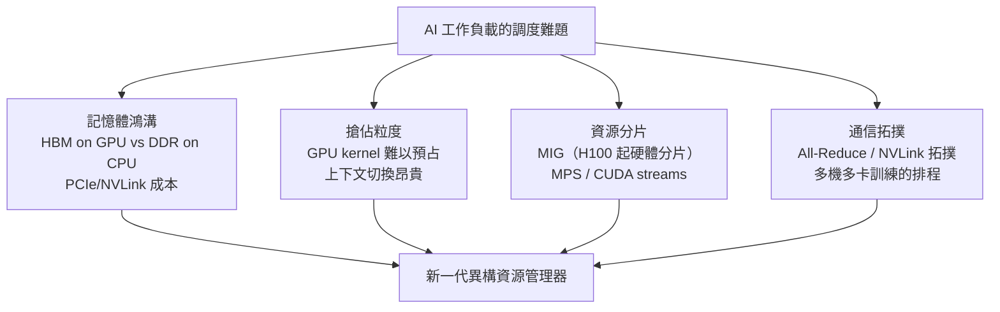
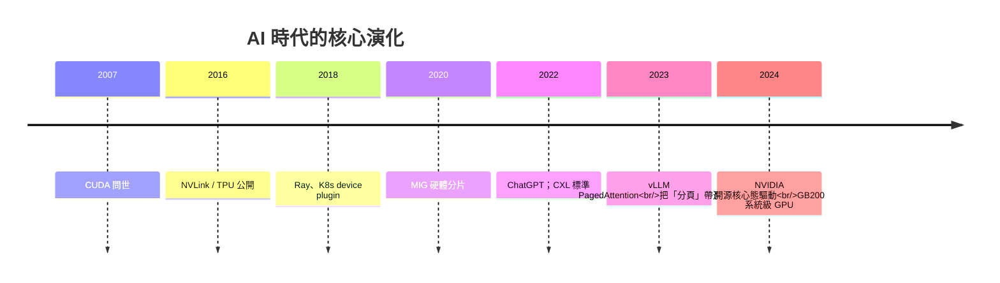

# AI 異質運算與作業系統的未來：當作業系統必須直接調度 GPU、NPU 矩陣算力時面臨的革命性轉折

## 為什麼是現在：三重匯聚的歷史時刻

2020 年代，作業系統面臨 1985 年（386 問世）以來最大的架構衝擊。原因有三：

1. **算力地形改變**：AI 工作負載的主體是**密集線性代數**——矩陣乘法。GPU（NVIDIA H100、AMD MI300）、TPU、NPU（蘋果 M 系列的 Neural Engine、手機 SoC 的 AI 單元）與商用 CPU 是完全不同的物種，其記憶體階層與排程粒度完全不同；
2. **資源的稀缺性翻轉**：2022 年 ChatGPT 之後，全球 HBM 顯存成為最搶手的戰略物資（H100 一度排隊數月，租用價格數倍於帳面成本）——**又一次印證：稀缺永遠催生新的作業系統職能**（呼應 1.3 節）；
3. **載體的形態變化**：過去 OS 的「行程」是長期運行的計算程序；今天的「推理服務」是**流式、批次、低延遲的微服務**，一個 LLM 的服務棧（tokenizer、prefill、decode、KV cache 管理）本身就是一套小型 OS。

## Heterogeneous Scheduling 的憲法難題

把 GPU/NPU 納入 OS 的管轄，本質上是要**修改「行程」的定義**。傳統行程的假設：可搶佔、狀態保存在 CPU 暫存器/記憶體、切換成本低（7.1 節）。而 GPU 的 CUDA 核心啟動（kernel launch）一旦放到 SM 上，搶佔粒度是**指令級或 warp 級**，上下文切換成本高達微秒到毫秒，**且 GPU 記憶體（HBM）與主存（DDR）之間隔着 PCIe/NVLink 的鴻溝**——Von Neumann 架構的統一記憶體假設破裂。

工程回應已經分批湧現，每一次都值得記錄：

- **CUDA 的十年霸權（2007-2022）**：NVIDIA 以 CUDA 工具鏈壟斷了開發者心智（**軟體護城河**概念的教科書案例），OS 層的治理反而退居幕後——GPU 驅動被批評為「比核心更大更黑」（NVIDIA 的閉源驅動、2022 年才開源核心態模組與 2024 年的完整開源之路）；
- **硬體虛擬化追隨而來**：NVIDIA 的 **vGPU**（對應 Intel VT-x 的邏輯：1.1 節虛擬化歷史的 GPU 版本）、**MIG（Multi-Instance GPU, 2020）** ——把 A100/H100 硬體級切成最多 7 個獨立實例，**硬體廠商開始親自定義「GPU 沙盒」**；
- **叢集層的資源調度器**：K8s 的 **GPU device plugin（2018）** 讓 GPU 成為可宣告資源（`resources: nvidia.com/gpu: 1`）；Volcano（華為牽頭，2019 加入 K8s 生態）補上了 gang scheduling（成組調度，訓練作業的 N 張卡必須同時起飛）；Ray（Anyscale/UC Berkeley RISELab，2018 開源）為 AI 任務提供更自然的資源宣告式介面——**這就是 10.2 節分散式 OS 針對 AI 的方言分支**；
- **多租戶與公平共享**：Slurm（HPC 的老牌 Scheduler，2000 年代起）在大模型訓練集群中依然強勢，與 K8s 構成 HPC 雲兩大陣營——**排程器的戰國時代重演（7.3 節）**。

## 系統棧的下層重建：從 PCIe 到 CXL、從 batch 到 spec decode

硬體層的變革同樣深刻，並與 OS 的演進共同推進：

**互聯的憲法重修**：PCIe 的頻寬早已不夠喂飽數據中心級 GPU——**NVLink（NVIDIA，2016 起）** 讓 8 張 H100 互相直連 900 GB/s，**CXL（Compute Express Link，Intel 主導，標準 2020 起）** 則試圖讓 CPU 記憶體與加速器記憶體**池化與共享**。2023-2024 年的 HBM3e、GB200 NVL72 的「一台機器 72 個 die」的**超大統一記憶體**——**記憶體管理單元（8.1-8.3 節）的邏輯正在 GPU 領域整卷重演**：頁面遷移、按需分配（CUDA UVM）、寫時複製的顯存版。

**推理服務的調度獨立成學**：vLLM 的 **PagedAttention 論文（2023，UC Berkeley）** 把 8.1 節的**虛擬記憶體與分頁字面應用於 KV cache**——把每個請求的注意力鍵值字典分頁管理，吞吐提升 2-4 倍；DeepSpeed/Megatron 的 ZeRO 分片（微軟，2020）、TensorRT-LLM 的 kernel fusion、Speculative Decoding（speculative sampling，2022-2023 學界推廣）——**每一次推理加速的本質，幾乎都是一次 OS 課程經典技巧（分頁、管線、快取、batching、工作合併）在 GPU 上的再發明**。

## 誰是新時代的作業系統？

回到本書的核心主題：**作業系統是資源抽象與治理的憲法**。AI 時代，這部憲法正在分散到多層：

- **硬體層的迷你核心**：GPU 的 SM 調度器、TPU 的占空比虛擬化（XLA 編譯器配合切片）、NPU 的實時喚醒（呼應 9.1 節的行動省電哲學）——每種矽上都有微內核；
- **驅動層的「巨型堆疊」**：CUDA、ROCm、oneAPI——**「驅動 = 作業系統」的新語義**；
- **叢集層的資源作業系統**：Kubernetes + Volcano + Ray + vLLM router；
- **應用層的「協作共享中心」**：RAG、Agent 工具鏈的排程（呼叫順序即資源請求序列）。

歷史的迴響清晰可循：**1960 年代的 IBM 用 OS/360 統一台主機的混亂（1.1-1.2 節），2020 年代的工程師正在用 CUDA/ROCm/K8s 統一異構晶片的混亂**——兩次都面臨「封閉 vs 開放」的路線之爭（AT&T 的重錘，與 NVIDIA 的軟體護城河），兩次都必將被新一代的開放標準部分擊穿（POSIX 的成功因子，見 4.3 節）——**PyTorch 2.0 的 compiler stack（2023）、ONNX（2017）、OpenXLA**，都是「介面層不依賴單一廠商」的現代 POSIX 嘗試。

## 結語：從排程時間片到排程矩陣

回顧全書，作業系統的每個時代都在回答同三個問題：**稀缺的是什麼？誰排隊？誰有權決定？** 1990 年代稀缺的是 CPU 時間，2000 年代稀缺的是頻寬與記憶體，2010 年代稀缺的是可靠與隔離，2020 年代稀缺的是**矩陣算力與顯存**。作業系統的角色不斷重寫，但憲法的本質從未改變：**在昂貴而稀缺的資源之上，建立秩序、公平與可預期性**。

當 2030 年代的作業系統課本裡，「Layered Architecture」旁邊寫的是 **「Heterogeneous Resource Orchestration」**，當 GPU 的 kv-cache defrag 成為工程師的日常詞彙，當 K8s 的 scheduler 原生理解 token-level 粒度——那是作業系統作為人類數位文明的隱形治理機構，又一次面臨自身憲法的大修時刻。**我們正站在一次新演化的起點**——不是作業系統的終章，而是一批新憲法條文的起草之年。
