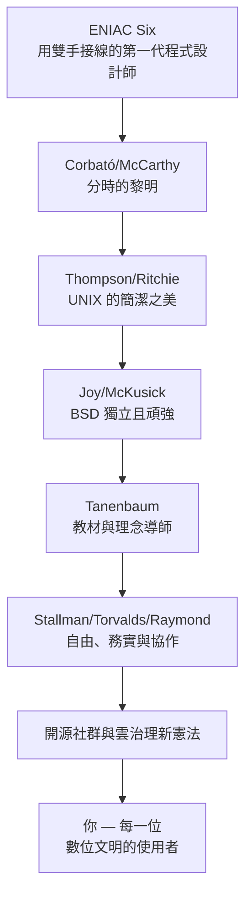

# 結語：從開關面板到全球資料中心——作業系統作為人類數位文明永恆的隱形守護者

## 七十年的距離感

1945 年，ENIAC 的女工程師們用一整天接線設定一個程式；2026 年，你在雲端服務上按下按鈕，背後是數萬台機器上的數百萬個容器瞬間完成排程、隔離與執行——**七十年的距離，是從「人工換帶」到「全球自動化憲法」的距離**。

回顧全書，我們可以從這段歷史中提煉出幾條貫穿始終的元律：

**元律一：稀缺催生制度。** CPU 等待 I/O 的浪費催生了緩衝與多道程式（1.3 節）；記憶體稀缺催生分頁與 CoW（8.1、8.3 節）；電池稀缺催生能量經濟學（9.1 節）；算力稀缺催生了 AI 資源作業系統（10.3 節）。**每一層作業系統的成長，都是一場稀缺資源的制度化治理**。

**元律二：抽象是最高槓桿。** 「一切皆檔案」用一組系統呼叫統一了宇宙（3.3 節）；POSIX 用一份介面契約統一了全球系統（4.3 節）；Kubernetes 用一種 YAML 宣告統一了資料中心（10.2 節）。**每次抽象的成功，本質上都是一場「概念經濟學」的勝利**——用最小的概念負擔撬動最大的系統複雜性。

**元律三：權力的重新設計與被利用。** 每一次保護環、沙盒、namespace 誕生，都是為了**限制某類主體的權限**；而每一次新的隔離邊界，都會被新一代的攻擊者（Spectre、容器逃逸）與新一代的立法者（DMA、Epic 案）挑戰。**作業系統的演化，同時是一部技術憲法與一部社會憲法的演化**。

**元律四：歷史偶然 + 制度必然。** Thompson 的一週（1969）、Torvalds 買的那台 386（1991.1）、Linus 發布的那則訊息（8.25）都有偶然性；但這些偶然必須逢上**正確的制度土壤**——反壟斷法律放出源碼、網路聯通、開放文化——才會成為文明事件。**偉大的軟體是技術與制度共同的結晶**。

## 人物的紀念碑

這七十年的舞台不只是系統，還有人：

## 給未來讀者的話

如果你正在使用 Windows、macOS、Linux、Android、iOS，或在寫第一行 `docker run`、第一份 YAML、第一個 CUDA kernel——**你其實正活在這些歷史的既成結果之中**。

下一次，當你打開終端機輸入 `ls | grep | sort`，當你按下電源鍵，當你點同意一個 App 的權限，當你在雲端跑一個訓練作業——你可以停下來想想：這個動作背後，是一整部七十年憲法經驗的沉澱：**是 Corbató 的時間片、Thompson 的管道、Ritchie 的 C、Kolivas 的公平渴望、Torvalds 的務實、Stallman 的道德、Epic 的訴訟、CNCF 的開放治理、以及每一位你叫得出或叫不出名字的工程師**，共同寫下的結晶。

作業系統永恆，因為人類對「在稀缺的資源上建立秩序」的需求永恆。**從開關面板到全球資料中心，從機械開關到雲上的 GPU 農場，這部隱形憲法仍在被起草**——而下一個章節，正在此刻，被你（或與你同時代的人）寫下。

---

**參考的經典著作**（延伸閱讀）

- Tanenbaum：*Operating Systems: Design and Implementation*；*Modern Operating Systems*
- Silberschatz / Galvin / Gagne：*Operating System Concepts*（恐龍書）
- Kernighan & Pike：*The UNIX Programming Environment*
- Eric S. Raymond：*The Cathedral and the Bazaar*
- Richard Stallman：*Free Software, Free Society*
- Deborah G. Johnson & Keith W. Miller：*Computer Ethics*（作業系統與倫理的現代擴展）
- AJP 計算機史經典：*Computer: A History of the Information Machine*（Campbell-Kelly 與 Aspray）
