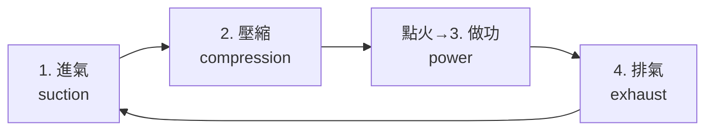

# 第 5 章　勒努瓦、奧托與四衝程循環

# 5.2 尼古拉斯·奧托與奧托循環：進氣、壓縮、做功、排氣的四衝程真諦

## 5.2.1 一個推銷員的北德行腳

**尼古拉斯·奧托（Nikolaus Otto, 1832–1891）**原是科隆的軋磨機與雜貨推銷員，因自學勒努瓦機改造而踏上工程之路。1862 年法國人**阿方斯·博·德·羅沙（Alphonse Beau de Rochas）**刊出「四衝程＋預壓縮」的**理論專利**（未實施即失效）——歷史在此重演了 4.3 的模式：**理論先行、工程後到**。

## 5.2.2 自由活塞（1866）與 1876 年的四衝程機

- **1866–69 年**，奧托與歐根·蘭根（Eugen Langen）造出「**自由活塞（atmospheric）機**」：燃氣爆炸推活塞被上托，由齒條與飛輪收回能量，於 1867 年巴黎萬國博覽會獲獎，並以「Gasmotoren-Fabrik Deutz」起家；
- **1876 年**才是真正的極點：**奧托四衝程壓縮機**投運。其循環：

預壓縮的意義可由理想循環效率看出：

$$
\eta = 1-\frac{1}{r^{\gamma-1}} \quad (r:\text{壓縮比})
$$

壓縮比 $r$ 越大效率越高——**這條公式定義了此後內燃機工程的全部主戰場**（初代奧托機 $r\approx 2.5$–3，效率約 10–14%，遠勝勒努瓦）。

## 5.2.3 專利戰與商業帝國

- 1877 奧托取得德帝國專利；但 1886 年德國高等法院裁定專利無效（四衝程概念因 Beau de Rochas 論著在前而不再具有新穎性）——**專利墜落使四衝程成為公共財，德國機器業（MAN、Krupp 及後來的 Benz、Daimler）得以爆發性投入**；
- Deutz（今仍存在的引擎巨頭之一，當時名 Gasmotoren-Fabrik Deutz）成為**德國動力工程師的黃埔**——戴姆勒、邁巴赫皆出自其地（5.3）；
- 四衝程機以煤氣起步，先後普及於工坊、農場與小型電廠，成為當時最普及的原動機之一。

## 5.2.4 前因後果

- 前因：勒努瓦（無壓縮）＋Beau de Rochas 理論＋北德煤氣網。
- 事件：1866 自由活塞、1876 四衝程、1886 專利失效。
- 後果：內燃機獲得競爭力；「高壓縮比」成為工程主戰場；德國工程教育與動力工程體系成形——下一節是把這引擎縮小到**裝上輪子**。

---

下一節：[5.3 戴姆勒與本茨](05.3-戴姆勒本茨.md)
