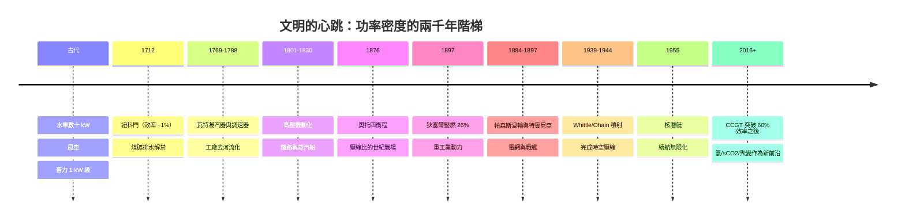

# 結語：永不熄滅的造物心臟——動力機器作為人類文明跨越時空的永恆引擎

## 一條兩千年的主鏈

把全書的動力節點連成一線，會發現它們其實是同一問題的連續逼近：

## 五條貫穿全書的規律

### 1. 效率是階梯，不是終點

從紐科門的 0.5% 到聯合循環的 60%+——每一次效率躍升都改寫能源的經濟地理：煤造就英國、油造就美國、天然氣聯合循環重排地表。

### 2. 動力一變，社會全變

蒸汽機去水車化 → 工廠城市；柴油機 → 集裝箱全球化；蒸渦＋發電機 → 24 小時文明；噴射 → 半日地球；核動力 → 續航無限化的軍事與能源結構。動力機器是社會制度的緩慢立法者。

### 3. 科學與工程互相饋養

巴本的理論先於加工與資本；瓦特的潛熱來自布萊克；卡諾的理論又反過來引導複脹機——動力的科學史就是「工程先行、科學補義」與「理論先行、工程落地」兩種節奏的反覆交替。

### 4. 極限即材料，材料即命運

鍋爐鋼、高壓活塞、單晶葉片、CMC——動力機器的每一次代際跳變，全是材料極限的跳變。熱效率的世紀旅程，本質上是一張冶金史的清單。

### 5. 制度保證安全，安全決定規模

塞維利的安全閥、里科弗的質量文化、核電三起事的制度學習——動力史也是一部**監管制度的進化史**；規模（功率、裝機、燃料吞吐）越放大，制度越成為真正的第一性約束。

## 一句總結

> 燧石手斧延長了手；工具機延長了工具；而動力機器延長了**意志**——從肌肉到原子，從河流到聚變，人類以每一次新的心臟向世界宣告：我們奔跑不再靠腿，而是靠黑匣子中燃燒的物理定律。

文明的動力半徑，就是文明本身的半徑。

---

全書完 ｜ 回到 [目錄](README.md)
