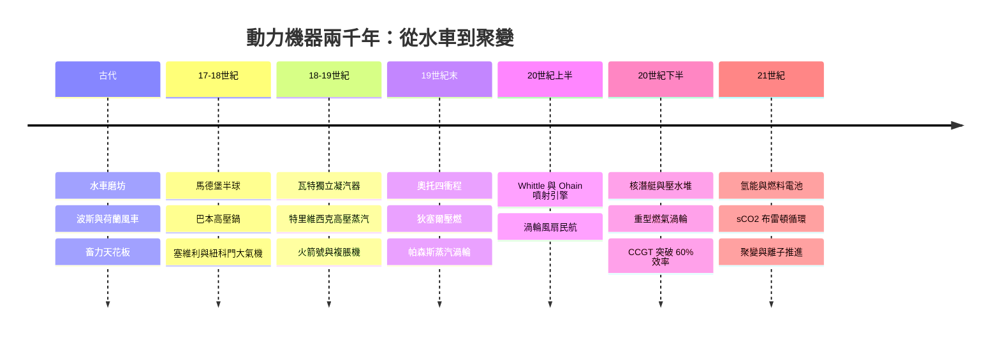

# 《動力機器的故事：從蒸汽咆哮、內燃機革命、噴射引擎到核能與次世代渦輪》

> 專為機械工程師、能源架構師、動力系統專家、科技史愛好者與全球工業文明觀察者設計的專題史。
>
> 「動力機器」（Power Machinery / Prime Movers）是人類文明擺脫生物肌肉限制、將自然界能量轉化為機械功的終極心臟。如果沒有動力機器的突破，工業革命將無從談起，現代城市、跨洋交通與電力文明更只是水中泡影。本書以歷史演進、能量轉換範式轉移與極限工程學突破為主軸，記錄人類如何從古代的水車與風車，走過蒸汽機的鋼鐵咆哮、內燃機的流動革命、蒸汽渦輪與水力發電的電網時代、噴射引擎的藍天征服，直到當代的大型燃氣渦輪、核反應堆動力與次世代綠色能源動力新紀元。

## 全書結構

---

## 目錄

### 前言：自然能量的征服者——動力機器如何將物理世界的能量轉化為文明的心跳

見 [00-preface.md](00-preface.md)

---

### 第一篇：前工業時代與自然動力的初步馴服（古代 – 18 世紀初）

* 第1章-風車、水車與古代機械動力的極限
    * [1.1-羅馬與中國古代的水車：利用流體位能與動能的早期灌溉與冶煉磨坊](01.1-水車.md)
    * [1.2-波斯與歐洲的垂直／水平風車：利用風能抽水與磨麵的自然動力網絡](01.2-風車.md)
    * [1.3-畜力與人力機械的物理天花板：為什麼前工業時代的能量輸出永遠受限於生物學？](01.3-畜力天花板.md)

* 第2章-氣壓、真空與大氣式發動機的破曉
    * [2.1-伽利略、托里拆利與馮·格里克：馬德堡半球實驗揭開大氣壓力的神秘面紗](02.1-馬德堡半球.md)
    * [2.2-德尼斯·巴本的高壓鍋與活塞狂想：利用蒸汽凝結創造真空的初步嘗試](02.2-巴本.md)
    * [2.3-1698 年托馬斯·塞維利的「礦工之友」：第一個無活塞式蒸汽抽水泵的利弊](02.3-塞維利.md)

### 第二篇：蒸汽機革命與大工業時代的鋼鐵心臟（18 世紀 – 19 世紀）

* 第3章-紐科門到瓦特：蒸汽機的偉大進化
    * [3.1-1712 年托馬斯·紐科門的大氣式蒸汽機：拯救淹沒礦井的笨重巨獸](03.1-紐科門.md)
    * [3.2-詹姆斯·瓦特與獨立凝汽器：將熱效率提升數倍的物理學奇蹟](03.2-瓦特.md)
    * [3.3-雙向動作、曲軸連桿與離心調速器：讓蒸汽機從「抽水專用」變成「萬能工廠動力源」](03.3-曲軸調速器.md)

* 第4章-高壓蒸汽與移動動力的爆發
    * [4.1-理查·特里維西克與高壓蒸汽機：打破瓦特低壓專利的輕量化突破](04.1-特里維西克.md)
    * [4.2-史蒂芬生「火箭號」火車與蒸汽輪船：高壓發動機如何征服陸地與跨洋航線？](04.2-火箭號.md)
    * [4.3-複脹式蒸汽機與熱力學定律的誕生：焦耳、克勞修斯與開爾文的理論昇華](04.3-複脹熱力學.md)

### 第三篇：內燃機革命與液體化石燃料的流動時代（19 世紀中 – 20 世紀初）

* 第5章-勒努瓦、奧托與四衝程循環
    * [5.1-艾蒂安·勒努瓦的煤氣發動機：第一個商業化內燃機械的嘗試](05.1-勒努瓦.md)
    * [5.2-尼古拉斯·奧托與奧托循環：進氣、壓縮、做功、排氣的四衝程真諦](05.2-奧托循環.md)
    * [5.3-戴姆勒與本茨：將汽油發動機縮小並裝上車輪的個人出行革命](05.3-戴姆勒本茨.md)

* 第6章-狄塞爾與柴油機：高壓壓燃的熱效率極限
    * [6.1-魯道夫·狄塞爾的理性夢想：追求卡諾循環極限熱效率的發動機設計](06.1-狄塞爾夢想.md)
    * [6.2-1897 年柴油機的誕生：擺脫火星塞、利用高壓壓燃自燃的工程奇蹟](06.2-1897柴油機.md)
    * [6.3-柴油發動機征服重工業：大型遠洋輪船、鐵路機車與重型卡車的絕對主宰](06.3-柴油重工業.md)

### 第四篇：渦輪機革命、噴射引擎與航空電網時代（19 世紀末 – 20 世紀中）

* 第7章-查爾斯·帕森斯與蒸汽渦輪機（Steam Turbine）
    * [7.1-傳統往復式蒸汽機的尺寸天花板：高速旋轉渦輪取代重型活塞的流體力學革命](07.1-往復機天花板.md)
    * [7.2-1884 年帕森斯的多級反應式渦輪機：將蒸汽動能轉化為高速旋轉機械能](07.2-帕森斯渦輪.md)
    * [7.3-「特賓尼亞號」皇家海軍閱兵式上的驚天一衝：蒸汽渦輪統治發電廠與戰艦](07.3-特賓尼亞.md)

* 第8章-弗蘭克·惠特爾、歐海因與噴射引擎（Jet Engine）
    * [8.1-活塞式發動機的螺旋槳天花板：高空高速飛行下的音障與功耗極限](08.1-螺旋槳天花板.md)
    * [8.2-弗蘭克·惠特爾與漢斯·馮·歐海因的雙軌並行：渦輪噴射發動機的誕生](08.2-惠特爾歐海因.md)
    * [8.3-從渦輪噴射到高涵道比渦輪風扇：民航噴射客機縮短全球時空距離](08.3-渦輪風扇.md)

### 第五篇：核動力、燃氣渦輪與次世代綠色動力前沿（20 世紀下半葉 – 至今）

* 第9章-海曼·里科弗與核反應堆動力系統
    * [9.1-原子能的平和馴服：利用鈾核裂變鏈式反應釋放巨量熱能](09.1-裂變馴服.md)
    * [9.2-海曼·里科弗與鸚鵡螺號核潛艇：無限續航力的水下鋼鐵巨獸](09.2-鸚鵡螺號.md)
    * [9.3-壓水堆（PWR）與沸水堆（BWR）：船用與發電動力系統的工程極限](09.3-壓水堆沸水堆.md)

* 第10章-重型燃氣渦輪（Gas Turbine）與聯合循環發電（CCGT）
    * [10.1-航太噴射技術反哺陸地發電：重型工業燃氣渦輪機的極限燃燒室與高溫合金](10.1-重型燃氣渦輪.md)
    * [10.2-燃氣-蒸汽聯合循環（CCGT）：將排氣廢熱二次利用、突破 60% 熱效率](10.2-聯合循環.md)
    * [10.3-單晶葉片、陶瓷基複合材料與冷卻孔技術的微觀材料學](10.3-單晶葉片CMC.md)

* 第11章-次世代綠色動力與未來動力邊界
    * [11.1-氫能源發動機與氫燃料電池：擺脫碳排放的電化學與直接燃燒動力](11.1-氫能.md)
    * [11.2-超臨界二氧化碳布雷頓循環渦輪：極致緊湊與高效率的次世代發電設備](11.2-sCO2布雷頓.md)
    * [11.3-可控核聚變與離子推力器：人類走向深空探索的終極動力引擎](11.3-聚變離子推進.md)

---

### 結語：永不熄滅的造物心臟——動力機器作為人類文明跨越時空的永恆引擎

見 [12-epilogue.md](12-epilogue.md)

---

## 💡 本目錄亮點

1. 完整穿透動力機器發展史：從古代水車／風車與大氣式真空泵 → 紐科門與瓦特蒸汽機革命 → 奧托汽油機與狄塞爾柴油機 → 帕森斯蒸汽渦輪與航空噴射引擎 → 核反應堆動力、重型燃氣渦輪 → 氫能發動機、超臨界 CO2 渦輪與深空推進器。
2. 深度解構四大能量轉化類型：
   - 往復式熱機：蒸汽機、汽油機、柴油機（衝程、壓縮比、熱效率）；
   - 旋轉式流體機械：水輪機、蒸汽渦輪機、燃氣渦輪機、航空渦輪風扇引擎；
   - 核能與反應堆動力：壓水堆、沸水堆、核潛艇／航母動力包；
   - 次世代與新能源動力：燃料電池、氫能發動機、離子推進與聚變動力。
3. 結構嚴謹：全書 11 章，每章均包含 3 個深度小節。重視歷史關聯與前因後果——科技、經濟、制度、文化、政治、思想、教育互相的驅動關係。所有事件皆為真實史事。
