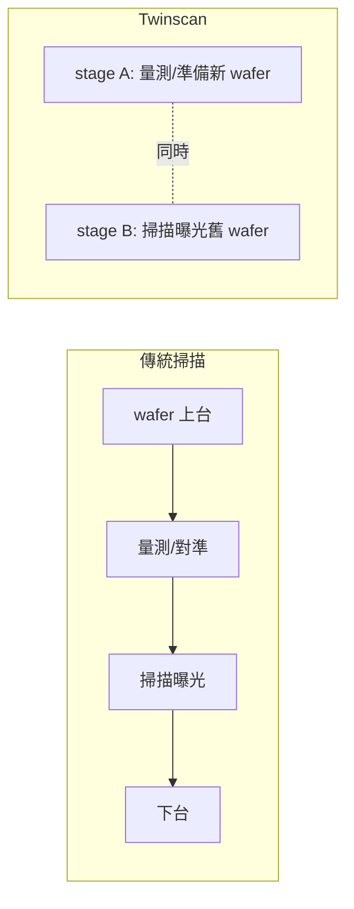

# 5.2 PAS 5500 平台與雙晶圓台（Twinscan）架構：讓曝光與量測平行執行的魔鬼產能設計

## PAS 5500：模組化的思想勝利

1980 年代末的 ASML 冒著「可能死掉」的風險，拋棄 PAS 2000，重做全新平台——PAS 5500（1990 年前後完成量產）。

PAS 5500 的三個核心設計：

1. 模塊化：鏡頭、照明、wafer stage、對焦系統各自獨立，可以分開更換、維修不必拆機全身；
2. 平台化：同一基座與同一調校構造，可以擴展為不同鏡頭與不同製程版本；
3. 生產率導向：ASML 特別重視每小時能印幾片 wafer——1980 年代末，其產能已逼近 Nikon。

平台化的意義：ASML 之後的每一個新型號都是在 PAS 5500 家族下的延伸——設計投資不被浪費，客戶的學習曲線平坦，這是 ASML 能夠有效反打 Nikon 的原因之一。

## 雙晶圓台（Twinscan）：產能的殺手鐧

1990 年代末至 2000 年代初，ASML 推出改寫微影產能經濟學的架構：Twinscan（雙晶圓台掃描系統）。

### 傳統掃描的「等待問題」

傳統掃描式微影機的工作依序發生：

1. wafer 上台；
2. 量測／對準；
3. 掃描曝光；
4. 下台，下一片準備。

在 fab 中，「準備時間」每片 wafer 都會耗費數秒至十幾秒——在高產能要求下，機台有相當比例的時間在閒置。

### ASML 的解藥：兩個 stage 輪番上工

Twinscan 的核心思想：

- 一個量測／預備台對新 wafer 進行對準、leveling、溫度穩定；
- 一個曝光台正在掃描曝光；
- 兩台同時工作——曝光與準備並行。

結果：同等級技術下，機台生產率接近翻倍。對客戶來說，「每小時多印一片 wafer」等於 fab 產能的直接提升。

## 為什麼 Nikon／Canon 沒有做？

1. 設計基因不同：Nikon 以光學與成像品質為傲，「機台生產率」被視為機械問題；而 ASML 從第一天就把 throughput 放在設計決策中心；
2. Twinscan 需要整機重新設計——舊機型無法後補；Nikon 選擇用更多機台追產能，但結構性差距難以彌補；
3. 台、韓、美客戶的單位成本壓力在 1990 年代後越來越大——Twinscan 正好命中痛點。

### Twinscan 的長線意義

Twinscan 的架構延續至今：今天的 EUV 掃描機仍然是「雙 stage＋掃描」系統；High-NA EUV 亦然。Twinscan 的設計思想沒有過時，它是 ASML 取得世代領先的軟性護城河。

## 小結

ASML 的兩大武器——PAS 5500 的模組化平台（低成本、可重構）與 Twinscan 的雙 stage 並行（產能），共同塑造了 ASML 的工程 DNA，也把「機台的商業設計」由「性能」轉移為「每小時印滿 wafer 的成本」。下一節，蔡司鏡頭是真正的硬底——蔡司與 ASML 的鐵血同盟。
