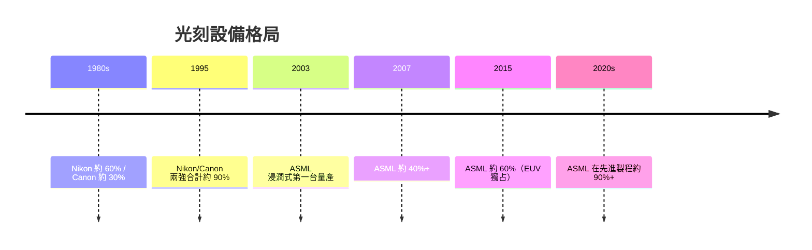

# 6.3 ASML 孤注一擲擁抱浸潤式技術：徹底擊敗日系尼康與佳能，奠定全球微影獨霸地位

## 2002 年的抉擇：三家人、三個方向

157nm 死局顯形後，全球微影三強的選擇：

| 公司 | 選擇 | 路線性質 |
|---|---|---|
| Nikon | 先精修 157nm、再考慮浸潤式 | 保守、日式務實 |
| Canon | 同樣著手 157nm，後來轉向 | 半保守 |
| ASML | 2002 年迅速全力投入浸潤式 | 高風險全押 |

## ASML 的「孤注一擲」

林本堅的論文與樣機數據一出，ASML 管理層就做出三個決定：

1. 停掉或擱置 157nm 機型研發，把資源全部遷移到浸潤式；
2. 直衝量產：2004 年初，第一台浸潤式機台 TWINSCAN AT:1150i 進入 fab 試用；
3. 整機重新設計：防水的 stage、灑水系統（water dispenser）、與材料廠 top coat 的配對——全球只有 ASML 在兩年內做出浸潤式量產機。

### 客戶的反應

- 台積電成為第一批量產客戶——林本堅的影響力直接指向 ASML；
- Samsung、Intel 等迅速跟進；
- 2006 年前後的 65nm 世代，浸潤式對 Nikon／Canon 的同世代產品全面勝出。

## Nikon／Canon 的困境

### Nikon 的三重失敗

1. 浸潤式晚了 ASML 約兩年；
2. 1990s–2000s 日本半導體客戶自身重組與衰退（NEC、日立、三菱 DRAM 分拆合併為爾必達等），Nikon 的客戶基盤萎縮；
3. 在產能結構上沒有同步轉型到雙 stage 路線，2007 年前後 throughput 已被 ASML 明顯拉開。

### Canon 的退賽

- Canon 的半導體光刻業務在 2000 年代持續萎縮；
- 到 2010 年代初，Canon 在最先進製程已完全退場，只保留 i-line 與近接式等成熟製程利基；
- Canon 之後轉向本業（相機、影像），其步進機技術部分以 FPA 系列留在封裝與利基市場。

### 客戶結構的反身性

日本大客戶群本身的重組（NEC、東芝、日立等的半導體重組浪潮），加上台、韓、美三大新客戶群（台積電、三星、Intel）的崛起，使全球微影客戶結構從「日本內循環」轉為「全球市場」——ASML 沒有歷史包袱，Nikon 的日本客戶紐帶反成桎梏。

## 市占率的翻盤

## 結構性勝利：浸潤式＝ASML 的時代

ASML 的勝利不只是技術，而是三重結構的交響：

1. 時機——新公司、動作快；
2. 技術深度——與蔡司聯合開發出浸潤式所需的高 NA 鏡頭；
3. 資本——1995 年上市後的資金結構，使它承受了 Nikon 不能承受的研發賭注。

文化與經濟的深層原因：將來自日系大企業的組織慣性，與來自 ASML 缺乏在地客戶包袱的機動性，一正一反地廣結了微影產業的世紀。

## 小結

浸潤式微影是半導體設備史上最有戲劇性的一戰——台灣工程師的一滴水、荷蘭小公司的孤注一擲，合起來使 Nikon／Canon 兩大日本帝國退出王座。但「浸潤」只是上半場；EUV 與摩爾定律的極限之戰，是第四篇的主題。
