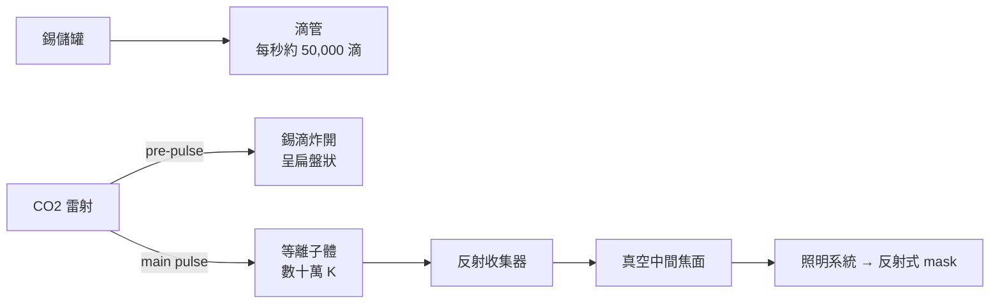

# 7.2 融化錫滴的雷射砲：每秒炸裂 50,000 次融化錫滴以產生極紫外光的雷射等離子體（LPP）光源

## EUV 需要「人造太陽」

13.5nm 波長對應的光子能量約 92 eV——比 DUV 的 4–6 eV 高出逾 20 倍——沒有「溫和」的方法可以產生它。

唯一可行的工程方案是：把物質打到「等離子體（plasma）」態，等離子體會輻射出極紫外光譜。主要路線有三條：

1. LPP（Laser-Produced Plasma）：以高功率雷射轟擊錫滴；
2. DPP（Discharge-Produced Plasma）：電弧放電；
3. 自由電子雷射等其他路線（被放棄）。

LPP 是最後的贏家——Cymer（後併入 ASML）在 2000–2015 年間將其工程化。

## LPP：如何「炸」出 EUV 光

### 第一步：備好一滴錫

- 錫在約 232°C 熔化；滴管以微米級精度，以每秒約 50,000 次的週期，滴出直徑約 25–30 微米的液態錫滴；
- 錫滴以每秒 70–80 米的速度飛過真空腔。

### 第二步：兩道「雷射砲」

- 第一道（pre-pulse）：較低功率的雷射在錫滴迎面而來時，把它炸開成一個扁盤狀雲團——使第二步的能量吸收更有效；
- 第二道（main pulse）：高功率 CO2 雷射（10.6μm 波長、約 20kW 級）打進錫雲——錫被瞬間加熱到數十萬開爾文（約太陽日冕的溫度等級），形成等離子體，輻射出 13.5nm 的極紫外光。

### 第三步：收集與傳遞

- EUV 光由多面金屬反射構成的集光器收集——集光器還要承受等離子體粒子的轟擊；
- EUV 光經中間焦面，再由照明系統送往反射式光罩。

## 為什麼選錫？

- 錫原子在不同電離態下的能級躍遷群在 13.5nm 鄰近非常密集，輻射效率極高；
- 錫便宜、供應充足；
- 缺點是污染：未用掉的錫會沉積在反射鏡與腔體表面——必須靠氫氣流沖刷與溫度管理。這套「錫管理」是 ASML EUV 機台最隱祕、也最耗資數億美元的研發重點。

## 光源功率的十年長征

| 年代 | 可用 EUV 功率 | 意義 |
|---|---|---|
| 2007 | 約 1W | 僅能演示 |
| 2012 | 約 10W | 工程測試 |
| 2016 | 約 100W | 走向工程可行 |
| 2019 | 約 250W | 量產可行（台積電 7nm 開啟 EUV 元年） |
| 2020s | 500W+（NXE 系列→High-NA EXE 系列） | 產能翻倍時代 |

光源功率直接決定每小時能印多少片 wafer——「功率遊戲」是 EUV 的生命線，也是 ASML 全球研發資金最大的投資點。

## 全球獨家的難點

1. CO2 雷射本身是特殊改造的高功率雷射——其功率放大鏈是德國 TRUMPF 的專長（ASML 與 TRUMPF 為長期合作夥伴）；
2. 錫管理系統與腔體的自動清潔是核心祕密；
3. 供應商（雷射、錫源、反射鏡、精密 stage）與 ASML 系統整合的緊密結合，構成 EUV 生態（見下節）。

## 小結

EUV 光源是半導體設備史上最典型的「系統級工程奇蹟」——把雷射、真空、金屬錫、光學、機台全部縛成一組。下一節看這台機器背後的制度：客戶注資與供應商綁定的生態結構。
