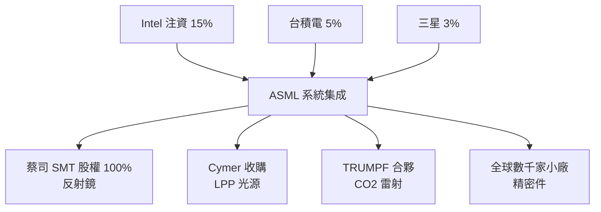

# 7.3 數千家供應商、數十萬個零件與台積電、英特爾、三星三大巨頭共同注資綁定的極致生態

## 一台 EUV 的「料號等於一架客機」

一台 EUV 機台的規模：

- **超過 10 萬個零件**；
- **全球數千家供應商**（德國 TRUMPF、蔡司，日本豐田通商、安川等，遍佈歐美日）；
- **重量約 180 噸**、需 **40 個貨櫃／4 架波音 747** 運輸，安裝調試約數月；
- **全天 24/7 連續工作**，Camera 般**不可停機**——它是真正的「工業心臟」。

沒有任何一家廠商可以「全部自己做」。**ASML 的核心能力是「系統集成（system integration）」**——並以**財務與股權的方式把夥伴綁進自己的生態**。

## 生態的三種綁定方式

### 1. 直接收購

- **2013 年 ASML 收購 Cymer**（光源，約 26 億美元）；
- **2016–2018 年 ASML 收購蔡司 SMT**（反射鏡）；
- **2000 年代 ASML 已收購 SVG 的 track 業務**（塗佈顯影），後於 **2007 年將 track 業務出售給 TEL**。

### 2. 長期合夥與專屬供應

- **德國 TRUMPF 的 CO2 雷射**是 EUV 光源的必需品，雙方長期共同研發；
- **日本精密部件**（精密導軌、馬達、真空零件）至今仍是 ASML 供應鏈重要部分；
- **蔡司在 2016 年前是供應商，之後成為股權綁定的子公司**。

### 3. 客戶直接注資（歷史最精采的一步）

**2012 年「客戶協同投資計畫（Customer Co-Investment Program）」**——**台積電、Intel、三星共同投資 ASML**：

| 客戶 | 投資類型 | 金額 |
|---|---|---|
| **Intel** | 15% 股權 + 可轉債 | 約 41.4 億歐元 |
| **台積電** | 5% 股權 | 約 13.8 億歐元 |
| **三星** | 3% 股權 | 約 8.3 億歐元 |
| 合計 | | **約 64.5 億歐元** |

**ASML 相應承諾**：EUV 技術與量產產能**優先給這三家**，研發成本**三方分擔**。

**這是史無前例的垂直反向整合**：**客戶用股權把設備商的研發風險扛在肩上**，代價是設備的**先進製程優先權**。自 2012 年之後，**三大客戶**事實上成為**高階製程**的**唯一壟斷集團**。

## 為什麼這個注資是歷史性的

1. **資本規模**：ASML 在 2012 年**營收僅約 60 億歐元**、**市值約 100 億歐元級別**——**64.5 億歐元**是一次**足以救命**的基金；ASML 的 10 年營收在此之後成長約 6–8 倍；
2. **技術整合**：**「台積電 + ASML + 蔡司」** 締造了**先進製程**的**核心縱向同盟**；
3. **供應鏈的不可替代性**：**任何人要無中生有再造一個 ASML**，必須**重建數十年的光學、真空、系統能力**——**基於整個歐洲光學工業的百年紅利**。

## 小結

EUV 生態是**工程與金融的雙重奇蹟**——**數千家供應商、數十萬零件、三大客戶注資、兩次憑股權收購**——**最複雜的設備，本質上是一種制度設計**。下一章看「四大支柱設備」——**除了光刻之外，晶圓廠還需要誰**。
