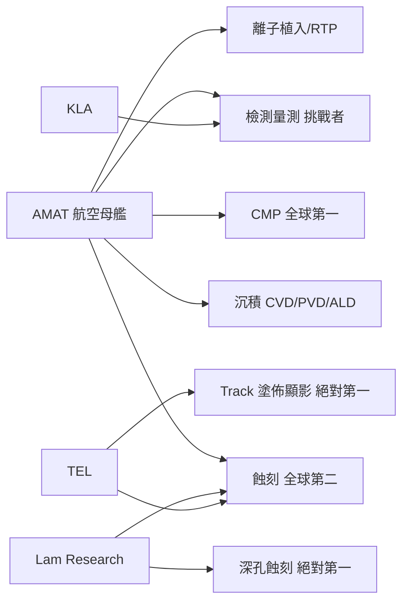

# 8.1 應用材料（AMAT）：覆蓋薄膜、拋光（CMP）與材料工程的半導體設備航空母艦

## 從 1967 年到全球第一

Applied Materials（AMAT）1967 年由 Michael McNeilly 創建於加州 Santa Clara，最初以化學氣相沉積（CVD）設備起家，隨後快速擴張到晶圓製造的幾乎每個品類；1972 年營收約兩千萬美元；1990 年代至今多數時間是全球最大半導體設備商（2020 年代中期年營收約 260 億美元級）。

## 「航空母艦」的多品類策略

AMAT 的戰略思想是「品類佈局」——不只做一個品類之王，而是在晶圓製造的每個戰位上佔一席：

| 品類 | AMAT 角色 | 市場地位 |
|---|---|---|
| 沉積（CVD/PVD/ALD/EPI） | 領先 | 全球前二 |
| 研磨（CMP） | 絕對第一 | 全球第一 |
| 蝕刻 | 第二 | 緊跟 Lam |
| 熱處理（RTP／爐） | 領先 | 全球前二 |
| 離子植入 | 前二 | 與 Axcelis 並列 |
| 檢測量測 | 挑戰者 | KLA 為王 |
| 封裝設備 | 崛起者 | 近年大幅擴張 |

AMAT 總體市占率約 20%、覆蓋逾 20 個品類——晶圓廠裡每一道工序，AMAT 的設備出現次數最多——它是設備產業最大共同交集。

## CMP 的絕活：把「平面」還給晶片

CMP（化學機械研磨／拋光）是 1990 年代 IBM 開創並推廣的工藝，AMAT 的 Reflexion 系列使其成為行業標準：

- 原理：晶圓被壓在旋轉的拋光墊上，化學腐蝕液＋磨料粒子把表面凸出部分磨掉——平面度控制在奈米級；
- 意義：多層互連（鋁／銅布線）時，每一層都要「磨平」才能疊下一層——CMP 是先進互連的先決條件；
- 實務價值：CMP 的精度控制直接決定製程能否量化——AMAT 的 CMP 長期是全球智慧財產與口碑的核心。

## AMAT 的「材料工程」思想

AMAT 的內部文化是「材料工程優先」：

- 研發：CVD、ALD、CMP、外延（Epi）各品類同時開展——數十年的材料資料庫不可替代；
- 投資佈局：2013 年收購太陽能電池設備商 Baccini，2019 年試圖收購日本 Kokusai（被日本政府否決，顯示其擴張野心）；
- 服務：全球多座服務中心，並建立二手設備經銷體系。

### AMAT 與全球設備格局

## 小結

AMAT 不是單一品類之王，而是「全佈局之王」——覆蓋晶片製造的多個高階品類；其本質是「製程＋機器＋材料情報」三者合一的公司，加上與客戶「資本—服務」的長期綁定。它成為全球最大設備公司，是數十年戰略佈局的結果。

下一節看 Lam Research 深孔蝕刻的奇蹟。
