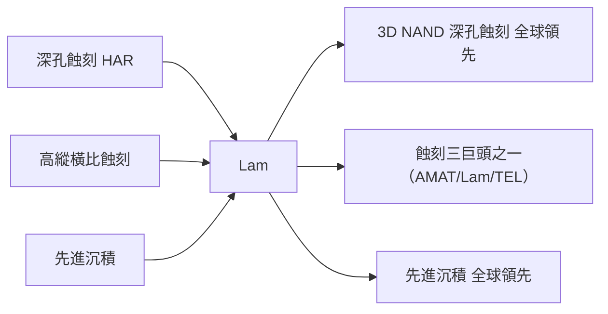

# 8.2 科林研發（Lam Research）與高縱橫比（HAR）深孔蝕刻：3D NAND 時代的絕對霸主

## Lam 的誕生：電漿蝕刻自動化的先驅

Lam Research 由 David K. Lam 於 1980 年在加州 Fremont 創立，以「電漿蝕刻自動化」起家。Lam 的早期優勢在於對蝕刻深度與各向異性的工程掌控——電漿深孔蝕刻（High Aspect Ratio Etching, HAR）自此成為其一生主業。

## HAR 蝕刻：3D NAND 時代的核心

### 記憶體的「立體化」

- 平面時代（1980s–2000s）：記憶體單元幾乎全部「躺」在 wafer 表面；
- 當尺寸縮小逼近物理極限，記憶體轉向三維堆疊：
  - 3D NAND 是代表：垂直疊 64 → 96 → 176 → 232 層記憶體單元；
  - 結構的核心是極深的孔——例如 176 層的通道孔（channel hole）深度約 10–15 微米、直徑僅 100–200 nm——縱橫比 60–100:1。

### 縱橫比的工程挑戰

做 100:1 的深孔必須同時解決：

1. 各向異性：蝕刻只能沿垂直方向，側向幾乎不能擴張；
2. 孔壁保護：上半段蝕刻久了，孔壁會被污染與侵蝕——需要「蝕刻＋鈍化」交替進行；
3. 循環式（cyclic）蝕刻：蝕刻＋沉積鈍化層＋再蝕刻的循環，分批挖深，否則一次蝕不到底；
4. 深孔內部檢測：能在 wafer 剖面或內部直接檢查孔底形貌——檢測設備的空間解析度必須達亞 100nm 級；
5. 後續薄膜：孔壁的 ALD 沉積（如高介電層）要完整覆蓋孔底——Lam 的沉積設備與蝕刻設備形成配套。

### 蝕刻機的「多腔（multi-chamber）」架構

Lam 數十年累積了多腔型蝕刻機的結構知識：

- 每台機器有多個並行蝕刻腔（parallel processing），總產能遠超同期競品；
- 單腔的溫度、壓力、RF 功率、氣體流量可以獨立控制；
- 1990s 到 2020s 的每一代產品（Kiyo、Flex、Striker 等）都延續這一結構。

## Lam 的全球地位

- 2020s Lam Research 年營收約 160 億美元級；
- Lam 的 HAR 蝕刻在 3D NAND 製造中具有近乎壟斷的地位——全球多數 3D NAND 的深孔蝕刻工序由 Lam 完成。

## Lam 的四大技術基石

1. 機台結構上的多腔並行架構，使每台產能最大化；
2. 化學配方與製程資料庫——「製程＋設備」的知識綁定；
3. 蝕刻與後續薄膜設備的整合（蝕刻＋ALD＋檢測的完整鏈條）；
4. 與客戶緊密的共同開發（co-development），尤其與 3D NAND 製造商的長期合作。

## 小結

Lam Research 是 3D NAND 時代的核心巨頭——只要人類繼續堆疊晶片，深孔蝕刻就繼續存在，而 Lam 在此領域近乎不可取代。下一節看 KLA 的檢測量測。
