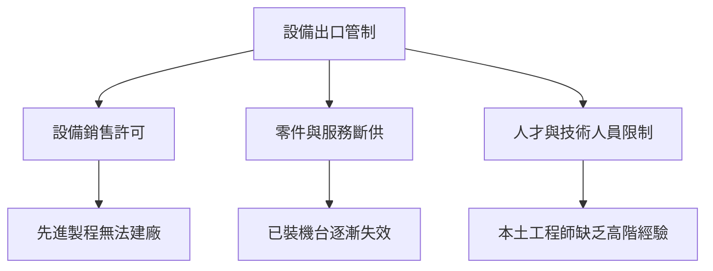

# 9.1 晶片法案與設備管制：從 DUV 到 EUV，設備授權與售後服務成為科技戰的終極籌碼

## 設備為什麼是武器？

先進晶片是戰略商品，而設備是瓶頸。控制設備的三種槓桿：

1. 售前：**沒有設備就無法建先進 fab**；
2. 售中：**許可制可以選擇性地允許或禁止出口**；
3. 售後：**零件、服務、軟體升級是機台長期運行的生命線**——「買了機器但無法維修」等於慢性失效。

## 2018–2022 年，管制輪廓的成形

- 2018–2019 年：中興、華為被列入美國實體清單（Entity List），使用美國技術的晶片供應受限；
- 2020 年：荷蘭在美國壓力下未批准 ASML 向中國出口 EUV 機台；
- 2022 年 2 月起：俄烏戰爭帶動對俄設備出口禁止；
- 2022 年 10 月：美國商務部發布「先進運算與半導體」出口管制新規，是迄今最系統性的設備管制。

## 2022 年起的三個「晶片法案」

### 1. 美國：CHIPS and Science Act（2022 年 8 月）

- 總約 2,280 億美元的法案框架，其中約 527 億美元直接補貼半導體製造；
- 意義：美國首次以國家補貼直接介入晶圓廠建設——台積電亞利桑那廠、Intel 俄亥俄廠、三星德州廠均直接受益；
- 設備層面：新建 fab 的設備採購幾乎全部流向 ASML、Lam、AMAT、TEL、KLA 五家——全球設備市場的重心隨補貼向北美移動。

### 2. 歐盟：European Chips Act（2022 年起）

- 目標規模約 430 億歐元；
- 目標：提升歐洲製造產能占全球比重（歐洲目前約低於 10%）；
- ASML 與蔡司是歐盟的「戰略資產」——歐洲重返半導體產業戰略的核心。

### 3. 日本：半導體補貼＋出口管制跟進（2022–2023）

- 日本政府設立半導體補貼（台積電熊本廠、Rapidus 2nm 專案等為受益案）；
- 2023 年：日本宣布對 23 類半導體製造設備實施出口許可制（與美國方向一致）；
- 荷蘭 2023 年起對部分 DUV 出口實施許可制——美日荷形成設備管制的「三國陣線」。

## 出口管制的大棋局

### 限制的走向

- EUV：完全禁止出口中國；
- DUV（先進型）：2023 年起納入荷蘭許可制；日本對先進設備全面許可；
- 美國設備大廠（Lam、AMAT、KLA）：無法向中國晶片廠自由銷售先進能力的設備；
- 服務與人才：設備廠的限制不僅銷售，還包含零件、服務和技術人員的支援。

### 生態戰的三張王牌

- 設備銷售許可＝新 fab 能否落地；
- 零件與服務斷供＝已購機台的長期可用性受威脅；
- 人才限制＝本土能否真正消化高階技術。

## 大憲章的邏輯

管制的效果取決於三個現實：

1. 中國晶片廠的 raising 依賴：成熟製程設備（20+ 層）仍可採購，先進製程被圍堵；
2. 供應商的多國屬性：ASML（荷）、蔡司（德）、TEL（日）、AMAT／Lam／KLA（美）——但政府聯合才讓管制真正生效；
3. 「服務」成為最隱蔽的武器：管制無法被「一次付錢」解決，只能靠長期維修與升級持續施壓。

## 小結

晶片法案與設備出口管制把設備從商品升格為地緣棋子。誰掌握 fab 機台與服務，誰就擁有先進半導體的真正統治權。下一節看中國如何尋求自己的突圍。
