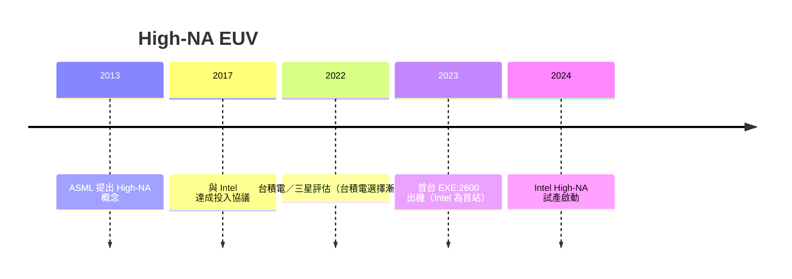

# 10.1 ASML 的 High-NA EUV（高數值孔徑）微影機：數億美元一台的下一代算力微雕神器

## EUV 之後的核心追求：NA 再往上

第一代 EUV（NXE 系列）的 NA 是 0.33。用 Rayleigh 公式推演：

$$CD_{min} \approx 0.27 \times \frac{13.5}{0.33} \approx 11\ nm$$

面對 AI 與 HPC 對更細電晶體的渴求，僅靠現行 EUV 不夠。解決方式：把 NA 從 0.33 提升到 **0.55**——這就是 **High-NA EUV（EXE 系列）**。

## High-NA 帶來的三個量級變化

1. 解析度提升：在相同 $k_1$ 下，最小線寬可縮至約 8 nm；
2. 鏡頭結構重構：反射鏡組重新設計，與蔡司 SMT 繼續深度合作；
3. 像場縮小：從 26mm×33mm 縮至 26mm×16.5mm——每個 shot 覆蓋面積只剩一半，同一晶片需要更多 shot——產能與成本成為新挑戰。

### High-NA 的三大難題

| 難題 | 內容 |
|---|---|
| 製程整合 | 需要新的光阻與檢測技術跟上更小的 CD |
| 產能（throughput） | 像場縮小、scan 次數翻倍，機台負擔更重 |
| 成本 | 單台約 3.5–4 億美元，比第一代 EUV 貴近一倍 |

## 誰在推 High-NA？

- Intel：2010 年代製程落後後大力重視 High-NA，第一個付定金與裝機權（2016–2018 年間鎖定頭兩台），爭取先進製程重回市場；2024 年前後開始裝機測試；
- 台積電：仍是 EUV 市場最大買家，但對 High-NA 採漸進評估（一方面考量成本，一方面本身有成熟路徑）；
- 三星：中間路線，先擴建第一代 EUV 產能，再評估 High-NA 導入。

### 歷史年表

## 價格與市場的社會意義

- 一台約 3.5 億美元——全球只有 Intel、台積電、三星買得起；High-NA 正式成為先進製程的准入證；
- 設備地緣：ASML、蔡司、TRUMPF 三家歐洲公司徹底壟斷；世界對 EUV／High-NA 的依賴成為地緣政治的核心變數（見第 9 章）；
- 服務的價值：高端設備的維護需要 High-NA 級工程師——服務收入成為 ASML 及其夥伴的第二生命線。

## 小結

High-NA EUV 是未來十年的微影主戰役——價格高昂但不可替代；誰先擁有 High-NA，誰就拿下下一世代先進製程的准入證。下一節看摩爾定律的另一戰場——先進封裝設備。
