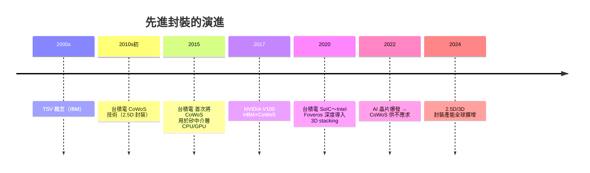

# 10.2 摩爾定律延續的第二戰場：CoWoS、3D IC、晶圓級封裝（WLP）設備與鍵合機（Bonder）的爆發

## 一個觀點轉變：封裝不再是「包裝」

傳統上「封裝（packaging）」被視為晶片生產的最後一道程序，多由封測廠（OSAT，如日月光 ASE、Amkor）承擔。但 2010 年代以後出現一個轉變：

- **同質／異質整合（2D + 3D packaging）**成為核心：**GPU、HBM、晶上電路、傳感器**，以**整晶圓封裝**（**WLP**）、**堆疊**、**中間層（interposer）**等技術，將**多個晶片**「組裝」成一個高效能包（**module**）；
- **歷史的起點**：**2000s 年代 IBM 與 NEC** 已提出**「through-silicon via（TSV）」**概念（晶片內部貫穿的金屬導柱）——**2010 年代台積電 將其成熟**為 **CoWoS（Chip-on-Wafer-on-Substrate）**；
- **2017 年起，AI 晶片（GPU）本身的大爆發**，**HBM 疊層**與**大尺寸 GPU die 的需要**，令先進封裝變成**真正的戰場**。

## CoWoS 是什麼？

- **矽中介層（interposer）**：**一個中間矽晶片**，其上有微金屬導線，將**多個 die（如 GPU＋多顆 HBM）**橫向「黏」成一個包；
- **未取代傳統 die 製造**，而是**一層「微縮工程」的**第二層**：CoWoS 的早期版本產能極難擴大——**這也**使**先進封裝**成為**新的**viz/info**瓶頸**。

## 3D IC：把晶片「疊」起來

3D IC 的本質是**多重晶圓直接鍵合**：

- **混合鍵合（hybrid bonding／direct bonding）**：兩顆晶圓的金屬層**直接鍵合**（**無** **凸塊、無** TSV**），**鍵合點的** pitch**能達****10μm**以下（**遠**高於**微凸塊 bonding 的** ~40 μm**）；
- **主要技術／公司**：**SoIC（台積電）、Intel Foveros、三星 X-Cube**；**設備**主要來自 **Applied Materials、EVG（奧地利）、SUSS、SMT（** ******）**。

### 關鍵設備品類

| 品類 | 用途 | 代表 |
|---|---|---|
| **鍵合機（bonder）** | 晶圓對晶圓／die 對晶圓的鍵合 | **EVG（奧地利）、SUSS**、**AMAT** |
| **晶圓級雷鍍（laser anneal）** | TSV 的形成 | Lam、AMAT |
| **薄膜沉積**（ALD／CVD） | 中介層與 TSV 裡的絕緣堆疊 | AMAT、TEL |
| **電漿蝕刻**（TSV 導孔蝕刻） | 深度高、側蝕極小 | Lam、AMAT |
| **光刻（投影）** | RDL（重新布線層）的平版圖形 | **（在** 2020 年代後，** Canon/ASML **都**任教**） |
| **研磨拋光（CMP）** | TSV 表面與薄膜碾平 | AMAT（Reflexion）、Ebara |

## 生態與市場的新格局

- **設備原廠的擴張**：**AMAT、Lam、KLA、TEL** 的****先進封裝設備**部門**收入在** 2020 年代**顯**著**成長**；
- **封裝、材料**的**新分工**：**基板（substrate）** 和 **中介層** 需要**「**載板（**carrier**）」**技術**，**進入** **** **** TSMC、ASE、Amkor **的**供應**關係**；
- **封裝產品的**市場地位**:**** **** 2020s 大約 **150~200 **億**美元**／**** 封裝**設備**市場**，**年成長**高**於** **** 傳統** 封裝。

## 核心的經濟觀點：封裝遲早取代部分「摩爾定律」的努力

- **當 EUV 極限逼近**，**3D 封裝**提供了**補償**路徑：**多顆**晶片異質整合，**產能**能提升而**成本**未必上漲；
- **「Chiplet（小晶片）」**概念**由此誕生**：**把 CPU 拆成多個功能 chiplet**，**各自**用**最優製程**，**封裝時**組合——**AMD**（**Zen** 2 / 3 **等）為開創者**，**Intel、** **NVIDIA**接**續**；
- **因此**：**封裝設備**是**半導體設備**產業**的** **第二增長曲線**。

## 小結

先進封裝（CoWoS、3D IC、Chiplet）是摩爾定律的延續戰：在晶體管外的**第三維**繼續堆疊。封裝設備是多品類集合（鍵合、CMP、光刻、蝕刻、沉積），正成為設備產業的第二戰場。下一節看晶圓廠的終極前沿——AI 自我優化與原子級製造。
