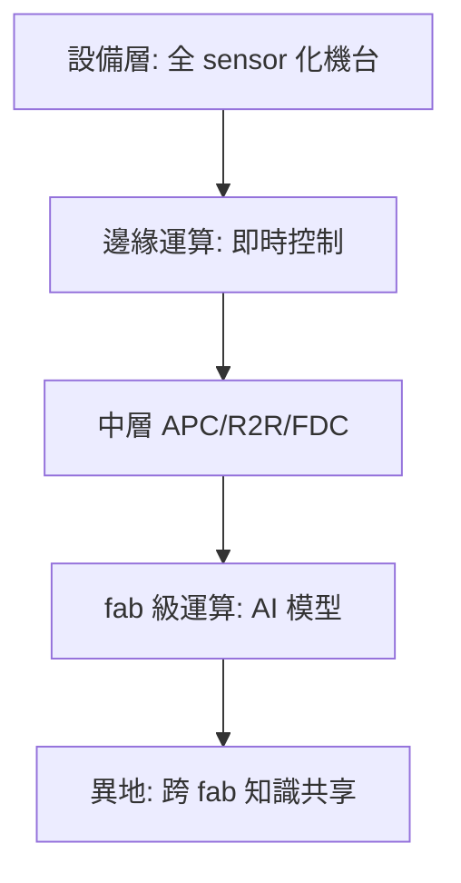

# 10.3 終極前沿：當原子級精密製造遇上 AI，設備自我診斷、AI 優化製程參數（APC）的未來晶圓廠

## 晶圓廠的三個演進方向

1. 更細的原子級製造（EUV、ALD、混合鍵合）；
2. 更複雜的系統整合（3D IC、Chiplet）；
3. 更智能的製造控制（AI 與 APC）。

本章聚焦第三層——未來晶圓廠的「大腦」。

## 製程控制（APC）：先進製程的神經系統

APC（Advanced Process Control）是晶圓廠自動化的核心：

- 每台設備上裝配精密 sensor，機台自動採集製程結果（膜厚、CD、溫度、壓力）；
- 控制系統判斷偏差，自動調整下一片 wafer 的參數（run-to-run control, R2R）；
- 故障檢測與分類（FDC）即時捕捉異常，預防漂移與停機。

歷史：

- 1990 年代末–2000 年代初，IBM、Intel 開始大規模部署 APC；
- 2000 年代 SEMATECH 制定標準（E40、E157 等），形成統一資料介面；
- 現代先進 fab 中，APC 已覆蓋逾 90% 的製程設備。

## AI 的角色：從 APC 到 AIOps

### 傳統 APC 的三個極限

1. 規則依賴：須由工程師預先定義控制規則與調整公式；
2. 資料量：先進 fab 一天產生 TB 級資料，無法由人處理；
3. 多變數耦合：製程參數相互耦合，規則型控制無法捕捉。

### AI 的進階應用

1. 自動缺陷分類（ADC）：以影像辨識自動分類缺陷（KLA、AMAT、TEL 均有布局）；
2. 製程參數優化：以機器學習模型學習參數與結果的關聯，主動選擇最優設定；
3. 虛擬量測（virtual metrology）：以 sensor 資料預測未量測晶圓的關鍵指標，減少破壞性抽樣；
4. 預測性維護（PdM）：預測零件故障，事先安排維修。

### 業界的fab 智慧化

- 台積電的智慧製造（iManufacturing）、Intel 的 fab AI、三星的 AI 製程均已廣泛部署；
- 設備商（AMAT、Lam、KLA）也在設備上內建 AI 模組，向客戶推廣流程優化。

## 原子級精密製造與 AI 的交會

- 進入 2nm 以下節點，單層原子的平整度誤差就是良率的直接決定因素；AI 成為唯一能同時處理多變數組合工具；
- GAA（gate-all-around）與 CFET（互嵌晶體）等新結構的調校，仰賴高維度資料處理——這是人工規則無法勝任的領域。

## 未來 fab 的輪廓

- 設備層：所有機台內建精密 sensor；
- 邊緣運算：即時控制與故障檢測；
- 中層：APC、R2R、FDC、virtual metrology；
- fab 級：AI 模型綜合各設備資料進行全局優化；
- 跨 fab 層：公司內多廠的知識聯合。

## 挑戰與未來

- 資料孤島：設備商、fab、材料廠之間的資料難以共享；
- 模型可解釋性：工程師需要知道 AI 為何這樣調整；
- 人材平衡：AI 無法替代 fab 多年經驗——協同仍是未來十年的主旋律。

## 小結

未來 fab 是微觀物理與 AI 的綜合運作——設備自我監控、AI 調參、虛擬量測，共同構成以「資料為生產力」的新型製造。設備產業的未來，不只是「更細的微影」，而是「更智慧的製造」。

最後，本書的終章：在極限物理、制度與經濟的複合領域，半導體設備是文明的天花板。
