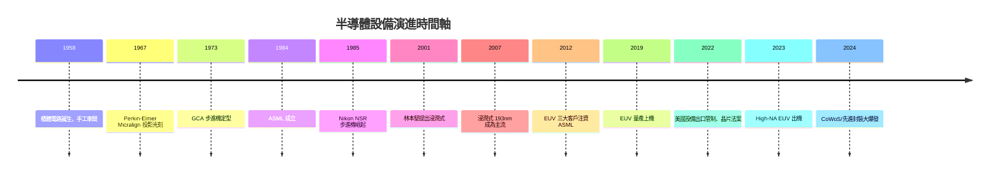

# 《半導體設備的故事：從微米光罩、極限蝕刻、ASML 光刻神話到地緣政治下的晶片之戰》

> 一本寫給半導體工程師、設備專家、晶圓廠主管、科技史愛好者與全球供應鏈觀察者的專題史。
> 如果說晶片是現代世界的石油，那麼半導體設備就是開採並精煉這份矽基能源的「神級工具」。

## 前言：打造微觀世界的神兵利器——半導體設備如何將矽石煉化為人類智慧的心臟

本書以**歷史演進、關鍵技術突破與全球供應鏈戰略**為主軸，記錄人類如何從早期的手工擴散爐、簡易顯影槽，走過微影機的「光學與波長之戰」、乾式蝕刻與薄膜沉積的極限控制，經歷美日歐設備巨頭的世紀割據，直到當代 ASML 獨霸極紫外光（EUV）、台積電先進封裝設備，以及地緣政治下半導體設備封鎖與自主突圍的新紀元。

---

## 目錄

### 第一篇：前設備時代與手工車間的破曉（1950 年代 – 1970 年代初）

* 第1章-早期晶圓廠的手工幾何與簡易熱力學
    * [1.1-貝爾實驗室與仙童的早期車間](01.1-貝爾實驗室與仙童的早期車間.md)
    * [1.2-人工接觸式微影：用顯微鏡手動對準](01.2-人工接觸式微影.md)
    * [1.3-晶圓刮傷與良率噩夢](01.3-晶圓刮傷與良率噩夢.md)

* 第2章-第一代專業設備商的萌芽與 GCA 步進機革命
    * [2.1-佩金埃爾默 Micralign：反射鏡解決刮傷危機](02.1-佩金埃爾默Micralign.md)
    * [2.2-GCA 步進機：分區曝光拉開微米製造序幕](02.2-GCA步進機.md)
    * [2.3-晶圓軌道（Track）與清洗設備的萌芽](02.3-Track與清洗設備.md)

### 第二篇：日美半導體大戰與設備供應鏈範式轉移（1970 年代末 – 1990 年代）

* 第3章-日本光學巨頭的逆襲：尼康與佳能的霸權崛起
    * [3.1-日本 MITI 的 VLSI 計畫與設備國產化](03.1-MITI的VLSI計畫.md)
    * [3.2-尼康 NSP 步進機的降維打擊](03.2-尼康NSP步進機.md)
    * [3.3-佳能的分庭抗禮](03.3-佳能的分庭抗禮.md)

* 第4章-薄膜沉積、乾式蝕刻與離子植入的四大金剛
    * [4.1-應用材料與乾式電漿蝕刻](04.1-應用材料與乾式蝕刻.md)
    * [4.2-CVD/PVD 到 ALD：原子級平整度](04.2-CVD到ALD.md)
    * [4.3-瓦里安與離子植入機](04.3-瓦里安與離子植入.md)

### 第三篇：飛利浦孵化、浸潤式突破與 ASML 光刻帝國的崛起（1980 年代末 – 2010 年代初）

* 第5章-ASML 的生死狂賭：從板房小公司到全球光刻巨頭
    * [5.1-1984 年飛利浦與 ASM International 的合資](05.1-ASML的誕生.md)
    * [5.2-PAS 5500 與 Twinscan 雙晶圓台](05.2-PAS5500與Twinscan.md)
    * [5.3-蔡司光學與 ASML 的鐵血同盟](05.3-蔡司與ASML同盟.md)

* 第6章-林本堅與「浸潤式微影」：改寫全球半導體歷史的 193nm 奇蹟
    * [6.1-157nm 乾式光刻的物理死局](06.1-157nm的物理死局.md)
    * [6.2-林本堅的瘋狂想法：一滴純水](06.2-林本堅的一滴純水.md)
    * [6.3-ASML 孤注一擲擁抱浸潤式](06.3-ASML擁抱浸潤式.md)

### 第四篇：極紫外光（EUV）的神話與五大設備巨頭的割據（2010 年代 – 2020 年代）

* 第7章-13.5nm EUV 微影機：人類工業歷史上最複雜的機器
    * [7.1-真空環境與多層膜反射鏡](07.1-EUV真空與反射鏡.md)
    * [7.2-融化錫滴的雷射砲（LPP 光源）](07.2-雷射砲與錫滴.md)
    * [7.3-數萬零件、數千供應商的極致生態](07.3-EUV生態與注資.md)

* 第8章-晶圓製造四大支柱：應用材料、科林研發、東京威力科創與 KLA
    * [8.1-應用材料：設備航空母艦](08.1-應用材料.md)
    * [8.2-科林研發與高縱橫比深孔蝕刻](08.2-科林研發.md)
    * [8.3-東京威力科創與 KLA：Track 與檢測之眼](08.3-TEL與KLA.md)

### 第五篇：地緣政治風暴、先進封裝與半導體設備新紀元（2020 年代 – 至今）

* 第9章-地緣政治大賽局：美日歐設備出口管制與本土化突圍
    * [9.1-晶片法案與設備管制](09.1-晶片法案與設備管制.md)
    * [9.2-國產設備的艱難突圍](09.2-國產設備突圍.md)
    * [9.3-二手設備與成熟製程的再造榮光](09.3-二手設備與成熟製程.md)

* 第10章-High-NA EUV、CoWoS 先進封裝與未來設備邊界
    * [10.1-High-NA EUV：數億美元一台的微雕神器](10.1-HighNA-EUV.md)
    * [10.2-CoWoS、3D IC 與鍵合機的第二戰場](10.2-先進封裝設備.md)
    * [10.3-原子級製造與 AI 優化的未來晶圓廠](10.3-未來晶圓廠.md)

### [結語：極限物理的造物主](99-結語.md)

---

## 💡 本書四大核心底層觀念

1. **微影（Lithography）**：波長→解析度的物理方程，浸潤式與 EUV 的兩次奇襲
2. **蝕刻與沉積**：電漿雕刻與原子層沉積的三維結構之美
3. **檢測與量測**：沒有量測就沒有良率
4. **精密工程 + 全球分工**：設備是「把物理極限工程化」的集大成者

