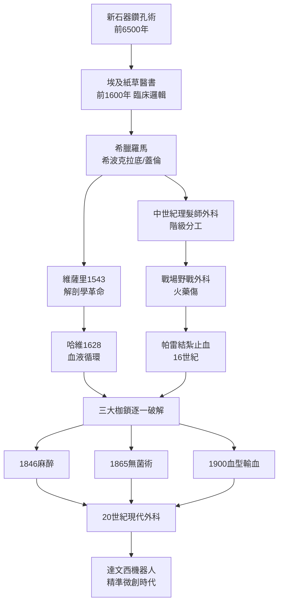

# 前言：劃開黑暗——外科如何從荒誕走向精準科學

人類文明史上有三道枷鎖，長期將「以外科手術救人」這件事押在深淵之中：**疼痛**、**感染**與**出血**。在麻醉、無菌術與止血技術尚未問世的年代，一場手術是三重災難的同時爆發——病人會在劇痛中掙扎休克，傷口隨後化膿潰爛，而鮮血則在醫師與病人眼前不斷湧出。十九世紀以前的外科醫師，與其說是救人的科學家，不如說是與死神搶時間的屠夫：倫敦名醫切爾登能（Robert Liston）以「三分鐘截一條腿」聞名，因為速度是唯一能降低死亡率的手段——但他也曾因手術刀過快，誤切助手的手指，病人與助手雙雙死於感染，成為史上唯一「死亡率百分之三百」的手術紀錄。

本書的敘事軸線，就是這三大枷鎖被逐一掙脫的過程。**疼痛**的枷鎖在 1846 年被乙醚麻醉撞開（麻省總醫院的「乙醚日」）；**感染**的枷鎖由塞麥爾維斯的洗手、李斯特的石炭酸消毒、再到科霍的細菌學理論層層瓦解；**出血**的枷鎖則經歷了最漫長的演進——從烙鐵沸油的酷刑式止血，到帕雷的血管結紮，再到二十世紀的血型輸血與凝血技術。三者並非各自獨立，而是互相咬合：沒有麻醉，外科醫師無法放慢速度做精細結紮；沒有無菌觀念，再成功的術式也會死於敗血症；沒有輸血，開胸開腹的大手術永遠是賭命。

但外科史從來不只是技術史。我們將看到**科技、經濟、制度、文化、政治與思想**如何互相驅動：印刷術讓維薩里的解剖圖譜推翻蓋倫的千年權威；行會制度與大學體系的階級鬥爭，決定了理髮師而非內科醫師成為手術的執行者；戰爭——從火繩槍到兩次世界大戰——是外科最殘酷也最高效的實驗室；宗教對人體解剖的禁忌，遲滯了解剖學千年，而文藝復興的人文主義又將它解放。每一次技術突破的背後，都站著制度變革與思想鬆綁。

而這條因果長河的起點，遠比我們想像的古老。約公元前 6500 年，法國 Ensisheim 的一位先民已經接受了成功的開顱手術，並存活多年；秘魯印加的醫者累積了成熟而高存活率的鑽孔技術。從新石器的燧石刀，到今日能縫合直徑一毫米血管的達文西機器人手臂，這條鏈條由無數偶然、錯誤、權力鬥爭與少數天才的執念串成。讓我們從第一刀說起。

## 因果鏈總覽

